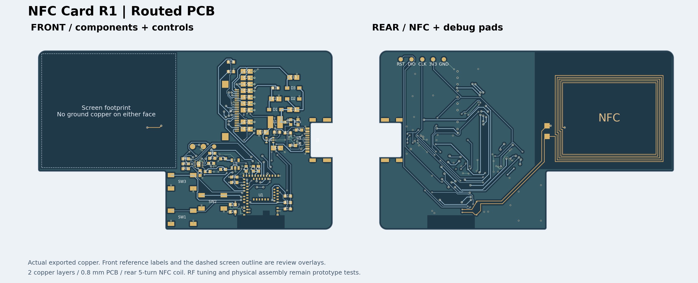

# Programmable NFC Business Card

## 当前确定方案

**2026-09-28 重新规划决定：**用户确认后续在 `master` 开发，并停止沿 R21 连续局部修补。下一轮从独立 PCB 候选重新布局布线，复用已核对的原理图、封装和设计约束；先落实 DFM 间距与装配条件，再交付带尺寸的整体布局、关键路径/回流规划和局部试布证据。具体范围和空间初步分析见[PCB 重新规划记录](docs/pcb-replan-2026-09-28.md)。尚未开始新板；下列 R21 及更早结果均为历史对照，不是新板的验收结果。

**2026-09-28 合并检查点：**PCB、DFM、桌面实验及外壳研究已汇总到 `master`，合并不代表制造放行。当前 PCB 入口为 R21；下述 4.8 mm 外壳及按钮研究使用旧 R1／USB4500 基准，尚未与 R21／USB4110 同步，不能混用为装配包。

**最新 USB 局部候选：**[R21 独立原生工程、制造文件与 USB 局部图](hardware/production/r1-layout-reset-r21/README.md)继承 R20，只重布 `USB_CC2`。过孔 4→2，铜线中心线长 12.454→8.196 mm；器件和焊盘未动。保存重开后的原生 DRC 0，独立连通、NFC、0.30 mm 钻孔／0.1016 mm 孔环、0.15 mm 异网离散铜间距及 BOM/CPL 对账通过。[R21 线上 PCB／SMT DFM](hardware/production/r1-layout-reset-r21/vendor-dfm-2026-09-26.md)已完成：VIA 孔到焊盘危险 0，旧 USB 槽和 J1 焊脚重叠危险 0；焊盘近距、阻焊、U1 装配及 USB4110 外壳适配仍未解决，**不可下单**。

**重新规划需保留的已知证据：**[R21 七区与 USB 复核](hardware/r1-r21-pre-routing-review.md)区分真实几何、网页模型与已解决项目。U1 的 P1MV2 物料对 `1MV2` 命名封装已用 Raytac 官方库核完 **61 个焊盘**，天线禁铜区无铜侵入；原厂本体与 Gerber 板边仅约 0.066 mm，网站 0.07 mm 危险有实际几何依据。[U1 板边方案比较](hardware/r1-r21-u1-edge-decision.md)显示旧布局单独内移或扩板 0.5 mm 均不是安全捷径；工艺边与 USB4110 外壳候选可供新布局比较，尚未获制造放行。

**外壳几何进展：**[R21 USB4110 的 6.3 mm 独立 FreeCAD 候选](enclosure/r1-usb4110-6p3/README.md)从同版 Gerber 重建板框及两颗定位孔，替换旧中置 USB 参考体；原厂名义包络至上壳 0.32 mm，端口无交叠，三键约 0.50 mm 扫掠通过。仍需真实连接器/插头、公差、其它 R21 器件 CAD 同步和 U1 板边处理，**不能作为装配或下单包**。

**最新独立候选：**[R20 原生工程、制造文件与检查记录](hardware/production/r1-layout-reset-r20/README.md)在 R19 上只局部移动三个同网过孔及相连短线。保存、关闭、重开后原生 DRC 0；本地审计中同网孔壁到焊盘 <0.10 mm 的三处降为 0，异网离散铜对象无 <0.15 mm 配对，最小钻孔约 0.30 mm、径向孔环 0.1016 mm。R20 Gerber 已上传嘉立创但分析结果页未打开，**线上危险未确认清除**。USB 扇出仍沿用旧绕线，孔环、阻焊、U1 装配及 USB4110 外壳适配仍未放行，**不可下单**。

**最新同步候选：**[R19 独立原生工程与检查记录](hardware/r1-usb4110-sync-r19.md)已把原理图 J1 换成完整官方 USB4110 库器件，14 个有网络引脚维持原连接。保存、关闭、重开后原生 DRC **0 条**；原理图／PCB 66 个位号、256 个引脚逐脚一致，PCB 几何与 R18B 逐项相同。R18B 的线上 DFM 仍揭示孔环、阻焊、局部间距和 U1 装配危险；外壳与 USB4110 也未适配，**R19 不可下单**。

**最新 USB4110 诊断：**[R18B 原生工程、制造文件与线上 PCB／SMT DFM](hardware/production/r1-layout-reset-r18b/README.md)将 J1 换为 GCT 官方顶部贴装器件，并改用直板边。旧四个镀铜槽危险 4→0，J1 焊脚／焊盘相交危险 12→0；0.30 mm 最小钻孔、0.1016 mm 最小径向孔环、独立连通与天线检查通过。原生 DRC 仍有 1 条原理图／PCB 同步提示，网页仍报孔环、阻焊、局部间距及 U1 装配危险，5.8 mm 外壳与新接口名义干涉约 0.18 mm。USB 区旧绕线尚未重布，**R18B 不可下单**；R14 仍是 DRC 0 对照基线。

**最新独立候选：**[R14 原生工程、制造文件与线上 DFM](hardware/production/r1-layout-reset-r14/README.md)继承 [R12](hardware/production/r1-layout-reset-r12/README.md)，只移动 R1、C1、C8 和 SWDIO 附近四个过孔及短线，器件、板框、天线和 USB 保护未移。保存重开后原生 DRC 0，独立连通、NFC／板框、0.30 mm 钻孔和 ≥0.10 mm 径向孔环检查通过；未发现 <0.15 mm 异网铜对象间距。同网孔壁到焊盘铜边 <0.10 mm 的不同过孔 8→4；嘉立创 VIA 孔到焊盘危险 20→12，焊盘间距危险未增加。孔环、阻焊、USB 槽及 J1/U1 装配危险仍待供应商人工确认，**不可下单**。

**USB 诊断：**[R15 焊盘位移试验](hardware/production/r1-layout-reset-r15/README.md)在当次 Gerber 中把 J1 焊盘移动约 0.30 mm，线上 SMT 接触比约 0.35→0.50，但位移**未保存到重开的原生工程**。[R16 缺口试验](hardware/production/r1-layout-reset-r16/README.md)把缺口加宽到约 9.20 mm，J1 焊盘仍是旧坐标、接触比仍约 0.35。[R17 独立工程](hardware/production/r1-layout-reset-r17/README.md)在封装主数据中移动 12 个焊盘，已保存重开并重跑本地检查与线上 PCB DFM；它新增 12 条 J1 焊盘贴近缺口的原生 DRC 与线上危险。R17 仍是诊断，R14 仍是可复现的 DRC 0 审核基线，**不可下单**。

**七区重排依据：**[原厂参考与实施门槛](hardware/r1-seven-zone-reference-plan.md)逐区列出屏幕、供电、USB、主控、按键、NFC／调试的固定关系和可移动范围。[R21 USB 扇出复核](hardware/r1-usb-routing-review-r21.md)按网络列出已简化的 CC2 与尚需联合评估的数据对、VBUS；[USB4500 与原厂顶部贴装 USB4110 的取舍](hardware/usb-connector-options.md)列出工艺和外壳高度代价。尚无可下单的新版。

**前版布局与 DFM 基线：**[R7 原生工程、制造文件与检查记录](hardware/production/r1-layout-reset-r7/README.md)从 R4 经 R5、R6 的局部修正继续迭代，保留显示供电分区、电池采样和 USB CC2 保护拓扑。保存重开的原生 DRC、独立连通、板框／天线、Gerber 钻孔与孔环、BOM/CPL 一致性检查通过；最小实际钻孔约 0.30 mm、最小径向孔环 0.1016 mm，未发现小于 0.15 mm 的异网铜对象间距。[嘉立创 R7 PCB/SMT DFM](hardware/production/r1-layout-reset-r7/vendor-dfm-2026-09-25.md)确认 U1 焊脚到孔危险从 2 降为 0，VIA 孔到焊盘危险从 32 降为 30；孔环、阻焊、USB 槽、J1 焊脚模型和 U1 板边危险仍需处理及供应商人工确认，**不可下单**。R5/R6 保留为对照；R2 是较早的低成本基线。

**最新低成本制板候选：**[R2 独立工程与制造检查文件](hardware/production/r1-free-0p30-sense-ring-r2/README.md)继承了 TS/MR 10 kΩ 到地及可关断的电池 ADC 采样，在显示供电、USB 扇出及充电区局部重布。重开工程后原生 DRC 为 0，最小实际钻孔 0.30226 mm、最小径向孔环 0.1016 mm；独立走线/焊盘/过孔审计未发现小于 0.15 mm 的异网铜间距。[新版线上 PCB/SMT DFM](hardware/production/r1-free-0p30-sense-ring-r2/vendor-dfm-2026-09-24.md)仍列孔环、过孔到焊盘、USB 槽及 J1/U1 贴装危险，**尚不可投产**；原 R1 是未投产的制造基准。

**独立布局重排试验：**[R3 工程与诊断](hardware/production/r1-power-relayout-r3/README.md)把显示供电器件移到右上功能区，保留屏幕、NFC、USB 保护及电池采样。旧规则下保存重开后的 DRC、连通与 0.15 mm 异网间距检查通过；但自动布线生成了 **54 个约 0.25 mm 过孔**，简单放大至 0.30 mm 又出现 29 对窄间距。现已把当前工程的过孔内径最小/默认改为 0.30 mm，原生 DRC 据此报 54 条过孔尺寸错误；新建 PCB 的默认双面板规则也已保存。C10–L1–Q1 布局代理面积仍偏大。此版是下一轮按工艺约束重布的起点，**不是低成本制造候选，不可下单**；R2 仍是最新低成本候选。

**PN532 桌面实测（2026-09-25）：**[PN532 与 ESP32-S3-CAM 六线接线图](wiring-diagrams/pn532-esp32-spi.html)已归档。SET0=L、SET1=H 时，SPI 探测返回 `PROBE_OK chip=0x32 firmware=1.6`；[NDEF 测试固件](firmware/pn532_ndef_test/README.md)现支持串口临时切换 URI。手机已正确打开 `https://example.com`；小红书主页短链可经浏览器到达正确主页。微信个人二维码的 HTTPS 地址只到下载页，`weixin://addfriend/...` 可唤起微信选择但未进入加好友页。实验结束后当前运行状态切回小红书链接，ESP32 重启会恢复 `example.com`。下一步验证墨水屏显示微信原始二维码并让另一部手机用微信扫码；实体按键切换待测。详细记录见 [NFC 桌面实验](docs/nfc-bench-test.md)。

**按钮询价候选：**[局部加厚防脱挡边](enclosure/r1-key-retention-study/README.md)已建模并导出 STEP/STL，外缘高 0.8 mm、跨开关凹位的局部厚度仍 0.4 mm。三键按压及新增外缘的全角度旋转包络检查通过；用户接受少量打磨，接下来由用户向打印商确认成型与后处理。整机 4.8 mm／主体内腔 3.2 mm 不变。

**跨项目电路续审，2026-09-24：**对照 Seeed EN05、InkTime、AramCon 和 MagTag，已合并 [12 项后续清单](hardware/r1-circuit-reference-review.md#后续集中处理清单)。用户确定不加测温，TS 固定 10 kΩ 待落实；三颗屏幕电容保留 4.7 µF 作为样板起点。电池采样是新增建议，CE、时钟和唤醒主要由固件处理。先等降低小孔成本的候选版完成，用户再次通知后再基于该版集中修改；本轮只更新审查记录。

**厚度决定已确定：**用户接受主体内腔 **3.2 mm**、整机 **4.8 mm**，停止进一步压缩；USB 局部内腔约 3.39 mm。下一重点是按钮结构与加工，电池由用户适配。安装层、底盖固定及制造公差仍需完成验证。

**当前减薄 CAD：**用户确认按 USB 定厚、电池适配自行处理；[4.8 mm 候选](enclosure/r1-usb-fit-4.8/README.md)已完成主体 3.2 mm 内腔、USB 局部避空、PCB 下沉及薄挡边键帽的集成。名义几何与装入检查通过，正背面预览已检查；电池预留空间为 32.5×14×3.2 mm。薄安装层、薄壁、键帽和底盖固定仍待制造验证，未替换 5.8 mm 打包版。

**3.0 mm 内腔研究：**按用户反馈电池最厚处可卡入 3 mm，已完成 [4.6 mm 总厚诊断](enclosure/r1-cavity-3mm-study/README.md)。现有 USB、主控、FPC 座和按键运动存在干涉；局部深腔与平整外表两条路线已有尺寸预算，尚无可打印的 3 mm 内腔方案。电池 3.0 mm 仅用于本次研究，打包版不变。

**最新减薄候选：**[3.6 mm 内腔／5.2 mm 总厚度](enclosure/r1-usb-height-5.2/README.md)已生成。保持电池 3.4 mm 包络及 PCB 安装高度，调整键帽中央压柱后，静止无预压干涉、完整行程几何通过；USB-C 顶部名义余量约 0.11 mm，打印公差和实物回弹仍未验证。5.8 mm 打包版保持不变。

**减薄方向更新：**以 USB-C 安装高度为约束的 [5.4 mm 圆角候选](enclosure/r1-usb-height-5.4/README.md)已生成。键帽底面局部挖空后完整行程几何检查通过，仍保留 3.4 mm 电池包络；键帽局部薄壁、回弹公差与可拆底盖待解决，尚未替换 5.8 mm 打包版。

**CAD 最新接口同步：**[2.54 mm SWD 圆角候选](enclosure/r1-rounded-rear-soft-swd254/README.md)沿用 5.8 mm 厚度，仅更新底盖五孔：Ø1.60 mm、孔口 R0.05，表面最窄连桥 0.84 mm。用户接受通用夹具假设，实物试夹待完成。可拆底盖与按钮减薄仍在设计中。

**外壳工艺评审：**[SLA 打印与 SWD 烧录说明](enclosure/r1-rounded-rear-soft/manufacturing-review.md)已完成，保留五个调试孔。圆角候选仍需解决薄底盖、胶接定位、涂层配合和按键轴向公差；首选向嘉立创 3D 询价，备选 PCBWay。成品板固件尚未开发；首次 bootloader 由用户通过 SWD 写入，不安排工厂代烧。

**最新圆角候选：**[加大圆角的上壳与底盖](enclosure/r1-rounded-rear-soft/README.md)已生成，正面／背面／俯视四角为 R1.2／R0.7／R3.2 mm；外尺寸与 PCB 不变，装入几何检查通过。仍待底盖固定与实物工艺验证。

**外壳方向更新，2026-09-24：**用户选择正面＋侧壁一体、独立底盖、背面内移接缝和外露圆角。[独立 CAD 候选与剖面](enclosure/r1-rounded-rear-study/README.md)保持原外尺寸，PCB 对上壳的装入路径检查通过；底盖固定、胶接工艺和实际装配仍待验证，尚未替换现有 CAD 或制造文件。

**R1 is the current editable engineering prototype.** Three front keys and a front e-paper display; rear NFC coil; right-centred recessed USB-C; two-layer 0.8 mm PCB; transparent printed enclosure, 85.2 × 53.2 × 5.8 mm. The selected battery is nominally 31 × 12 × 3 mm.

**Reviewed prototype checkpoint, 2026-09-24:** the perimeter GND rim is removed, the rear coil has 45° corners and equal offsets to the three exposed edges, and USB CC2 now branches at its protection pad. DRC/connectivity checks pass. **The C1 finding was retracted after identifying C8 as the existing charger input capacitor.** [Review and discussion items](hardware/pcb-r1-review.md). RF tuning, battery measurements and physical assembly remain unverified. The earlier archive checkpoint is `ccf9f92`; the PCB and enclosure study checkpoint is `bee8846`. Subsequent drill/return-path changes are described in the [pre-order review](hardware/r1-preorder.md).

**Latest electrical review:** CE/SCL routing now uses two fewer vias and 4.88 mm less combined trace; saved/reopened DRC and independent copper checks pass. R3/R4 changed to 0 ohm / C21189. [USB update/logging and SWD recovery plan](hardware/r1-usb-swd-recovery.md) records the implemented 2.54 mm SWD row, its synchronized cover access and the user-selected SWD programmer recovery path. The selected generic 5P clip is accepted on nominal dimensions; actual contact is a prototype check. Current manufacturing files are refreshed; the user confirmed on 2026-09-24 that R1 needs no hidden RESET switch or side opening. Next: [production verification handoff](hardware/r1-preorder.md#next-task-handoff).

**低成本制板试验：**[R1 0.30 mm 钻孔候选](hardware/production/r1-free-0p30/README.md)已另存并完成本地检查，且已做[嘉立创线上 DFM](hardware/production/r1-free-0p30/vendor-dfm-2026-09-24.md)。它消除了 0.25 mm 钻孔，但最窄孔环约 0.076 mm；孔环、镀铜槽和 USB-C 贴片模型仍需供应商确认。电路评审还确定需补 TS/MR 10 kΩ 到地，当前候选制造包尚未合入；原 R1 仍是当前制造基准。

**Battery follow-up:** battery pads are routed at the user-selected **B position beneath the screen**, with the pack lead exit toward the upper right; both pads were subsequently shifted **1.5 mm right**, to (32.5,18.7)/(35.5,18.7) mm. Three redundant signal vias and one unused stub were removed; reopened DRC and independent copper checks pass. [Regional height/button handoff](enclosure/r1-height-handoff.md) records the accepted 3.4 mm battery and 0.25 mm ferrite assumptions. Thickness/button work is deferred; the active case remains **5.8 mm**. Its old wire/ferrite service bodies need revision for the new pads.

## R1 file index

| Entry | Purpose |
| --- | --- |
| [Native EDA project](../../eda/NFC-Card-R1.eprj2) | Primary editable source: one PCB and one four-page schematic |
| [Ring and clearance R2 candidate](hardware/production/r1-free-0p30-sense-ring-r2/README.md) | 最新独立工程、Gerber/BOM/CPL、本地验证与新版线上 DFM；不可投产 |
| [R3 layout reset trial](hardware/production/r1-power-relayout-r3/README.md) | 独立重排与诊断导出；小孔和供电回路待解决，不可下单 |
| [R4 routed layout candidate](hardware/production/r1-layout-reset-r4/README.md) | 独立工程、Gerber/BOM/CPL、本地验证及 PCB/SMT DFM 危险明细；待改孔改线与供应商审核，不可下单 |
| [R5/R6 intermediate candidates](hardware/production/r1-layout-reset-r6/README.md) | R5 消除 C9 和 CC2 部分危险，R6 修正 CC2 回退并保留保护拓扑；均为对照，不能下单 |
| [R7 latest layout candidate](hardware/production/r1-layout-reset-r7/README.md) | U1 孔位局部修正，同版制造文件、本地检查和线上 PCB/SMT DFM；仍有危险，不可下单 |
| [R9 via-clearance checkpoint](hardware/production/r1-layout-reset-r9/README.md) | 继承 R8 丝印清理，局部移开 3 个同网过孔；保留作对照 |
| [R10 latest layout candidate](hardware/production/r1-layout-reset-r10/README.md) | 顶层封装丝印清理，保留阴极标记；本地检查通过，线上 DFM 仍需处理，不可下单 |
| [R12 latest layout candidate](hardware/production/r1-layout-reset-r12/README.md) | R2、Q2 两孔及短线局部调整；本地和线上 PCB/SMT DFM 已重跑，仍需供应商审核，不可下单 |
| [R14 latest layout candidate](hardware/production/r1-layout-reset-r14/README.md) | 四个过孔及短线局部调整；本地和线上 PCB/SMT DFM 已重跑，供应商审核清单待答复，不可下单 |
| [R15 USB footprint diagnostic](hardware/production/r1-layout-reset-r15/README.md) | 实时焊盘位移未保存到原生工程；上传文件只作敏感性诊断 |
| [R16 USB notch diagnostic](hardware/production/r1-layout-reset-r16/README.md) | 加宽缺口后重开与线上 DFM；J1 装配危险仍在，不可下单 |
| [R17 USB land diagnostic](hardware/production/r1-layout-reset-r17/README.md) | 12 个焊盘在原生封装保存重开；板边 DRC 与线上危险新增，待原厂／工艺复核 |
| [R18B USB4110 diagnostic](hardware/production/r1-layout-reset-r18b/README.md) | 标准顶部贴装接口、直板边、同版制造文件与线上 PCB／SMT DFM；仍有原生同步、局部工艺和外壳问题，不可下单 |
| [R19 USB4110 schematic sync](hardware/r1-usb4110-sync-r19.md) | 替换完整官方原理图符号，保存重开后原生 DRC 0；PCB 几何与 R18B 一致，仍不可下单 |
| [R20 via clearance candidate](hardware/production/r1-layout-reset-r20/README.md) | 局部移动三孔，本地检查通过；Gerber 已上传但 R20 线上 PCB／SMT DFM 尚未读取，不可下单 |
| [R21 USB CC2 candidate](hardware/production/r1-layout-reset-r21/README.md) | 保留 ESD 布局并删去 CC2 冗余底层绕行，本地检查与线上 PCB／SMT DFM 已完成；焊盘近距、阻焊、U1 装配及外壳问题待解，不可下单 |
| [R21 USB fanout review](hardware/r1-usb-routing-review-r21.md) | 按网络比较 CC、D+/D−、VBUS 的过孔和线长，列明下一轮数据对与供电路径门槛 |
| [USB connector options](hardware/usb-connector-options.md) | 原厂顶部贴装 USB4110 可避开中置缺口／槽，但名义上需要约 6.3 mm 外壳候选 |
| [Previous battery-sensing cost candidate](hardware/production/r1-free-0p30-sense/README.md) | 前版线上 DFM 与薄孔环诊断基线 |
| [Manufacturing files](hardware/production/r1/README.md) | Gerber for bare PCB; BOM and CPL for assembly; PDF, STEP and portable EDA backup |
| [Design and verification](hardware/pcb-r1-delivery.md) | Design decisions, checks, limits and reproduction commands |
| [USB/SWD recovery](hardware/r1-usb-swd-recovery.md) | Electrical checks, UF2/CDC plan, clip dimensions and selected SWD recovery |
| [Design inputs](hardware/r1-design.json) | PCB, screen, flex, battery and enclosure dimensions |
| [Clear enclosure](enclosure/README.md) | Editable CAD, assembled STEP and printable tray/lid/three-key meshes |
| [Evidence](hardware/records/r1-validation.json) | Saved DRC, netlist, physical copper, winding and export checks |
| [Scripts](scripts/README.md) | Current export, verification and package commands |
| [Progress](docs/progress.md) | Remaining engineering and physical work |
| [Complete local ZIP](artifacts/NFC-Card-R1-prototype.zip) | Rebuildable handoff containing PCB, CAD and checks; do not upload it as a Gerber ZIP |
| [Historical archive](archive/README.md) | E-series designs, experiments, old indexes and migration map |

## PN532 桌面测试程序

当前 ESP32-S3-CAM 上运行 [pn532_ndef_test](firmware/pn532_ndef_test/README.md)，SET0=L、SET1=H；串口可临时切换 NDEF URI。接线按[六线交互图](wiring-diagrams/pn532-esp32-spi.html)；手机实测及限制见 [NFC 桌面实验](docs/nfc-bench-test.md#个人主页与微信入口实测2026-09-25)。

| 程序 | 作用 | 本次实测 |
| --- | --- | --- |
| [pn532_probe](firmware/pn532_probe/README.md) | 串口收到 `PROBE` 后读取 PN532 芯片和固件版本 | `PROBE_OK chip=0x32 firmware=1.6` |
| [pn532_ndef_test](firmware/pn532_ndef_test/README.md) | 模拟只读 NFC Type 4 标签，上电默认 `example.com`，串口可临时切换 URI | `NDEF_READY`、`NDEF_SESSION`；小红书短链可达，个人微信直达未成功 |

两个工程都独立构建，具体工具链、依赖、构建与烧录命令在各自 README。NDEF 工程直接使用锁定在 `upstreams/` 的 Seeed PN532 与 don/NDEF 子模块。当前结果只覆盖桌面模块与这一部手机；实体按键、墨水屏和最终 nRF52840 板仍未测试。

## Physical validation still required

- Measure the complete protected battery, sealed edges and wires against the assumed 32.5 × 14 × 3.4 mm envelope.
- Fit the fully inserted display flex, printed enclosure, keys and USB plug; check screen-to-aperture alignment and adhesive retention.
- Bring up the assembled PCB and tune NFC with the final screen and enclosure. C23/C24 = 220 pF is provisional.

[Bench experiments](docs/nfc-bench-test.md) and their firmware are separate from production-board qualification. No order has been placed.
