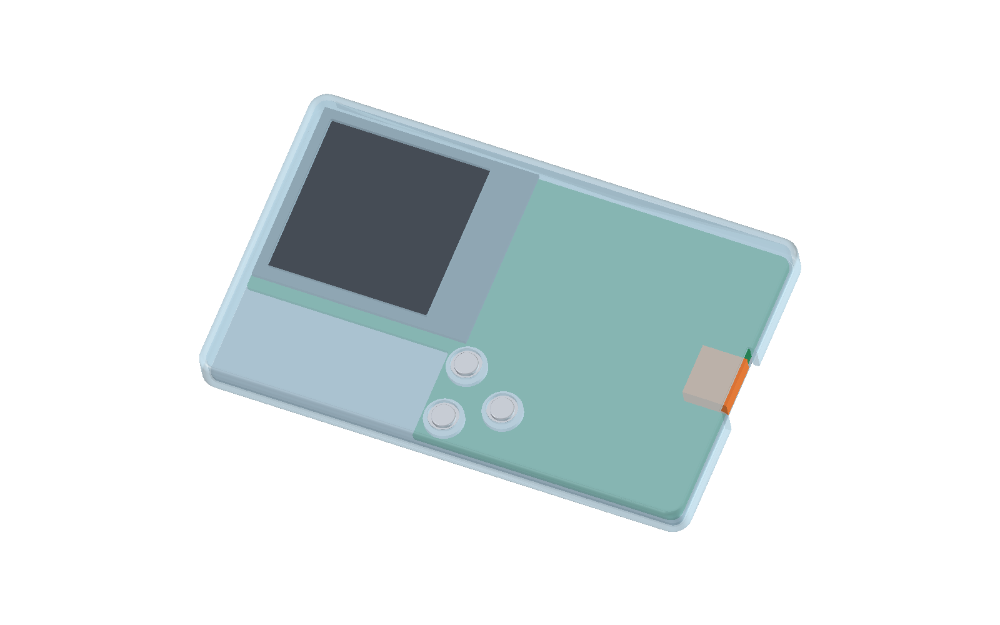

# R21 USB4110：6.3 mm 外壳名义几何候选

## 当前确定方案

从[现有 5.8 mm 圆角外壳](../r1-rounded-rear-soft-swd254/README.md)独立复制、加高上壳 0.5 mm，并以 [R21 同版 Gerber](../../hardware/production/r1-layout-reset-r21/README.md)的完整外轮廓及两颗 Ø0.65 mm 非镀定位孔替换旧 USB4500 板框参考体。接口使用 [GCT USB4110 原厂图纸](https://gct.co/files/drawings/usb4110.pdf)的**名义尺寸矩形包络**，不是原厂 STEP。旧 CAD、R21 EDA 和制造文件未修改。

这是可重开的 **6.3 mm 几何候选**，尚不是可打印、可装配或可下单的整机版本。它解决了 5.8 mm 外壳与 USB4110 顶部的名义干涉；[U1 距板边 0.066 mm](../../hardware/r1-r21-pre-routing-review.md)及 R21 剩余 PCB/SMT DFM 未改变。



## 同基准检查

R21 的 J1 前侧外壳焊盘中心 `x=80.655 mm`，按 GCT 图纸至接口前缘的 2.85 mm 得接口前缘 `x=83.505 mm`；与旧 CAD 接口前缘相差约 0.001 mm。USB4110 名义本体取长 7.70 mm、宽 8.94 mm、板顶以上高 3.26 mm；横向外壳焊脚跨度另取 11.30 mm、靠板低位 0.63 mm 包络检查。矩形包络可能在局部比真实件保守，未纳入尺寸公差、实际金属形状及插头。

| 项目 | 独立 CAD 检查结果 |
| --- | ---: |
| R21 Gerber 板框 | 闭合的 13 段边界、6 段圆弧；轮廓面积 3497.531 mm² |
| USB4110 本体至加高上壳的最短名义距离 | **0.320 mm** |
| 11.30 mm 宽外壳焊脚包络至上壳 | **0.449 mm** |
| 接口前缘及其侧边预留包络与上壳交叠 | **0 mm³** |
| R21 板框／其它旧 CAD 元件与上壳交叠 | **0 mm³**，其它元件位置仍沿旧 CAD |
| 三枚按键约 0.50 mm 完整位移 | 上壳、PCB、开关固定体及其它已建模元件交叠均为 0 |

屏幕及上壳同步抬高 0.5 mm；三枚键帽抬高并延长中央压柱，使静止端点仍对着原开关。底盖与 PCB 支撑位置保持原基准。[检查报告](report.json)记录输入哈希、几何值和保存重开结果；上壳 STL 封闭，导出的 STEP 重新读取为五个有效实体。

## 限制和下一步

- USB4110 的壳体仍是名义尺寸矩形体；需原厂 3D 或实物核对金属脚、定位柱、插头插入空间及公差，当前图不能证明真实插拔配合。R21 板体只建外轮廓和两颗定位孔，没有把 165 个镀铜过孔作为三维空腔；这不影响本次外壳碰撞结论。
- 除 J1 和 PCB 外，其它器件沿用 9 月 24 日旧 CAD 参考体。用本候选评审整体装配前，须同步 R21 各器件的真实位置与外形；旧版屏幕、导线、铁氧体、打印误差和底盖固定仍未实物验证。
- PCB 上的 U1 板边近距没有因外壳加高而改善。下一独立 PCB 候选应先比较拼板工艺边、U1 连同近邻电容的小范围内移、或局部扩板与外壳的完整取舍，再改布局。

## 文件和重建

- [完整 FreeCAD 候选](r21-usb4110-height-6p3.FCStd)、[五件壳体 STEP](case-parts.step)、[上壳 STL](upper.stl)。
- [等轴预览](assembly-iso.png)、[USB 侧面预览](usb-side.png)；透明颜色仅为几何检查。
- [生成脚本](../study-r21-usb4110-case.py)、[预览宏](../preview-r21-usb4110-case.FCMacro)。

输出目录必须不存在，完成后检查 `report.json` 的状态和断言结果：

```sh
NFC_R21_USB4110_CASE_OUT="$PWD/projects/nfc-business-card/artifacts/r21-usb4110-case-rebuild" \
PYTHONHOME=/Applications/FreeCAD.app/Contents/Resources \
PYTHONPATH=/Applications/FreeCAD.app/Contents/Resources/lib \
/Applications/FreeCAD.app/Contents/Resources/bin/freecadcmd \
  projects/nfc-business-card/enclosure/study-r21-usb4110-case.py
```
