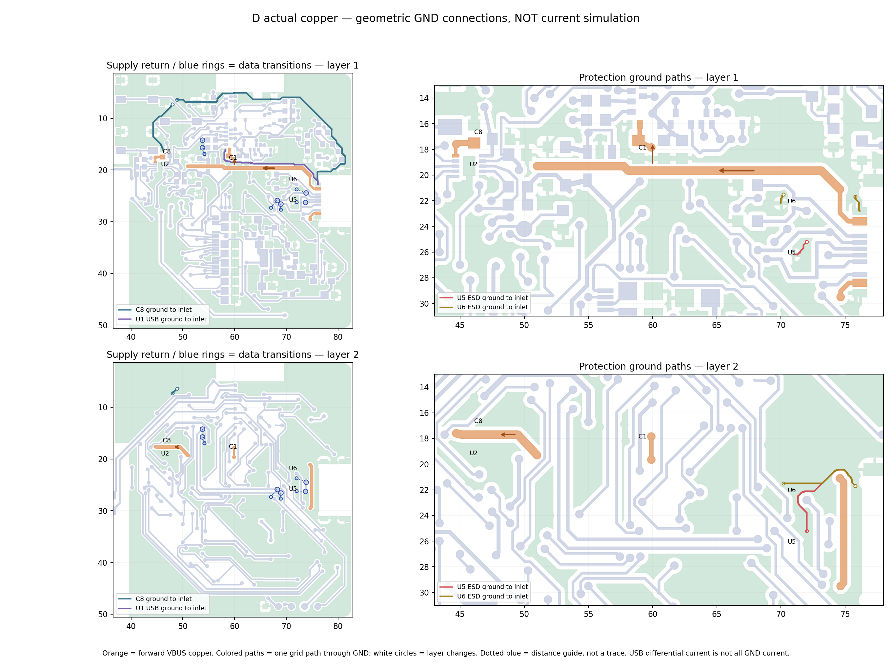
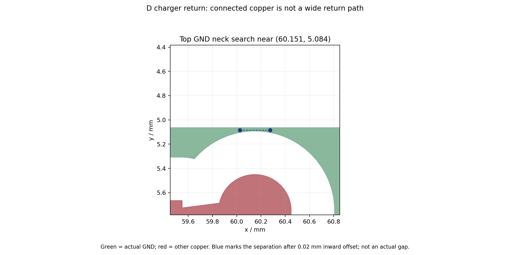
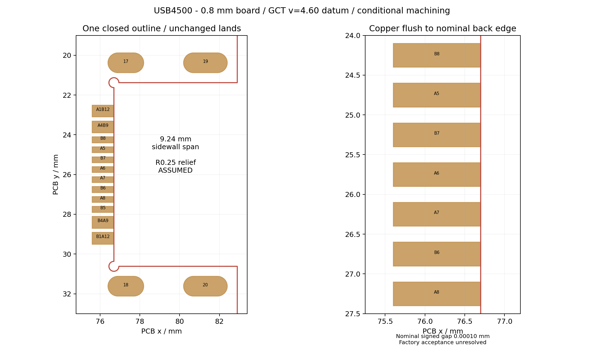

# Board Review D：USB 供电、整板候选与制造复核

## 当前确定方案

2026-09-28，继续在 `master`、嘉立创 EDA 中完成独立 [D 原生工程](../../../eda/NFC-Card-R2-Board-Review-D.eprj2)。用户后续授权将 C 扩展为整板审核候选；A/B/C/R21 保留，文件指纹未变。用户在 EDA 的操作未破坏保存的几何；最后一次保存并完整退出／重开后，器件、焊盘、走线、过孔、板框、禁布区、文字、规则和网表一致。

**D 已全网连通，但 USB／电源区不能定型，不能下单。**原生未连接为 0，其他普通几何错误为 0；仍有 12 项 USB 贴片焊盘贴边、2 项固定槽近板边。进一步的回流审查发现充电器地依赖约 0.029 mm 的地铜细颈，这是本版实质阻塞。三条普通信号串行换层 7／7／6 次，不能据连通或 DFM 结果宣称布线合理。

[顶层全板](records/board-review-d-top.png)、[底层全板](records/board-review-d-bottom.png)均按 PCB 正面坐标观察，底层未镜像。图由实际填铜生成，未混入飞线／全部辅助层。

## 电流路径与本轮调整

接口两组 VBUS 汇合后，经共用干线分为 `C1→U1.32` 与 `C8→U2.10`。保持 C1 服务 U1、C8 服务充电器输入；U5/U6 分别保护数据／CC，其短地出口与接口地实铜连通。主干约 0.60 mm、接口合并段 0.50 mm、U1 支路 0.30 mm、充电器末端细间距逃逸 0.20 mm；这些是当前几何，不是额定载流能力承诺。

本版将 C1 的纵向 VBUS 分支改到背面，用两个 0.30/0.60 mm 孔连接，腾出顶层 C1.2→C7.2 的约 0.35 mm 地连接；C1 到 U1 输入脚短线未拉长。U3 地脚、U1.33、J2 地脚、电池地及局部铜区通过短线／地孔接通；清理死端和只接一面的无效孔。最终为 912 段明线、198 个过孔，其中 GND 42、VBUS 6；USB 数据／CC 的全部信号铜与 B/C 相同，完整数据路径仍为 6 孔。

显示升压回路按 `C10→L1→Q1→R15→C10.GND` 组织，R15 地以约 0.60 mm 底层铜回 C10；RESE 从 R15.1 独立引到 J2.3，约 22.95 mm、2 孔。GDR 从 J2.2 到 R14.1 约 23.67 mm。U4 是负载开关，不能拿 U4 位置代替 Q1 开关回路。C3 和部分控制电阻位置变动见[逐器件变更表](records/board-review-d-review.json)；屏幕、电池、主控和 NFC 总体布局保持。

**VBUS 保护尚未选定，也未加入网表。**拟将共同入口拆为保护前／后两网，保护同时覆盖 U1 与充电器；`x=69.5–73.5、y=17.8–20.5 mm` 仅是规划范围，未证明最终封装可放下。nRF52840 VBUS 绝对最大值 5.8 V；普通“5 V TVS”或保护芯片标称值不能证明钳位安全。TPS25200 的稳态限制与示例瞬态仍有差距，不能直接定型。原厂证据和候选比较见[电源与保护预算](pcb-restart-design-plan-2026-09-28.md#电源与保护现在能算出的边界)。

BQ25186 默认 500 mA 输入限流仅限制其分支，不包含直接接入的 U1；Rd 也不等于 USB 已授权该取电量。TPS7A02 上限 200 mA，屏幕刷新峰值未实测；301030 已到手、厚 3 mm，“110 毫安”暂按 110 mAh，允许充放电电流仍缺规格。预算、保护和热设计均未冻结。

## 回流：连通通过，质量未通过



[路径记录](records/board-review-d-return-paths.json)采用实际地铜、0.025 mm 网格及 0.005 mm 向内收缩；孔间换层按 0.8 mm 计。固定终点为 J1 上侧地焊盘时，C8／U1.33／U5／U6 的图示路径约 64.67／22.77／13.51／10.42 mm。它们不是电流仿真，也不是唯一放电路径或低阻抗证明。C8 的明显绕行触发了进一步检查，未用“存在路径”结束评审。



[精确铜区诊断](records/board-review-d-return-bottleneck.json)显示：原地铜连通，整体内缩 0.01 mm 后仍连通，内缩 0.02 mm 后 C8.2 与 J1 上侧地断开。已定位顶层 `x≈60.15、y≈5.08 mm` 的颈部；在 x=60.15 截面宽 **0.02854 mm**，位于 NFC 引出孔与天线净空边缘之间。这里不能承担“连续、宽的电源返回”结论。收缩实验是诊断方法，不是新增制造规则，也没有修改原板规则来消除错误。

原厂 [BQ25186 §9 布局](https://www.ti.com/lit/ds/symlink/bq25186.pdf)与 [TPD2EUSB30 §10](https://www.ti.com/lit/ds/symlink/tpd2eusb30.pdf)要求按电流和低阻抗返回安排局部铜。本版整板信号扩展切割了 C 的局部地，必须修复此退化。不能扩铜侵入 BLE／NFC 净空。离线探查未找到一个可在 C8 顶层铜与主底层地重叠区直接增加 0.30/0.60 mm 孔、同时留出 0.40 mm 孔到 SMT 净距的简单位置；应联合比较 C8/U2 地出口、SWDCLK `(47,13.4)` 和 SYS 孔 `(46.9,14.7)` 附近通道，或重设局部跨层桥。此为下一组有限调整范围，尚未试布通过。

六个数据孔的最近有效地孔距离依次为 **1.701、1.950、1.099、1.883、2.721、1.250 mm**，完整坐标见[复核 JSON](records/board-review-d-review.json)。相对 C，部分地孔距离变大；尤其 `(53.80,14.201)` 的 D+ 换层由约 1.36 变为 2.72 mm。1.6 mm 是回流评审目标，不是 USB 全速必然失效阈值，但不能把这次回流退化漏记或宣称原结论自动继承。数据铜没变，不代表其参考地没变。

## 三条信号的布线质量

复用[三条路线专项](d-signal-planning-review.md)，并对最终 D 的孔坐标与线长做[续核](records/board-review-d-route-review-check.json)：

| 网络／端点 | 最少串行换层 | 明线中心线总长 | 判定 |
| --- | ---: | ---: | --- |
| SWDIO：U1.51↔TP4 | 7 | 68.33 mm | 已连接，但路径简化和共同通道规划未完成 |
| SWDCLK：U1.53↔TP3 | 7 | 78.16 mm | 两端与 SWDIO 相邻，却分别绕左／右，尚无充分理由证明这一取舍必要 |
| EPD_RESET_N_TBD：U1.41↔J2.10 | 6 | 33.27 mm | 有短距离换层再返回的可改善候选 |

这些确为两端之间的串行层变化，不是多分支总孔数。SWDIO `(69.5,25.2)→(70.5,24.2)` 的顶层跨接在底层直连确实撞 CHG_SDA；另两处——SWDIO `(72.3,9.9)→(72.3,8.5)`、复位 `(56.75,12)→(54.9,11.9)`——存在各减少两次换层的候选，但未重铺铜／执行新原生 DRC，不能直接删孔。现有证据支持“通道分配与路由输出简化都有问题”，不支持“USB 常见所以本板自然容易”或“这些孔都无法避免”。未展开全板重布或换脚。

## USB 板边的 12＋2 项



D 修正了 C 的双重轮廓：J1 库内开口线通过原生局部封装编辑移至机械层，实际制造层只有一个闭合轮廓。后缘恢复 GCT 推荐共同基准 `v=4.60 mm`，侧壁间距 9.24 mm；贴片焊盘不动，因此 12 个铜前缘与名义后缘几乎齐平（计算约 0.00010 mm）。**这已从建模问题进入真实的近边铜制造条件，不能忽略。**

角部采用 **R0.25 让位假设**，不是原厂或工厂已确认的尺寸。它使后排 J1.17/18 固定槽的铜到轮廓约 0.269 mm，低于保留的 0.300 mm 规则，新增 2 项 TH 板边错误。四个镀铜槽在 Excellon 中为 0.60×1.40 mm 两个、0.60×1.80 mm 两个；不是普通过孔。

给客服的材料为本图、同版诊断 Gerber、[GCT 图纸](../downloads/usb4500-drawing.pdf)及下列问题，由用户发送：

1. 对 USB4500-03-0-A／C5354966、双层 0.8 mm（工艺厚度公差仍需确认）、标准型 SMT，是否接受 v=4.60 的 12 个齐边 SMT 焊盘？CAM 是否削铜，成品焊接长度、公差、毛刺如何保证？本版 SMT DFM 对这 12 个焊脚均报告接触比 0.50、内边界超出 0.50 mm；请核对网站贴片模型和原厂推荐焊盘，明确是否实际存在焊接长度不足，不能只确认“支持中沉”。
2. 9.24 mm 侧壁及 R0.25 让位是否能定位／插装？能否给已贴装使用的缺口／封装图？若要求改变角部，请同时审核后排槽铜距约 0.269 mm。
3. 四个 0.60 mm 镀铜槽的加工、定位及焊接需要什么治具／补焊／拼板，费用如何分列？工厂可贴“中沉器件”不等于接受本图。
4. J1/J2/U2 约 0.10 mm 阻焊桥、U2 EP 约 87.9% 锡膏面积是否接受，是否需要钢网调整？未静默改为 1:1 开窗。
5. U1 本体离成品边约 0.066 mm（网页约 0.07 mm）：请确认工艺边、贴装／分板和模型处理。C1/C6/C7 与 U1 还有模型放大 9% 后碰撞的预警，请确认实际贴装间距；不能靠单独内移模块或拉远去耦来消计数。

## 保存重开与同版检查

| 门槛 | 结果与边界 |
| --- | --- |
| 身份／文件 | D 运行 UUID `859b1e59…02b89d`；完整退出后 SQLite quick_check 正常；A/B/C/R21 SHA 保持 |
| 网表／BOM／坐标 | 66 位号、256 元件引脚一致；BOM 29 组；CPL 66 个位置／角度与本版对应 |
| 原生 DRC 分类 | 未连接 0；USB SMT 板边 12；TH 板边 2；其他几何 0；保留 NFC 孔尺寸错误已消除；规则与 C 相同 |
| 实际铜 | 全网（含 GND）连通；死端 0、浮铜 0、单面接铜孔 0。**不证明返回宽度、阻抗、ESD 或热性能** |
| 过孔与 SMT | 孔壁到同网／异网 SMT 铜最小 0.40956／0.40627 mm；最小过孔壁间距 0.50650 mm |
| 钻孔／孔环 | 198 个过孔与 Excellon 一一对应，最小实导出钻径 0.29972 mm（名义 0.30）；实际最小径向孔环 0.14732 mm。保留孔原生 getter 与 Excellon 有一个 0.1 mil 刻度差异，未混成实际精度 |
| 阻焊／锡膏 | 过孔中心开窗 0；孔壁到开窗最小 0.35599 mm，盖油不等于塞孔。U2 EP 锡膏已从原生局部封装保存，Gerber 面积比 0.87915 |
| 轮廓／NFC／天线 | GKO 唯一闭合；五匝主线未改；NFC 74 段主/引出线切断一处长绕组后分为两组，排除净名相同掩盖旁路；BLE／屏幕净空无新增异网侵入 |
| 线上与实物 | 线上进度见下节；尚无本板实物 USB／ESD、屏幕、电源温升、NFC/BLE 或装配验证 |

原生 API 曾在修改后保留过期连接错误；完整退出应用并重开后消失，且前后实际几何一致。曾遇到直接改组件子图元不持久化、无效 Polygon 返回值导致板框修改未落盘，因此最终以局部封装保存、重开快照与 Gerber 为证，不用 API 返回成功代替验收。离线布线“成功”也曾遗漏铜断点；最终独立实铜检查已纠正这些点，仍未把几何连通升级为电气通过。

## 线上 DFM

同版 [Gerber](records/board-review-d-diagnostic-gerber.zip)、[BOM](records/board-review-d-diagnostic-bom.csv)、[CPL](records/board-review-d-diagnostic-cpl.csv)仅用于诊断。Gerber 已上传并解析，用户协助打开结果页；任务为 [DFMP2609280813](https://www.jlc-dfm.com/order/smt-dfm-lceda?dfmPcbTaskCode=DFMP2609280813&dfmPcbUploadFileKeyId=627459542952976386&dfmPcbTaskKeyId=627459555076689922)。没有下单、付款或联系工厂。

PCB 页设为 0.8 mm 后重新执行检查，已读到最小线宽 0.15 mm、线距 0.20 mm、孔径 0.30 mm、孔环 0.15 mm。网页默认“有铅喷锡、绿色、白色”不是最终选定表面工艺。以下是网页危险／警告计数，不是独立物理缺陷个数；100 等可能是显示上限。完整[分类原文](records/board-review-d-online-pcb.txt)和[同版文件指纹](records/board-review-d-online-dfm.json)已归档。

| PCB 项目 | D 危险／警告 | 解释／未闭合项 |
| --- | ---: | --- |
| VIA 孔到焊盘 | **0／0** | 这项旧问题已在本地和线上同时消除 |
| 走线间距、盘到线、焊盘距焊盘 | **均 0／0** | 比 R21 的局部近距改善；不代替参考地和阻焊检查 |
| 焊盘孔环 | **0／100** | 无危险，警告列表存在上限；本地实际最小径向孔环 0.14732 mm，警告适用性仍需按过孔／插件孔区分 |
| 焊盘距外型线 | **12／0** | 与 USB 的齐边 SMT 焊盘一致，特殊制造条件未接受 |
| 测量槽宽 | **4／0** | 对应 USB4500 的四个 0.60 mm 镀铜槽；需工厂审核，不能与 USB4110 无槽版混用 |
| 阻焊桥 | **42／4** | 固定节距器件和局部开窗仍有危险，尚未逐条归并到物理位置 |
| 开窗露线 | **1／0** | 网页为 0.07 mm 的正间隙、0.15 mm 走线到 RoundRect.d13 开窗；见下文交叉定位，尚不能写成实际已露铜 |
| 丝印距焊盘／孔 | **50／0、86／2** | 需要按成品丝印定位和裁剪，不影响铜网连通但尚未完成生产稿 |
| 丝印线宽、锐角拐线 | **5／45、0／1** | 保留为成品图元复核项 |

网页显示孔数 254，本地 Excellon 计为 198 个圆过孔＋4 个槽；网页口径可能计入槽的钻点，尚未据此认定重复钻孔或把它写成 254 个独立孔。原生的 2 项 TH 板边错误仍保留，不因网页未单列同样两项而消失。线上“最小线宽 0.15 mm”也没有证明覆铜细颈达到该值。

用户关闭旧页后，以同一任务地址新建浏览器页，文件选择控件恢复；BOM／CPL 已自动上传并保存，[29/29 组、66 位号匹配](records/board-review-d-online-matching.txt)。随后明确执行 SMT DFM，取得以下实际结果；不是导入前的全 0，也未替换网站模型、移动元件或降低规则。完整[SMT 分类](records/board-review-d-online-smt.txt)、[结果截图](records/board-review-d-online-smt.png)及各项详情均已归档。

| SMT 项目 | D 危险／警告 | 已核对象与处理边界 |
| --- | ---: | --- |
| 焊脚和焊盘相交区域 | **12／1** | 12 个 J1 接触比均 **0.50**；U2 为 **0.88**。未获工厂接受 |
| 元件距板边 | **1／1** | U1 **0.07 mm** 危险；SW1 **0.80 mm** 警告 |
| 元件碰撞 | **0／3** | C1–U1、C6–U1、U1–C7，值均 **0.09**；该值是模型放大比例，不是 0.09 mm 实际间距 |
| 元件与板框相交 | **0／1** | J1，交叉线 **10.64 mm**；属于接口伸出板边结构，仍需本版装配审核 |
| PIN 内／左／外／右边界 | **21／0、13／0、4／0、11／0** | 内边界含 J1 12 条 0.50 mm、U1 8 条及 U2 1 条显示 0 mm；其余边界集中在 U1/U2。网页取整的 0 mm 不证明没有越界，也不能直接判定封装错误 |
| 元件本体文字 | **0／4** | D1、D2、D3、U1；生产丝印待整理 |
| 元件焊脚到孔、PIN 无焊盘、插件孔相关项 | **均 0／0** | 对应检查未报危险／警告，不代表上述接触和工艺条件通过 |

[焊脚详情](records/board-review-d-online-smt-contact.txt)和[同版 Gerber 交叉核对](records/board-review-d-online-contact-crosscheck.json)表明：J1 的 12 个锡膏开口与铜面积均约 1:1，网页 0.50 接触比不能归因于“钢网只开了一半”；仍须对照实际引脚与 DFM 模型基准。U2 EP 的 0.87915 锡膏面积比与网页 0.88 数值相符，但尚未独立验证网站模型的计算几何，不能因此自动忽略警告或改成满开窗。[U1 板边](records/board-review-d-online-smt-edge.txt)、[碰撞](records/board-review-d-online-smt-collision.txt)和各 PIN 边界详情已保留，待按原厂尺寸与贴装条件逐项判定。

[开窗露线详情](records/board-review-d-online-pcb-mask-gap.txt)显示危险阈值为 <0.08 mm；本次值 0.07 mm 尚是正间隙，代表阻焊工艺风险，不能直接等同异网铜短接。本地将同版 Gerber 开窗与原生顶层走线交叉检查，C3.1 开窗 `(48.800,18.400)` 与同网 BAT_PACK_TBD 的 0.15 mm 竖线相距 **0.07398 mm**，位置、线宽和开窗类型与页面局部一致，列为优先复核候选；网页未给出精确对象坐标，映射尚未完全确认。[交叉记录](records/board-review-d-mask-gap-check.json)同时保留其他同网正间隙候选，未将它们冒充网页独立缺陷。本轮未为消除计数改铜或阻焊。

## 下一步与责任

1. **设计侧先修复充电器地细颈与绕行**，联合检查 SWDCLK/SYS 通道；同步审查六个数据换层的参考地退化。只做局部、可对照的方案，不先全板重跑自动布线。
2. 验证两处短换层简化候选，并比较 SWD 两线共同通道；任何方案都要重铺地、复核局部敏感关系和真实连通。
3. VBUS 保护、屏幕峰值／200 mA LDO 余量和充电热预算由设计／测量闭合；用户补电池允许充放电规格。不能把这些交给 PCB 客服判定。
4. 用户确认 USB 特殊板边／槽／拼板、U1 近边装配和费用；再冻结几何／料号。新版本保存重开后重新导出、做同版 PCB＋SMT DFM，不继续上传旧包。

## 文件与复现

[重开和文件记录](records/board-review-d-file-check.json)、[完整检查结果](records/board-review-d-review.json)、[原生 DRC](records/board-review-d-drc.json)、[快照](records/board-review-d-snapshot.json)、[网表](records/board-review-d-schematic.enet)、[PCB 引脚](records/board-review-d-pcb-pins.json)、[规则](records/board-review-d-rules.json)均对应 D。

```sh
unzip -o projects/nfc-business-card/hardware/records/board-review-d-diagnostic-gerber.zip \
  -d projects/nfc-business-card/artifacts/board-review-d/gerber
python3 projects/nfc-business-card/scripts/review-board-d.py \
  --gerber-dir projects/nfc-business-card/artifacts/board-review-d/gerber \
  --cpl projects/nfc-business-card/hardware/records/board-review-d-diagnostic-cpl.csv
python3 projects/nfc-business-card/scripts/review-d-return-bottleneck.py
python3 projects/nfc-business-card/scripts/plot-usb-c-return-paths.py --candidate d
python3 projects/nfc-business-card/scripts/check-netlist-consistency.py \
  --sch projects/nfc-business-card/hardware/records/board-review-d-schematic.enet \
  --pcb projects/nfc-business-card/hardware/records/board-review-d-pcb-pins.json
git diff --check
```

若需新的原生采集，先核 D 工程身份，再运行 `eda-export-midmount-candidate.js`，把输出传给检查器的 `--capture`；不能拼接不同版本材料。
