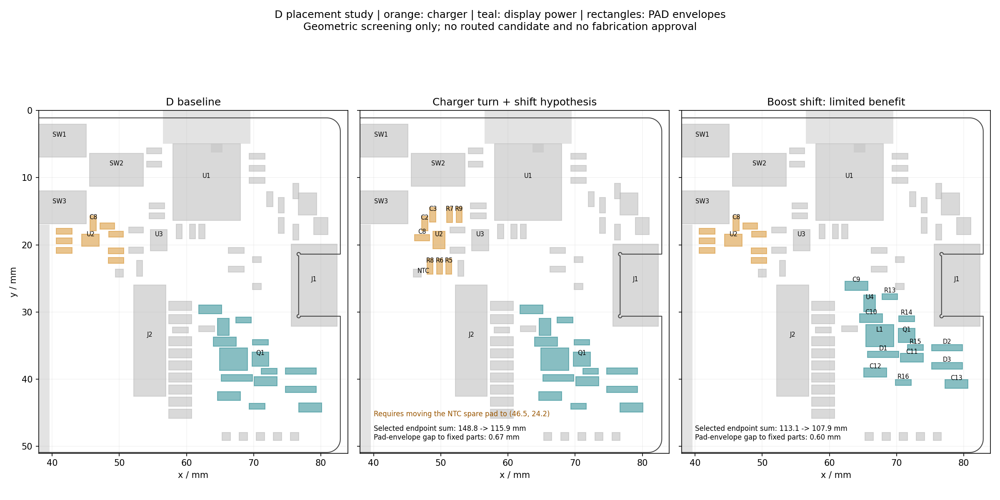

# D 版全局摆放调整评估

## 当前确定方案

2026-09-28，基于 D 的保存快照，比较器件组转向、平移及可选功能删减。**存在值得实际试布的调整方向，但没有证据证明“挪几颗就能修好整板”，也没有证据说明板面积已不足。**本次只生成离线候选及几何记录，未修改 EDA 工程、原理图、制造文件或恢复另一任务的布线。

优先比较充电区转向及其供回电出口；显示区需要比较组内重排，而不只是整块上移。用户提出“实在不行就去掉后加的电源检测区”，本报告按 **Q2/Q3、R20–R23、C25 外部电池电压采样区**记录为条件性备选，不等于立即删除，也不包括充电器或必要的电源旁路。

证据：[摆放图](records/d-placement-options.png)、[坐标与测量 JSON](records/d-placement-options.json)、[可复跑脚本](../scripts/review-d-placement-options.py)。图中矩形是**焊盘包围盒**，不是已确认的器件实体或装配禁布区。三幅图分别为原版、充电区候选和显示区平移候选；两种候选独立评估，没有合成新 PCB。



## 1. 充电区：有价值的候选，但需连同独立焊盘考虑

当前 U2 位于 `(45.72, 19.304) mm`。其外围电路分散到左侧控制电阻及右侧稳压器，主控相关控制引脚却位于更右边。

候选把 **U2、C2/C3/C8、R5–R9**作为 9 件刚性组合，围绕原 U2 中心在快照坐标中转 `270°`，再右移 4 mm，U2 到 `(49.72, 19.304) mm`。这是数学变换参数，不能未经坐标方向核验直接作为 EDA API 旋转参数执行。电容与服务引脚的相对位置及组内所有焊盘距离保持不变；这只保持摆放关系，不保证原来的回路和地铜自动保留。

**该候选必须同时把独立 NTC 预留焊盘从约 `(50.00, 24.20)` 移到 `(46.50, 24.20) mm`。**只检查有位号的器件时会漏掉它：若留在原位，R6 的候选焊盘包围盒会与之相交。NTC 焊盘用途、可达性及其到 R19/U2 的支路需在实际候选复核；现有 TS 固定电阻方案不因此改变。

| 指标 | D 基线 | 转向＋右移＋NTC 焊盘让位 |
| --- | ---: | ---: |
| U2.SDA → U1 对应脚端点距离 | 20.83 mm | 15.76 mm |
| U2.SCL → U1 对应脚端点距离 | 22.56 mm | 17.80 mm |
| U2.SYS → U3.IN 端点距离 | 8.17 mm | 6.01 mm |
| U2.IN → J1 指定 VBUS 焊盘端点距离 | 33.00 mm | 28.39 mm |
| 选取的 8 对跨区端点距离之和 | 148.76 mm | 115.95 mm（减少 22.1%） |
| 电池 BP → U2.BAT 端点距离 | 14.27 mm | 16.83 mm（增加 2.56 mm） |

八对关系为五条主控充电控制、SYS、VBUS、TS，详见 JSON。**22.1% 不是实际线长减少比例，更不是整板改善比例**；它不包含全部分支、绕障碍代价或地返回。更靠右会拉长电池支路，必须同时核查电池供电宽度、压降与返回。

候选移动部分对其余固定焊盘包围盒的最小间距约 0.671 mm，位于 R7/C4；组内最小包围盒间距仍约 0.300 mm，未因平移变宽。板框内缩 0.2 mm 与现有屏幕／天线禁布区的几何筛查通过。这些是初筛数据，**不能作为实体装配、布线可达或原生 DRC 通过的结论**。0.5 mm 筛选偏好和 0.2 mm 边界筛查也不是新制定的生产阈值。

若 NTC 焊盘也固定，本次粗网格筛出的另一个候选只把八对端点合计降到 139.87 mm（约 6.0%），且 SYS 关系变长。这说明摆放优化要明确“哪些能动”，不能把全部旧位置默认锁死后再要求布线变简洁。

**实际试布先验证 C8.2 → U2.5/11 的局部返回，以及输入／SYS／BAT 供回电，再验证五条控制信号。**现有约 0.029 mm 地细颈不会因为坐标变好就算修复。U3 与 C4/C5 暂不移动。

## 2. 显示区：整组平移收益有限，应比较组内次序

将 U4、C9/C10、R13、L1/Q1、R14/R15、D1–D3、C11–C13、R16 共 15 件作为刚性组合，得到两个对照：

| 候选 | 选取的 7 对端点距离合计 | 与固定焊盘包围盒的最小间距 | 判断 |
| --- | --- | --- | --- |
| 向右 0.5 mm、向上 3.5 mm | 113.14 → 107.90 mm，减少 4.6% | 0.597 mm，C10/R18 | 收益有限 |
| 向左 0.5 mm、向上 6 mm | 113.14 → 98.80 mm，减少 12.7% | 0.205 mm，D2/J1 | 与 USB 区更挤，不优先 |

较宽松候选中，GDR 端点距离只从 17.13 降到 16.43 mm，RESE 从 17.83 降到 16.75 mm；EPD_VDD 到 J2 的端点距离反而从 8.45 增至 10.00 mm。不能因整个图看起来更集中，就判定更好。

原因线索是：J2.2/GDR、J2.3/RESE 在约 `y=29–29.5 mm`，Q1/R15 却在更右下方；J2 旁还有长条 C14–C22 电容列，限制了整组左移。**下一份显示候选应联动这列电容与升压器件的排列方向，让 Q1/R15 更靠近对应接口端，同时保住 C10→L1→Q1→R15→C10.GND 回路。**这是有具体端点支持的设计方向，尚未生成完整可布候选，不承诺缩到某个长度或减少几个孔。不能只搬 Q1，留下其余开关回路元件。

依据及适用边界沿用[七区原厂关系](r1-seven-zone-reference-plan.md)：TI BQ25186 §9、TPS7A02 §8.4、TPS22919 §11；Good Display DESPI-E01 是电路参考，尚无已验证的同条件 PCB 可直接照搬。

## 3. 主控到屏幕／SWD：仍需重新分配跨区通道

[D 三条路径评审](d-signal-planning-review.md)已经发现相邻端点的 SWDIO/SWDCLK 分别绕向不同侧，以及屏幕复位多次短距离换层。移动充电组只是改变障碍位置，并不自动消除这些绕行。

下一候选要把 MCU 左侧到 J2、底部调试点的相关网络成批分配通道；保留 D 对照，允许受影响旧线拆除，避免把 912 段旧线全部当成固定障碍后逐条塞线。通道图须明确图层和返回安排，并经实际试布验证；不能只画两根箭头就称通道预留成功。U1 及其去耦、天线区、连接器和机构基准本次保持不动。

## 4. 删掉后加的电池采样区能换来什么

当前七件：Q2、Q3、R20、R21、R22、R23、C25。其焊盘包围矩形为 `x=71.95–81.05、y=10.84–19.26 mm`，约 `9.10 × 8.42 mm`（76.57 mm²）。这只是空间范围，不是可完整回收的布线面积；区域中已有其他网络走线，外壳／天线边界仍要保留。

快照中四个专用网络 `BAT_DIV_SUPPLY`、`BAT_SWITCH_GATE`、`BAT_MEAS_EN`、`BAT_ADC_SENSE` 合计 **28 段明线、8 个过孔、37.19 mm 明线中心线长度**。若删减这些器件及外部采样功能，可去掉这部分专用铜，器件数 66 → 59。共享 BAT_PACK_TBD 的采样支路还可进一步简化，但必须识别分支；不能把该网络的全部 12 个过孔或整条 BAT/GND 网络一并删掉。

代价是失去现有 MCU 控制的外部分压电池电压采样路径，相关固件／电量显示设计要同步取消或另行论证，不假定充电芯片能无条件替代它。收益集中在右上角及跨区 BAT 支路；**它不会自动解决左侧 C8 返回、屏幕 GDR/RESE 或 SWD 路径。**因此这是合理的产品简化备选，不能作为整个问题的唯一解释。

## 后续顺序与验证范围

1. 先在独立候选里比较充电组转向＋NTC 让位，确认电源条件允许继续沿用这些元件；先证实供回电质量，再接控制信号。
2. 针对显示区生成一份围绕 J2 引脚次序的组内摆放方案，并实际试布；不要只采用上述收益很小的平移。
3. 对主控到屏幕／调试的通道做成组验证。电池采样区保留／删除作为两种产品范围比较；本轮没有执行删除。
4. 只有实际候选通过同版供回电、原生 DRC、独立连通、机构与制造复核，才能说“问题更少”。不以这份几何筛查替代投厂评审。

复跑：

```bash
python3 projects/nfc-business-card/scripts/review-d-placement-options.py
```

脚本锁定快照 SHA-256 `b41283e216670f814a63f064995077f8df891c49a579c98a16db24af93236a0c`，检查组内焊盘距离不变、候选与固定焊盘包围盒间距、板框／禁布区以及源文件未改写。原位 NTC 冲突已纳入修订候选；检查包含没有器件位号的独立焊盘。未评估既有走线、过孔和覆铜对候选的阻挡，也未做场仿真、原生 DRC 或实物验证。本次目的正是筛选值得重布的摆放，不能把旧线路保持不动的落位检查当成最终可行性。
