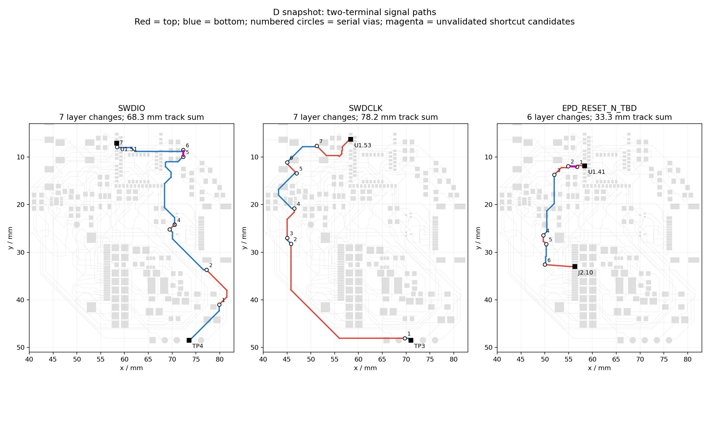

# D 版三条信号路径与提前规划评审

## 当前确定方案

2026-09-28，只读分析保存的 D 快照，未修改 EDA。目的是判断多次换层来自通道规划还是可避免的局部绕行，不以此替代 DFM 或电气验证。后续 D 可能继续修改，本记录仅对应 [JSON](records/d-signal-planning-review.json) 中 SHA-256 为 `4f6a393fcc2e34548a7fb194231320a208ed0a6881b205c65bca0dd92d53a044` 的快照。

## 已量化事实

沿用 `check-r1-copper.py` 的实际铜几何，将每层连通铜区作为节点、过孔作为跨层边，用广度优先搜索求两个焊盘之间最少需要的换层次数。每条网络恰有两个焊盘，因此本表不是多分支网络的孔数相加。铜区沿用原检查器的 0.001 mm 接触容差。

| 网络 | 实际串行换层 | 明线中心线长度总和 | 两焊盘中心直线距离 |
| --- | ---: | ---: | ---: |
| SWDIO：U1.51 → TP4 | 7 | 68.33 mm | 44.13 mm |
| SWDCLK：U1.53 → TP3 | 7 | 78.16 mm | 44.09 mm |
| 屏幕复位：U1.41 → J2.10 | 6 | 33.27 mm | 21.24 mm |

明线长度不含焊盘和孔内部路径；直线距离只是几何下界，不表示沿直线可布通。SWD 两个 MCU 引脚间距约 0.8 mm、两个调试触点间距 2.54 mm，但现有路径分别绕电子区右侧和左侧。这支持检查共同通道的可行性，不证明两条线必须并行或等长，也不证明已有无冲突的共同通道。

## 三处局部探查

按当前 0.15 mm 线宽、0.20 mm 间距探查假设直连，检查异网明线（包括地线）、焊盘和过孔；未重铺地铜，未执行新方案的原生 DRC，不作制造或电气通过结论。

| 对象／坐标 mm | 当前现象与探查结果 | 方法上的含义 |
| --- | --- | --- |
| SWDIO，(69.5,25.2) → (70.5,24.2) | 通过顶层短段跨接；若在底层直连，会与 CHG_SDA 实铜相交 | 当前路由下确实有障碍。应联合比较充电控制线与调试通道的分配，不能直接删孔 |
| SWDIO，(72.3,9.9) → (72.3,8.5) | 约 1.4 mm 顶层短段，两端换层；底层直连探查未发现异网离散铜间距冲突 | 有候选减少两次换层的空间，可能不必移动器件；仍需重铺铜、地路径及完整规则检查 |
| 屏幕复位，(56.75,12.0) → (54.9,11.9) | 约 1.85 mm 底层短段，两端换层；顶层直连探查未发现异网离散铜间距冲突 | 同样应做路线简化验证，不能将六次换层全部解释为布局必需 |

紫色虚线标出后两处候选直连。探查未证明删孔后地铜形状、返回路径及全板门禁仍通过；相关器件、板框、禁布区与网络不得随意改变。

## 下一轮如何预防

1. 功能分区后，画出跨区连接的通道和关键网络出口；主控到调试口可先比较共用一条走廊的方案，主控到屏幕则预留控制信号通道。供电、开关回路、保护与地返回先占必要空间，不把低速信号优先级机械地提高到所有关键电路之前。
2. 用关键区及拥挤通道的实际试布验证摆放；若两个端点的普通信号频繁换层，先查障碍和顺序，再决定是否成组移动器件。不能只凭摆放图分区整齐就冻结位置。
3. 每批布线后检查短距离“换层再换回”、大范围绕行、真实地返回；可在同层完成的候选先复核，避免积累到最终清 DRC 时才发现。孔数是诊断信号，不设置无来源的统一硬上限。
4. KiCad 可作为下一轮工具试验，但迁移本身不证明以上问题消失。仍需验证同样的布局意图、路线简化和电气／制造门槛。

本轮检查完成了铜区拓扑追踪、三条路线长度求和及三处异网离散铜探查；图已目视核对。结论是规划与路由简化都值得改善，尚未验证新的可采用布线。
