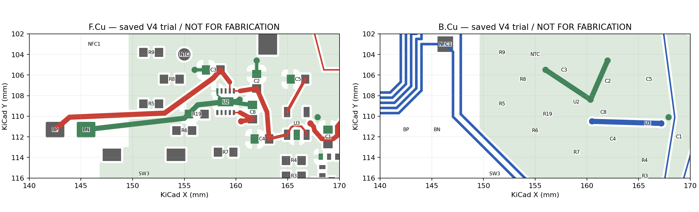
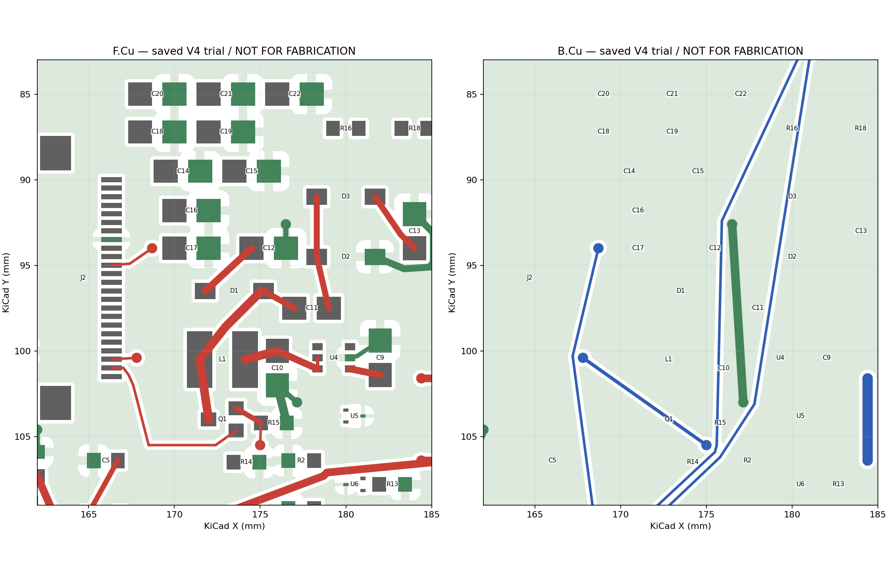
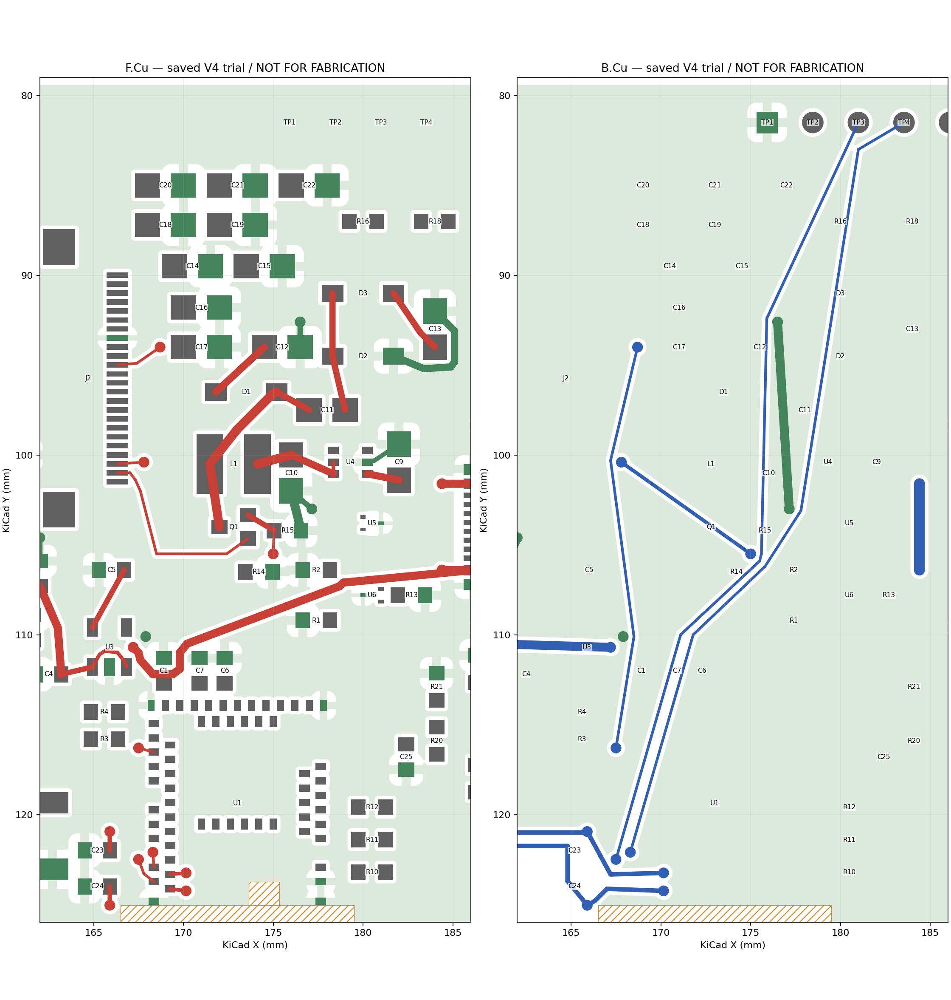

# NFC 名片 V4：KiCad 迁移、关键区试布与国内 DFM

## 当前确定方案

2026-09-29 第一阶段完成。使用 **KiCad 10.0.6 / kicad-python 0.8.0**，继续在 `master`；完整工程入口为 [NFC-Card-V4.kicad_pro](kicad/v4/NFC-Card-V4.kicad_pro)。**可以继续有限的联合摆放／通道试验，尚不具备推进整板详细布线或投厂的条件。**

这次实际完成了迁移对账、原生保存重开、关键供回电及三条跨区信号试布，并在国内嘉立创完成独立诊断文件的 PCB／SMT 分析。试布提前暴露了 VBUS 与屏幕信号通道的冲突，以及 SWD 参考地缺口；没有继续增加串行换层来勉强接通整板。

| 验收维度 | 本阶段结果 | 未关闭事项 |
| --- | --- | --- |
| 连接正确性 | 66 位号／256 器件引脚逐脚一致；U1 61 焊盘；10 个板上触点单列；原理图／PCB parity 0 | ERC 6 项；PCB 83 个未连接项，整板尚未布完 |
| 布局／回流质量 | C8 有直接局部地返回；BAT 支路和 SWD 实际路径缩短；显示导通回路换层 2→0 | VBUS／屏幕通道冲突；SWD、MOSI 对面地存在缺口；4 对新摆位相关 courtyard 重叠待核 |
| 制造识别／DFM | 同版 Gerber、钻孔、BOM、CPL 已被国内页面读取；29 组／66 件匹配；4 个镀铜槽和 258 个锡膏开口核对 | 槽宽、J1 接触比、U1 板边、阻焊与模型边界危险仍在；没有制造放行 |
| 待实测 | 已列保护、电流、热和机械输入的边界及测量办法 | 未接实物、未烧录、未测峰值／压降／温升／射频／装配 |

保持双层 **0.8 mm**、USB4500 中沉方向、4.8 mm 外壳目标。U1、J1、J2、三键、电池焊点、SWD、NFC/BLE 基准未改。Q2/Q3、R20–R23、C25 电池采样完整保留；当前瓶颈没有证据要求删除这项功能。

## 冻结基线与工程身份

- 起点提交：`7d684f6`，初始工作区干净；本轮没有 commit、push、下单、付款或联系工厂。
- [嘉立创 D 工程](../../../eda/NFC-Card-R2-Board-Review-D.eprj2) SHA-256：`1ba5a615cd051b29c45f9aaca5ccaa6c15dc469eadf2e713c6bea9a0d9569783`，结束核对仍一致。
- [D 快照](records/board-review-d-snapshot.json) SHA-256：`b41283e216670f814a63f064995077f8df891c49a579c98a16db24af93236a0c`。
- [原生重开记录](records/kicad-v4/reopen.json)与[最终逐脚检查](records/kicad-v4/final-validation.json)绑定实际文件；82 个工程、原理图、规则及库文件在原生规范化后的保存／关闭／重开中指纹一致。

D 只读导出后关闭，未覆盖数据库。迁移路径是 **嘉立创 Pro 导出 `.epro` → KiCad EasyEDA Pro 导入 → 原生工程核对与重建**，没有把 `.eprj2` 当作 KiCad 输入。[实际交换文件](records/kicad-v4/NFC-Card-D-export.epro)保留供复现；KiCad 的导入入口依据[官方工程说明](https://docs.kicad.org/10.0/en/kicad/kicad.html)。

独立制造诊断保留完整 D 铜线，只用于比较导入和制造解释。正式 V4 删除了全部非 NFC 的 D 走线，再试布：当前 **174 段、22 个过孔**，其中 NFC 沿用 74 段／6 孔，新试布 100 段／16 孔。不能将制造诊断中的旧铜线当作 V4 成果。

## 迁移差异与重建

[迁移逐脚／开口记录](records/kicad-v4/migration-audit.json)包含 256 个器件引脚和 10 个独立触点；后者不进入 SMT BOM/CPL。

| 项目 | 处理与验证 | 边界 |
| --- | --- | --- |
| 网络、料号与库 | 66 个位号的 MPN、LCSC 料号与冻结网表一致；原理图四页＋根页；71 个实际使用的封装变体和符号库随工程保存 | 同类器件保留不同阻焊／锡膏变体，未为减少文件数合并 |
| 跨页连接 | 导入的本地标签重建为全局标签；NFC 短接语义单独处理 | 导入初次可打开并不表示跨页网络已连接 |
| U1 | 61 个焊盘编号／网络完整；迁移中心误差 <0.003 mm；与既有 [Raytac 官方叠图](records/r1-layout-reset-r21-u1-official-overlay.json)关联 | 原厂叠图最大中心偏差约 0.0021 mm；U1 距板边约 0.066 mm 的工艺问题未变 |
| J1 | USB4500-03-0-A；保留 12 个 SMT 焊盘＋4 外壳镀铜槽、缺口及原方向；板框与诊断基线逐项相同 | 原有近边铜和装配接触比仍不合格，不能由迁移保真推导工艺正确 |
| J2 | FPC-05FB-24PH20 / C2856831；24 信号脚顺序和机械焊盘按源网表、非对称坐标核对；J2.2=(166.325,100.990) mm | 排线接触面、插入方向和实物匹配仍需器件图纸／实物确认 |
| NFC | `NFC2_TBD` 与 `NFC1_TBD` 显式归为连续线圈 DC 网络；移除普通双引脚 `Short-Symbol`，添加解释；线圈实铜几何保持 | 这是连续绕线的直流语义，不是证明 RF 匹配通过，也没有跨线圈加捷径 |
| 禁铜／装配区 | 从源标志重建 6 区：双层映射、禁走线／过孔／焊盘、禁铺铜、禁器件分别保留 | 原始导入曾把区域边界混入板框或扩大禁止项，已纠正；NFC 允许自身走线但禁铺铜 |
| 阻焊 | 266 焊盘按冻结 D Gerber 开窗重建局部 margin，保留板面 | 开窗桥等原有制造问题仍在，不重新美化为默认值 |
| 锡膏 | 精确恢复 **顶层 256＋底层 2** 个多边形，包括 4 个 USB 槽焊盘开口 | 非对称缺口不能用居中矩形或面积质心匹配替代；底部 NFC 开口来自 D，不代表已经确定印膏工艺 |
| 坐标 | `X=110+源mil×0.0254`，`Y=130−源mil×0.0254`；制造原点 (110,130) mm，CPL Y 向上 | 原生 nm/mm、源 mil、制造 mm 分开转换；所有 66 个 SMT 器件在顶面 |
| 模型 | 删除导入的无效占位 STEP 路径，符号／封装库用 `${KIPRJMOD}` | 本工程没有已核验的完整 3D 装配模型；4.8 mm 外壳不可据此判定通过 |

独立 Gerber 面积比较：顶层锡膏源面积 189.20323365 mm²，KiCad 189.20322477 mm²；对称差 **0.00012096 mm²**，Hausdorff 距离约 **0.00000071 mm**；底层对称差约 2.1×10⁻¹⁴ mm²。[计算与图形证据](records/kicad-v4/trial-audit.json)使用独立 Gerber 解析，并非仅比较原生字段。

发现并修正了两个工具问题：

1. `kicad-python 0.8.0` 移动／旋转本次导入的含圆弧 `fp_poly` 后，局部封装图形发生位移。封装库差异检查暴露问题；关闭 PCB Editor 后从未移动的原生基线恢复局部图形和焊盘定义，保留新铜线。焊盘局部数值误差最大约 0.000001 mm，最终库差异为 0。后续移动仍需此项核对，未升级工具链。
2. 原理图首次 GUI 打开补齐了全局标签 `Intersheetrefs` 属性及根页实例信息。保存后逐脚网表仍为相同 256 项；再次打开无修复提示。18 条无用途线尾缩短至既有标签，1 条零用途线删除，前后网表完全一致。符号电气类型按 TI／Raytac 引脚表修正，未用 ERC 忽略项代替修复。

原理图已可编辑、保存和重开，但导入的 J1／电池采样局部标签仍拥挤；这是后续图面整理项，不能把图面整齐视为电路审核完成。

## 会影响布局的设计输入

本轮未新增 OVP、调整充电电流或替换电源器件。下表中的预算仍为边界计算；来源与较完整推导见 [供电准备](pcb-restart-design-plan-2026-09-28.md)、[D 成熟度复核](d-prototype-readiness-review.md)。

| 输入 | 当前边界／不足 | 补齐办法及布局影响 |
| --- | --- | --- |
| VBUS 保护 | U1 VBUS 绝对最大 5.8 V；现有 ESD 器件约 7.6 V 典型钳位不能当作 OVP。U2 的更高 IN 额定值不能保护 U1 | 选保护器件前核对限压最大值、启动／插拔过冲及失效行为；示波器在 J1、U1.32 同时测。既有约 4×2.7 mm 预留并未证明可容纳完整方案 |
| 屏幕峰值 | 50/100/150/200 mA 屏幕情景＋假定 25 mA 其它负载＝75/125/175/225 mA | 在最低电池电压、低温全刷及 BLE 发射同时发生时测 3V3 和屏幕支路电流、启动峰值、负压／正压波形；固件超时不等于刷新耗时 |
| LDO | TPS7A02 额定 200 mA；200 mA、85°C 下最大 dropout 约 270 mV，125°C 约 310 mV。225 mA 情景超额定 | 160 mA 仅是预留 20% 的工程目标，未实测；若超过，需重选供电架构并重排 U3/C4/C5，当前不能细修定型 |
| 输入限流 | 500 mA 设置的容差范围及 U1 USB 支路绕过 U2 限流均需算入；Rd 不赋予 1.5/3 A 取电权限 | 对接 USB 电源状态、枚举／供电策略及支路预算，核对器件配置读回后再定保护与线宽 |
| 充电热 | 假定 5 V 输入、3.3 V 电池、55 mA 充电，在上述总负载情景下粗估损耗约 0.221/0.306/0.391/0.476 W | 55 mA 不是已批准电池电流；先取得电池规格，再在封闭薄壳测稳态与刷新温升、充电限流／热调节及电池附近温度 |
| 电池 | 301030 已到货，用户确认厚 3 mm；“110 毫安”暂按容量 110 mAh 理解 | 核实厂商最大持续／脉冲放电、充电电流、保护板阈值、温度范围及完整包络；取得允许值后做限流脉冲压降与温升测试。容量不能替代额定电流 |
| 机械／装配 | 4.8 mm 薄壳目标、0.8 mm 板和既定接口方向保留；3.0 mm 电池＋约 0.2 mm 名义余量不是公差／膨胀裕量 | 核对实际 USB、插头、FPC、胶层和电池包络；标准型 SMT 所需工艺边／拼板尚未设计，不能直接用单板尺寸下单 |

器件级依据：[BQ25186 数据手册](https://www.ti.com/lit/ds/symlink/bq25186.pdf)的电容／Layout 要求、[TPS7A02 数据手册](https://www.ti.com/lit/ds/symlink/tps7a02.pdf)、[TPS22919 数据手册](https://www.ti.com/lit/ds/symlink/tps22919.pdf)。通用审查用 [DC-001、GP-001、RP-001、SW-003 及其来源](../../../docs/pcb-design-rules.md)，阈值不替代本板的实际路径和负载。

## 联动摆放与实际试布

经历五个连贯摆放阶段，包含充电组转向、NTC 独立焊盘让位、显示功率组和电容列重排。每阶段经 IPC 原生保存与重铺铜；最终可重放计划记录 **38 个移动项、54 条命名路径、16 个新过孔**。拒绝的通道保留在诊断记录中，没有写入 PCB。

### 充电区

U2 转向 180°并移到 (159,108.6) mm；C8/C2/C3 按 IN/SYS/BAT 引脚成组安排。C8 地直接走顶层至 U2 EP，C2/C3 用邻近地过孔接底层局部返回，再回 U2 地；没有接受顶层绕行 28–37 mm 的尝试。NTC 焊点移至 (155,104) mm，功能不变。



### 显示电源区

Q1/R15、L1、C10、D1–D3/C11–C13 随 J2 的 GDR/RESE 端点一起安排，U4/C9 与输入支路成组处理。**U4 是负载开关，升压开关是 Q1。**当前已实际闭合 C10→L1→Q1→R15→C10 的导通回路，并连接局部二极管／电容泵支路；J2 的各输出电源轨和 C14–C22 尚未全部接完。

该导通回路外部中心线路径由 16.234 mm／2 次换层变为 9.425 mm／0 次；V4 投影闭合面积约 15.346 mm²。D 的层间投影自交，不能把其代数面积 11.505 mm² 与 V4 当作有效回路面积比较。此模型也没有验证开关关断时的充电路径、寄生参数或 EMI；这些仍需完成输出连接后审查。



### 跨区通道与失败边界

先试主控到屏幕的共同底层通道，再加入 VBUS。加入 U3 附近 VBUS 的底层短跨越后，原计划内的 SCK、CS、DC 路径不能同时满足既定通道和间距；RESET 更早就没有找到合格路径。这是**本次分配通道内的失败**，不是已经证明双层板全局无解。

最终只保留实际接通的 MOSI、SWDIO、SWDCLK。SWD 两线共同走向上侧调试触点，每条仅 1 次换层；MOSI 在端点两次换层。VBUS 主干顶层，U3 邻近局部跨底层，至 C8 路径串行换层 2 次。拒绝计划：[最初屏幕通道](records/kicad-v4/signal-rejected-plan.json)、[VBUS 加入后的冲突](records/kicad-v4/signal-feed-interaction-rejected.json)。



| 指定端点 | D 实际路径 mm／换层 | V4 实际路径 mm／换层 | 取舍 |
| --- | --- | --- | --- |
| C8.1→U2.10 | 2.356／0 | 1.965／0 | 输入去耦供电略短 |
| C8.2→U2.11 EP | 无独立明线路径 | 2.617／0 | 建立直接局部地线；D 依赖覆铜，不等于 D 断路 |
| C2.1→U2.1 SYS | 2.034／0 | 2.219／0 | 小幅增加，仍随服务引脚成组 |
| C3.1→U2.2 BAT | 2.161／0 | 2.350／0 | 小幅增加 |
| C3.1→BP.1 | 38.241／8 | 17.917／0 | 端点移动虽有几何代价，解除旧绕行后实际支路更短 |
| J1.A4B9→C8.1 | 36.443／2 | 29.509／2 | 变短，但跨层位置阻挡屏幕通道 |
| C10.1→L1.1 | 3.003／0 | 1.938／0 | 改善 |
| L1.2→Q1.3 | 1.871／0 | 3.540／0 | 明确代价：开关节点段变长 |
| Q1.2→R15.1 | 1.177／0 | 1.678／0 | 明确代价 |
| R15.2→C10.2 | 10.183／2 | 2.269／0 | 局部返回显著改善 |
| J2.2→Q1.1 GDR | 24.725／0 | 10.854／0 | 栅极支路改善 |
| J2.3→Q1.2 RESE | 22.949／2 | 13.280／2 | 变短，仍有两次换层 |
| U1.51→TP4 SWDIO | 69.172／7 | 45.941／1 | 路径改善，参考地未合格 |
| U1.53→TP3 SWDCLK | 79.747／7 | 46.127／1 | 同上 |
| U1.37→J2.14 MOSI | 33.172／4 | 26.185／2 | 参考地仍有缺口 |
| U1.41→J2.10 RESET | 33.819／6 | 未接通 | 不用反复换层勉强完成 |

表中使用同一个实铜接触图算法，包含焊盘中心与铜边接触处的连接段，未计覆铜任意路径；与旧报告其它端点／长度算法不可混算。上一轮约 22% 的端点直线收益没有当成本轮线长证据。

填充后，C8/C2/C3/C10/C12/C13/R15、BN、四个 J1 外壳焊盘、U1.33、TP1 均能经实铜地连接到 U2 EP；两面所有地分量经孔互通。但**接通不等于高频返回良好**：

| 底层线路 | 底层线长 mm | 没有顶层 GND 覆盖的投影总长 mm | 最大单段缺口 mm |
| --- | --- | --- | --- |
| SWDIO | 45.105 | 18.130 | 4.950 |
| SWDCLK | 44.571 | 18.407 | 2.915 |
| MOSI | 22.642 | 6.923 | 2.206 |

这是二维投影筛查，尚未计算侧向回流阻抗；已经足以否定“换层少了，因此通道完成”的结论。后续需联合规划参考地和跨层地连接，不能只对信号线找缝。

## 原生检查与预期未完成项

[ERC 原始 JSON](records/kicad-v4/final-erc.json)：**6 项**。其中 GND、U1 VBUS 两项 `power_pin_not_driven`，SWDCLK 一项 `pin_not_driven`，SWDIO/SWDCLK/NRESET 三项 `isolated_pin_label`。外接电源、调试器及板上触点的原理图建模仍需完善；没有添加 PWR_FLAG 或忽略项把未知驱动伪装成已确认。

[DRC 原始 JSON](records/kicad-v4/final-drc.json)：**94 违规、83 未连接、0 原理图／PCB 差异**。普通异网短路、铜间距和封装库差异均为 0；独立外部铜对象检查也没有 <0.199 mm 配对（规则 0.2 mm，1 µm 数值容差，封装内部间距仍以原生 DRC 为准）。

| DRC 分类 | 数量 | 含义／后续 |
| --- | --- | --- |
| copper_edge_clearance | 14 | 继承 USB SMT 12＋TH 2，制造基准未改，不是预期可忽略项 |
| via_diameter / annular_width | 2＋2 | 保留 NFC 中约 0.598/0.299 mm 的两孔；新孔全部 0.600/0.300 mm；未放宽规则 |
| courtyards_overlap | 9 | 新摆位相关 C10/L1、C18/J2、R17/J2、R13/U6；另有 U1 旁 C1/C6/C7、Q2/Q3/R22 旧区。装配包络需核，不以铜距通过代替 |
| starved_thermal | 4 | C1.2、C7.2、U3.2、C14.2，接地存在但热连接要求未满足 |
| silk_overlap / silk_over_copper / text_height | 52／4／7 | 导入和重排后图面尚未整理；不得当作制造通过 |
| unconnected_items | 83 | USB 数据/CC、电源分支、控制／I²C、其余屏幕信号及输出电源等未完成；详细端点在 JSON，数量不是网络数 |

原生最小铜距 0.2 mm、板边 0.3 mm、线宽 0.15 mm、新过孔外径/孔径 0.6/0.3 mm、孔环 0.15 mm。报告保留 KiCad 默认未启用检查的 `ignored_checks` 列表，**没有新增 DRC/ERC 排除项或放宽阈值**。这些检查不验证载流、瞬态或机械配合。

## 国内嘉立创文件衔接

使用[国内 BOM／坐标说明](https://www.jlc.com/portal/server_guide_48022.html)（页面标注更新 2026-08-11）和 `jlc-dfm.com` 当前页面；未使用国际站插件的角度表或工艺默认值。

正式用于结论的是 **DFMP2609280906**：[PCB／SMT 结果页](https://www.jlc-dfm.com/order/smt-dfm-lceda?dfmPcbTaskCode=DFMP2609280906&dfmPcbUploadFileKeyId=627529896232390657&dfmPcbTaskKeyId=627529907723264001)。任务号日期是网站生成的编号；本地检查记录跨至 2026-09-29。实际同版文件保存在 [diagnostic-02](records/kicad-v4/dfm-diagnostic-02/README.md)。

**这套文件来自保留 D 铜线的迁移诊断板，不是上述 V4 新试布布局。**源板 SHA-256：`3cbff44048c720afc1d90cb3384e71c46ff072c8f25d7ad9833a02f6f6c38c28`；每个上传文件指纹与 CLI 参数见 [manifest](records/kicad-v4/dfm-diagnostic-02/manifest.json)。新布局完成后必须重新导出并单独检查。

导出为 9 层 X2 Gerber、6 位小数，Excellon mm/decimal，槽用 route，PTH/NPTH 分离。原点统一 (110,130) mm；NPTH 文件为空，本中沉基线没有非镀铜孔，不能误套 USB4110 的两定位孔。CPL 采用 `Designator, Footprint, Mid X, Mid Y, Layer, Rotation, Comment`，板面 T/B，KiCad 角度模 360°；BOM 用 `Comment, Designator, Footprint, Quantity, 嘉立创元件编号`，UTF-8 BOM 编码。

| 网页／文件核对 | 观察结果 |
| --- | --- |
| 外形与层 | 双层，81.8×49.8 mm；USB 缺口可见，铜／阻焊／锡膏／丝印／板框被分层读取 |
| 厚度 | 页面每次重开会回到 1.6 mm；本次手动设 0.8 mm 后执行 PCB 检查，下一次仍必须复核 |
| 钻孔 | 细目 198 个圆孔＋4 镀铜槽，与原生报告一致；两槽 0.6×1.4 mm、两槽 0.6×1.8 mm。网页概览显示“孔数 254”，与细目不是同一计数，含义未查明，不能照抄为物理孔数 |
| 锡膏 | 更正非对称开口后，网页焊点数 180→258；本地几何独立比较通过 |
| BOM／坐标 | 29 组、66 位号全部匹配；没有板上手焊/调试触点混入 SMT，没有为了匹配而更换料号或手工转角 |
| 工艺字段 | 网站默认有铅喷锡／绿油等只是诊断页面默认，不是已选制造工艺或报价 |

| 重点器件 | 匹配料号 | 诊断 CPL 角度／板面 | 已核与剩余问题 |
| --- | --- | --- | --- |
| U1 | C5119772 / MDBT50Q-P1MV2 | 180° / T | 外形／天线方向与源板一致；网站封装名为 `COMM-SMD_MDBT50Q-P512K`，61 引脚源映射已核，但网页模型边界尚不能视为准确 |
| U2 | C44639442 / BQ25186DLHR | 90° / T | 图形及 pin-1 点位置与诊断板一致；零边界警告待比对模型与原厂焊盘。V4 新摆位是 180°，未混用这份 CPL |
| J1 | C5354966 / USB4500-03-0-A | 90° / T | 朝右、四槽和缺口对应；12 个焊脚接触比约 0.50 的危险仍在 |
| J2 | C2856831 / FPC-05FB-24PH20 | 270° / T | 24 脚沿右侧排列，源引脚映射及坐标无镜像；网页单独极性标记未完成可靠读取，实物排线接触方向仍待确认 |

PCB 检查保留的主要危险／警告／提示：焊盘距外型 **12/0/0**，阻焊桥 **42/4/4**，开窗露线 **0/50/0**，孔环 **0/100/0**，槽宽 **4/0/0**，VIA 孔到焊盘 **0/0/0**。原始完整结果见 [PCB 报告](records/kicad-v4/dfm-pcb-diagnostic-02.txt)、[孔细目](records/kicad-v4/dfm-drill-detail-02.txt)。

SMT 检查：碰撞 **0/3/0**，元件距板边 **1/1/0**，PIN 内/左/外/右边界危险 **30/13/10/15**，焊脚与焊盘相交 **12/1/0**，PIN 无焊盘 **0**。不能把匹配成功或零边界数值直接判为模型误报。[BOM 匹配](records/kicad-v4/dfm-bom-match-02.txt)、[SMT 报告](records/kicad-v4/dfm-smt-diagnostic-02.txt)、[截图](records/kicad-v4/dfm-smt-02.png)均已归档。

第一次任务 DFMP2609280904 使用缺少部分非对称锡膏开口的 diagnostic-01，已被本轮 corrected diagnostic-02 取代。01 的 U1/U2/J1 放大图仅作为方向观察补充；正式开口数和告警以 02 为准。这次通过重新建模→新导出→新任务→重新读取报告，验证了回原工程修正的闭环；**没有实时同步**。

## 可复现操作

工程文件与命令入口见 [V4 README](kicad/v4/README.md)。从仓库根运行：

```sh
python3 tools/kicad/health.py
python3 projects/nfc-business-card/scripts/verify-v4-phase1.py
python3 projects/nfc-business-card/scripts/audit-v4-trial.py
kicad-cli sch erc --format json --exit-code-violations -o projects/nfc-business-card/artifacts/kicad-v4/erc-repeat.json projects/nfc-business-card/hardware/kicad/v4/NFC-Card-V4.kicad_sch
kicad-cli pcb drc --format json --schematic-parity --refill-zones --exit-code-violations -o projects/nfc-business-card/artifacts/kicad-v4/drc-repeat.json projects/nfc-business-card/hardware/kicad/v4/NFC-Card-V4.kicad_pcb
```

已执行：工具健康检查退出 0；逐脚／几何／库检查退出 0；路径／地／锡膏独立审计退出 0；ERC 退出 **5/6 项**；DRC 退出 **5/94 项＋83 未连接＋0 parity**。本轮最终 DRC 另用了 `--save-board` 持久保存填充，执行时 PCB Editor 已关闭。保持 KiCad 10.0.6、Python 3.12.12、kicad-python 0.8.0，参考子模块验证于 `a6bba1add1e18b89e3aa0824b9769ed1d9d79174`，没有重装／升级。

## 是否进入整板详细设计

**暂不进入。**迁移与文件链路已证明可用，局部供回电也取得了真实改善；但联合通道、参考地、装配包络和电源选型输入尚未闭合。

下一候选应把 U3/C4/C5、VBUS 跨越、U1 周边去耦和屏幕信号作为同一次通道分配：先留连续参考地，再决定少量顶层信号与底层跨越的位置；比较后重新实际试布 SCK/CS/DC/RESET。SWD 应沿途规划地返回及端点地连接，不能只保留当前一孔指标。显示区还要完成电容列到 J2 的电源轨，并核对开关关断／充电泵回路和新 courtyard 重叠。

若该联合候选仍不收敛，应比较电源架构／器件封装与通道位置，而不是继续逐线互相让位。改变层数、USB 方向、板框／薄壳目标或删除采样功能属于产品取舍，需另行报告；本轮没有作这些变更。
