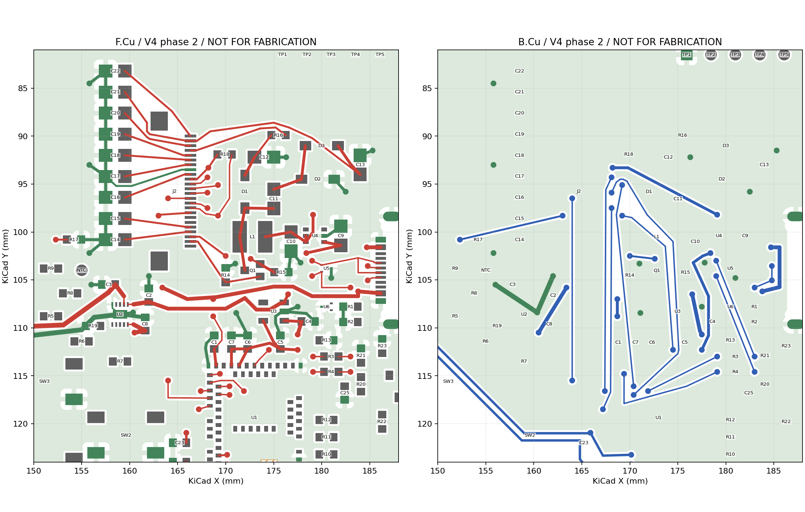
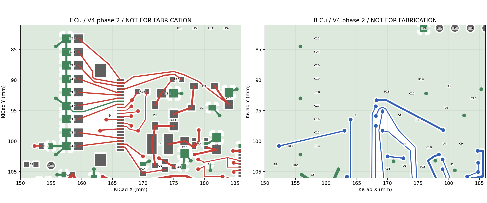

# NFC V4 第二阶段：联合通道、电气输入与本版 DFM

## 当前确定方案

2026-09-29，当前候选为 [v4-phase2 原生工程](kicad/v4-phase2/README.md)。**六根屏幕信号、USB 数据及关键供电、显示完整电源连接已能在同一版共存；参考地和 SWD 入口尚未收敛，未进入整板详细布线。**这不是整板完成报告，也不是制造放行。

第三版 [嘉立创 D](board-review-d.md)及 [V4 第一阶段](kicad-v4-phase1.md)均保留。D 文件指纹及第一阶段 82 个工程／库文件不变；在 `master` 工作，保留开始时已有修改。双层 0.8 mm、板框、U1/J1/J2、按键、电池／调试触点、BLE/NFC 基准和电池采样功能未改。没有换料号、降低间距／孔径、添加忽略项、commit/push、下单、付款、烧录或联系供应商。

| 维度 | 已解决／验证 | 未通过的门槛 |
| --- | --- | --- |
| 连接正确性 | ERC 6→0；66 件、256 器件引脚、U1 61 焊盘一致；原理图／PCB parity 0；所有地焊盘到 U2 EP 的实铜连接成立 | 仍有 49 个未连接项，含 SWD、CC、充电控制、按键和 ADC 控制，不是完整电路板 |
| 布局／回流质量 | 屏幕六线共同可布；U3/C4/C5 供回电及 U1 三组去耦实际连接；显示导通、关断、充电泵及输出电容已连接；courtyard、starved thermal、异网间距问题均 0 | SCK 对面地仍有 5.120 mm 连续缺口；USB D− 3.100 mm；SWD 西侧入口与 NFC 匹配区冲突。全网地连通不代表这些返回合格 |
| 制造识别／DFM | **本版** Gerber/BOM/CPL 实际上传，PCB/SMT 检查执行；29 组／66 件匹配，59 圆孔＋4 镀铜槽、258 锡膏开口核对 | USB 焊脚接触比／槽宽／近边铜、U1 板边、阻焊等危险未关闭；不能用旧 D 诊断结论代替本版 |
| 设计输入／实测 | [型号、原厂页码、条件和计算](v4-design-inputs.md)逐项补齐；真实电池的保护板、3.7 V／4.2 V 已记录 | 屏幕峰值、实际电池额定电流、低电量刷新、热、异常 VBUS 与薄壳装配仍没有保证证据 |

## 本轮实际改变与对照

本版 315 段走线、59 个过孔；其中保留的 NFC 74 段／6 孔不变，新增布线为 241 段／53 孔。数量仅描述覆盖范围，不作为质量分数。原生 PCB 保存、关闭、重开、再保存的 SHA 完全相同，见 [重开记录](records/kicad-v4-phase2/reopen.json)。

原理图根页首次 GUI 保存发生文件格式规范化，四张子页未变；随后关闭、重开并再次保存，五张原理图的 SHA 均保持一致。规范化后 ERC 为 0、256 个产品引脚网络仍与冻结迁移表一致，见 [原理图重开记录](records/kicad-v4-phase2/schematic-reopen.json)及 [原生编辑器截图](records/kicad-v4-phase2/schematic-native-reopen.png)。

布局按带规则器件处理：U3/C4/C5 与 U1 C1/C6/C7，依据 TI／Raytac 去耦要求；Q1/R15/L1/D1–D3/C10–C13 与 J2 电源脚，依据同型号 DESPI-E01；USB 串阻／ESD 与跨区信号、地一起考虑。来源及适用范围见 [设计输入](v4-design-inputs.md)和 [DC-001、SW-003、RP-001](../../../docs/pcb-design-rules.md)。没有套用四层平面对规则，也没有以器件排列整齐替代关系检查。

比较过的主要方向：

| 方向 | 实际试验结果 | 采用与代价 |
| --- | --- | --- |
| 屏幕信号集中走原西侧通道，保留既有电源横穿 | 单条能接，组合在 U3/VBUS 附近冲突；未把失败计划写入板 | 淘汰该固定通道分配；旧线允许拆除 |
| U3/去耦、USB 串阻与屏幕混合分配通道，输出电容移至 J2 西侧 | 六根屏幕信号、USB 数据、VBUS、SYS、3V3 同版共存；J2 输出电容列顺序可布，装配边界不再重叠 | 当前诊断候选；部分原本很近的显示电容连接变长，USB MCU 侧串阻支路也变长；参考地仍未达标 |
| SWD 再走西侧空白入口，保留上述六线 | `swd-service-spec-plan.json` 的 U1 入口孔与 C23/C24／NFC 铜发生冲突 | **失败、未应用**；不能凭画面空白断言通道可用，更不能删除匹配电容或缩孔接通 |

中间 `*-spec-plan.json` 包含失败结果和被替代方案，**不是顺序重放清单**；最终原生 PCB 和下面的检查记录才是当前版本。失败计划被应用器拒绝。

## 供电、USB 与六线共存

U3=(175,108.3,90°)，C4=(178.6,109.35,0°)，C5=(175.7,111.5,90°)；C1/C7/C6 在 y=111.5 一行，分别服务 U1.32 VBUS、U1.30 VDD、U1.28 VDDH。USB R3/R4 移到 MCU 北侧右方，与 U5/J1 扇出共同布线。局部坐标均为 KiCad mm。

六信号均 0.15 mm 宽，试布按不小于 0.20 mm 异网净距规划；新增过孔统一 0.60/0.30 mm，没有缩孔或降低规则。6 条线理想紧排至少需 `6×0.15+5×0.20=1.90 mm` 铜带；6 个同时并列的换层孔至少 `6×0.60+5×0.20=4.60 mm`。这两个数不含参考地和与其它网络的边界，不能当作完整通道所需宽度。实际采用错列端点，并非把所有孔塞进 1.90 mm 线带。

| 网络／端点 | MCU 侧过孔 mm | J2 侧过孔 mm | 实际图层／长 mm／串行换层 |
| --- | --- | --- | --- |
| SCK U1.36→J2.13 | (170.4,116.1) | (169.2,95.1) | F→B→F，25.212／2 |
| MOSI U1.37→J2.14 | (167.4,116.6) | (168.1,94.3) | F→B→F，25.386／2 |
| CS U1.38→J2.12 | (170.4,117.0) | (168.1,95.9) | F→B→F，31.380／2 |
| DC U1.39→J2.11 | (164.0,115.5) | (164.0,96.49) | F→B→F，27.486／2 |
| RESET U1.41→J2.10 | (167.2,118.5) | (168.1,97.5) | F→B→F，24.265／2 |
| BUSY U1.24→J2.9 | (174.5,112.3) | (169.2,98.3) | F→B→F，21.758／2 |

DC 西移至 x=164，与 VBUS 充电支路的底层跨越一起调整；MOSI/RESET 使用 MCU 西北端点，CS/BUSY 分配到稍东侧以容纳短 RESE 桥。都在同一局部区域，没有把相邻信号分别绕到整板两边。R18 是 BUSY 上拉，移至 J2 东侧后移除了约 13.359 mm BUSY 支线、16.879 mm EPD_VDD 底层支线及一个孔。相关六线都有完整端点实铜路径；其余控制／供电支路仍见未连接清单。

VBUS 主干使用 0.30–0.45 mm，USB 小焊盘局部有 0.15 mm 逃逸；3V3 已布部分 0.30 mm。线宽范围见 [实际通道提取](records/kicad-v4-phase2/local-corridors.json)，没有用这组宽度宣称任意负载或温升已经合格。

## 显示完整回路与装配处理

Q1 才是升压开关，U4 为屏幕负载开关。Q1/R15/L1、C10、D1/C12 和 C11/D2/D3/C13 整组调向／移动；没有只挪 Q1。

- **导通环**：C10.1→L1.1，L1.2→Q1.3，Q1.2→R15.1，R15.2→C10.2，全部顶层；外部铜中心线总长 10.150 mm、0 次换层。该总长不含器件内部电流路径，不是 EMI 测量。
- **关断正压**：L1.2→D1.2 3.046 mm，D1.1→C12.1 2.147 mm，均顶层；C12 地与 C10 地通过真实填铜／缝合孔相连，再经 R16 到 J2.21。
- **负压泵**：SW→C11.1、C11.2→D2.2→D3.1、D3.2→C13.1 分别 3.000、3.084、3.523、3.789 mm，均顶层；D2.1、C13.2 回本地地，VGL 至 J2.23。
- **GDR／RESE**：GDR 经 R14／Q1 栅极 9.575 mm、0 次；RESE 从 Q1.2/R15 上端取样到 J2.3，8.094 mm、2 次。短底层桥避开 GDR／功率器件，同时重新分配 CS/BUSY，未留下短距离连续补孔。
- **C14–C22**：按 J2 引脚关系排列在 x=158.5，信号焊盘朝右；九个输出电容全连接，地在左列到两面地铜，均在保留的 NFC 禁铜边界外、J2 courtyard 外。J2.17 为显示地端点。

输出电容远端至 J2 路径 6.843–9.681 mm。相较 D，部分原本约 2 mm 的 C14/C15/C17/C18 变长；换来了电容列与信号／回流通道可共存，其代价不能略去。

Courtyard 没有删除。按实际器件包络与原厂图分开排列电容、Q1/R15 和相邻小件；最终原生 courtyard 重叠为 0。R1 局部地返回消除了热辐条不足，R14 新地岛用局部地连接消除；不把连接 U2 EP 的整网 GND 删除，也没有把 U3 错当成带 EP 的封装。

## 实际路径对比与剩余瓶颈

单位为 **mm／串行换层次数**。从保存的铜中心线和焊盘中心接触计算，未把直线距离当作实际线长；地面路径不计入走线长度。`—` 表示没有可量的显式铜线路径，可能尚未布线，也可能经铺铜相连，需结合旁列。完整 53 对结果见 [path-comparison.json](records/kicad-v4-phase2/path-comparison.json)。

| 命名路径 | D | 第一阶段 | 本版 | 取舍 |
| --- | --- | --- | --- | --- |
| C8.1→U2.10 | 2.356／0 | 1.965／0 | 1.965／0 | 保留局部输入关系 |
| C8.2→U2 EP | — | 2.617／0 | 2.617／0 | 显式局部返回；D 依赖铺铜 |
| C3.1→BP | 38.241／8 | 17.917／0 | 17.917／0 | 未以缩短输入为代价拉长电池支路 |
| J1 VBUS→C8 | 36.443／2 | 29.509／2 | 30.505／2 | 为 DC 通道增加 0.996 mm，仍短于 D |
| C4供电／地至U3 | 1.776／0、— | 1.777／0、— | 1.803／0、3.547／0 | 地建立显式局部路径 |
| C5供电／地至U3 | 1.774／0、— | 3.653／0、— | 3.494／0、3.131／0 | 输出支路仍长于 D，不能只报地改善 |
| C1→U1.32 | 1.276／0 | — | 1.746／0 | 去耦仍近；容量与入口保护尚未闭合 |
| C7→U1.30、C6→U1.28 | 2.120／0、1.945／0 | — | 1.734／0、1.953／0 | 分别服务明确供电脚 |
| 导通环外部导体合计 | 16.234／2 | 9.425／0 | 10.150／0 | 完整显示组需要的代价较第一阶段略增 |
| GDR | 24.725／0 | 10.854／0 | 9.575／0 | 缩短 |
| RESE | 22.949／2 | 13.280／2 | 8.094／2 | 缩短，保持取样端点 |
| SCK | 39.495／4 | — | 25.212／2 | 已共存，返回未通过 |
| MOSI | 33.172／4 | 26.185／2 | 25.386／2 | 已共存，对面地缺口缩短 |
| CS／DC | 33.219／4、35.949／4 | — | 31.380／2、27.486／2 | 同版共存 |
| RESET／BUSY | 33.819／6、32.131／6 | — | 24.265／2、21.758／2 | 同版共存 |
| SWDIO／SWDCLK | 69.172／7、79.747／7 | 45.941／1、46.127／1 | — | 为联合规划拆除；未解决，不能把第一阶段路径继续算作已完成 |
| U1.35→R3.2、U1.34→R4.2 | 1.999／0、2.259／0 | — | 13.225／2、15.583／2 | 明显变长，换来了 MCU 去耦区与显示入口空间；需下一组重排检验 |
| U5→R3.1、U5→R4.1 | 30.741／2、27.552／2 | — | 13.113／2、13.113／2 | ESD 至串阻段变短，不抵消上行段返回不足 |
| J1 A6→U5、A7→U5 | 10.015／0、8.668／2 | — | 7.772／0、9.486／2 | USB 扇出实际覆盖；D−交叉保留两次换层 |

**回流检查：**当前所有地焊盘与 U2 EP 在同一实铜分量，游离地铜分量 0。在显示局部窗口 x=155.8–185.5、y=82–105.8 内，C12、D2、C13、R15、J2.17 和 C14–C22 的地都能到 C10 地，不需要靠绕完整板证明连通。窗口腐蚀探针结果保留于 [final/audit.json](records/kicad-v4-phase2/final/audit.json)；这是对铜宽的敏感性诊断，热辐条在其半宽处会消失，不等同于阻抗、热或 EMC 保证。

显示局部回流在腐蚀半径 0.075 mm 时仍全部连接，0.095 mm 时 C12／D2／C13／输出电容到 C10 的路径断开，只有 R15 仍连接。该敏感性提示返回仍受窄连接／热辐条约束，不能将“补齐关断回路”写成已保证承受开关峰值；需随实测峰值、铜宽及焊接热要求继续核查。

MOSI 底层最长对面地缺口由本轮组合初稿的 9.634 降至 1.898 mm；但 SCK 仍有 **5.120 mm**，大致位于 (170.4,116.1) 至 (169.888,111.005)，跨 MCU 北侧去耦／USB 逃逸区。USB_DM_MCU 在 x≈169.4、y≈114.8–117.9 仍有 **3.100 mm** 缺口；DC 为 4.050 mm，CS 为 3.054 mm。仅增加总地孔数不能消除这些投影缺口。同层地是否能构成短返回、换层点附近是否有合适缝合，仍须随下一组器件安排验证。

**下一组应比较两种有明确差异的局部方案，不能继续在现有缝隙逐条补孔：**

1. **MCU 西北入口重分配**：共同释放 x=167–173、y=109–124 的 SCK/MOSI/CS/RESET、USB MCU 段与未完成 SWD 端点；保留 U1、C23/C24 及 NFC 铜。先给 SWD 两线与 SCK 分配带连续参考地的纵向通道，再联动 R3/R4、U3/C4/C5 及 C1/C6/C7 的朝向。需接受部分当前六线拆改，不能锁死已布铜。
2. **USB 串阻回靠 U1 USB 脚、LDO 组向东北转向**：在不移动连接器／天线基准的情况下减少现在 13–16 mm 的 MCU 到串阻路径，释放西北入口供 SWD／SCK；代价是 U3 输出到 MCU、U5 到串阻的路径可能增加，以及右侧 ADC 组装空间收紧。必须同时验证全部六线、USB、SWD 和地，不以单条成功选定。

这两种是后续局部实验方向，**尚未实际通过**。本轮否定的是具体通道分配，不是证明双层或固定板框无解。也没有证据支持现在删电池采样。

## 原理图、检查与未连接项

ERC 剩余问题来自外部供电／驱动缺少建模。根页加入仅存在于原理图的 USB 电源 `XUSB1` 与 SWD 探头 `XDBG1`；USB VBUS/GND 为外部电源输出，SWD VTREF 是输入，SWDIO 双向、SWDCLK 输出、RESET 开漏。它们不进入 BOM/PCB，不在任意网络放 PWR_FLAG；模型仅表明真实连接拓扑，不保证外部供电电压或允许同时反向供电。[建模记录](records/kicad-v4-phase2/erc-external-model.json)和[根页图](records/kicad-v4-phase2/schematic-root.png)。

最终 [原生 DRC](records/kicad-v4-phase2/final-drc.json)为 **41 条违规、49 个未连接、parity 0**：[ERC](records/kicad-v4-phase2/final-erc.json)为 **0**。其中铜到板边 14（既定 USB 几何），NFC 孔环 2／孔径 2（保留基线），丝印相交 13／压铜 3／文字高度 7。异网铜间距、courtyard 重叠、starved thermal、dangling、封装库差异均 0；未修改规则或新增豁免。

49 项是 KiCad 的 airwire 项数，并非 49 个独立网络。分列于 [remaining-connections.json](records/kicad-v4-phase2/remaining-connections.json)：3V3 9；ADC sense 3、div supply 1、gate 2、enable 2；BAT/NTC 各 2；充电 SDA/SCL/PG/CE/INT 各 2；EPD_EN 2；CC1/CC2 各 2；三键各 3；SWDIO/SWDCLK/NRESET 各 1。保留这些缺线，未伪装为完整板。

## 制造与真实待测

[本版 PCB／SMT DFM 记录](records/kicad-v4-phase2/dfm-final/README.md)包括实传文件、字段转换、同版指纹、分类、四关键器件图形与未完成区告警。已跑通“导出→上传→检查→读报告→回原工程处理”的链路；整板以后完成仍须重新导出与重新检查。

主动查清的器件电压、电流、压差、启动条件、外围、热与布局来源在 [设计输入核查](v4-design-inputs.md)。结论包括：U3 全轨 200 mA，不能把任意屏幕情景电流当峰值上界；当前 USB ESD 不覆盖 VBUS；C3 偏压后余量很小，已有同高度同封装的 4.7 µF 替换比较；C1 2.2 µF 偏离 Raytac 10 µF 参考，需要与 USB 入口冲击／保护共同决定。[eFuse 独立封装与九件占位比较](kicad/v4-protection-option/README.md)尚未闭合阈值余量／瞬态，不建议直接采用。

仅实际电池完整型号与额定电流、屏幕最大负载／电感峰值、封壳热、USB/FPC 实物和工艺公差仍依赖供应商或测量。电池已经确认的带保护板、3.7 V、最高充电 4.2 V 不再重复询问；宣传图不提供电流保证。维持禁止启用充电的验证边界，不影响独立布局／文件检查。

本轮停在**有明确剩余障碍的局部候选**。在 SCK/USB 返回与 SWD 共存得到实证、受影响供电输入形成可采用方案之前，不把更多整板走线固化在此布局上。
