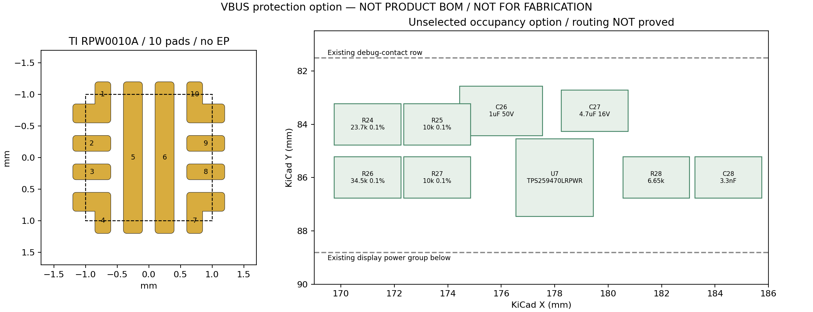

# V4 VBUS 保护备选

## 当前确定方案

这是未采用的电路与占位比较，**不是制造工程，也未改第四版 BOM**。原厂依据为 [TPS25947 Rev.C](https://www.ti.com/lit/ds/symlink/tps25947.pdf) pp.5–11、26–30、60–63 及 PDF p.73 的 RPW0010A 焊盘图。输入核查和排除的器件见 [设计输入](../../v4-design-inputs.md)。

选作比较的器件是 `TPS259470LRPWR`，2×2 mm、最高 1 mm，10 个功能焊盘，**没有地 EP**。独立 [KiCad 封装](V4_Protection.pretty/TI_RPW0010A_option.kicad_mod) 已通过 KiCad 原生 SVG 导出；保留原厂复合拐角焊盘和 0.20 mm 名义最小盘距，不能用其它 RPU 封装代替。0.05 mm 阻焊扩展、整焊盘锡膏及 0.25 mm courtyard 余量是候选设置，尚未通过该器件 SMT DFM。

## 具体连接与预算

| 引脚／外围 | 备选连接 | 计算及边界 |
| --- | --- | --- |
| IN 5、OUT 6 | J1 原始 VBUS → IN；OUT → **U1 与 U2 的共同受保护 VBUS** | 原始 VBUS 须单独命名，不允许保留直达 U1 的旁路。输入 1 µF/50 V 可复用 `CL21B105KBFNNNE`；输出 4.7 µF/16 V 可复用 `CL10A475KO8NNNC`。现有 C8 和候选 C1 仍在各负载旁。 |
| EN/UVLO 1 | 23.7 kΩ/10 kΩ 分压 | 按各 0.1%、阈值 1.183–1.223 V、±0.1 µA 漏电角点，静态开启约 **3.979–4.130 V**。这不是 USB 合法取电检测。 |
| OVLO 2 | 34.5 kΩ/10 kΩ 分压 | 同样角点约 **5.253–5.454 V**，上界低于 U1 的推荐 5.5 V。但标准 5.25 V 输入与最低切断点只差约 3 mV，尚未包含电阻温漂／噪声；此窗口很窄，不能直接定型。 |
| ILM 9 | 6.65 kΩ 到地 | 手册该档 0.425–0.575 A；额外电阻误差未包含。不能限制到 USB 枚举前允许取电，也不能代替 U2 的输入限流。 |
| DVDT 7 | 3.3 nF 到地 | 公式给出约 0.606 V/ms、5 V 爬升约 8.25 ms，均为条件估算。仅 C1=10、C8=4.7、新增输出4.7 µF 的标称总量就有19.4 µF；+10%时按该典型斜率约12.9 mA，另加 U1/U2 启动负载，**不是冲击电流上界**。 |
| GND 8 | 局部接地铜及近旁缝合孔 | 分压下端、ILM、DVDT 返回按 TI p.63 靠近地脚，输入/输出回路不经过分压地细线。 |
| AUXOFF 3、FLT 4、ITIMER 10 | AUXOFF、FLT 为未使用开漏输出；ITIMER 留空 | ITIMER 留空是手册明确允许的最快过流响应。未使用开漏输出不需要虚构接收端。 |

保护边界仍未闭合：OVLO 响应 **1.2 µs 仅典型**，快速故障／插拔电感可在断开前使 U1 超过 5.8 V；p.27 明确 OVLO 恢复时绕过 DVDT 斜率控制，不能把首次上电限斜率套到恢复情景。额外 TVS／缓冲需依据实际输入波形和完整钳位曲线设计。未把某个“5 V TVS”的额定工作电压当作最大钳位电压。

## 占位与代价

九个新增件（1 IC、5 电阻、3 电容）的初步 courtyard 包络占用约 X=169.75–185.75、Y=82.575–87.45 mm。图中无器件包络重叠；该位置在调试触点与显示电源组之间。此图只证明占位尺度，不证明新增供回电可布。J1 位于 Y≈104 mm，原始 VBUS 要上行约 18 mm 再返回负载，远离连接器的保护芯片对瞬态不利；若采纳保护方向，应把入口、U5/U6、U3 和 USB/显示跨区通道一起重排，不能锁定这个上方占位。

与直连比较：增加故障断开、斜率控制与反向阻断能力，但多九件、输入路径更复杂，并且快故障峰值及窄静态阈值窗口尚无保证。相比 TPD1S514-1 的已知过高 OVP 阈值，这个方向可继续推导；**目前不足以请求采用整套保护方案**。新增分压器／定时件的具体供应料号、温漂和贴装库仍须在拓扑通过后选定。

电容的独立最小变更是 C3 改用已有 C8 的 4.7 µF 同封装料号；C4 可选同换，C1 的 10 µF 则必须与上电冲击处理联动。各项都保留为候选，未默默变更料号。

复现：`python3 projects/nfc-business-card/scripts/prepare-v4-protection-option.py`。原始计算和封装指纹见 [option.json](option.json)。
