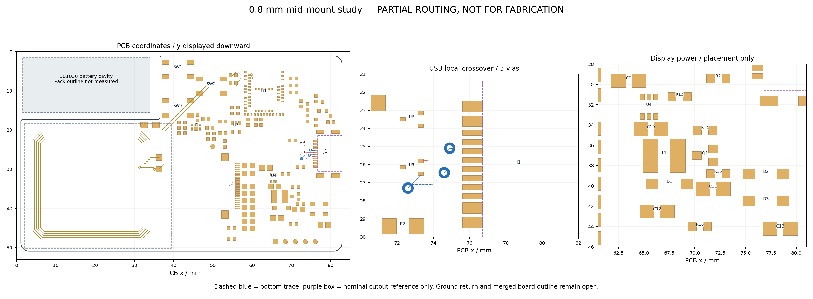

# 0.8 mm 中沉重设计：Placement A 局部候选

## 当前确定方案

2026-09-28，已从 R21 建立独立原生工程 [NFC-Card-R2-Midmount-Placement-A.eprj2](../../../eda/NFC-Card-R2-Midmount-Placement-A.eprj2)，并完成 USB／显示电源第一轮实际试摆及 USB 数据脚局部交叉试布。**这是未接完的研究候选，不是已通过 DRC/DFM 的制造版。**R21 原件保留，减薄目标仍为 0.8 mm 中沉＋标准型 SMT／4.8 mm 外壳。

本轮移动或旋转 19 个器件。U1 与命名去耦、充电／稳压主簇、J2、三键、NFC 74 段铜及 6 个过孔、电池焊点和背面调试焊点保留作第一轮对照，尚未表示这些区域已最终定型。USB4500-03-0-A / C5354966 是试验料号；工厂认可条件仍见[共同基准报告](usb4500-datum-review-2026-09-28.md)。



图由保存重开后的实际焊盘／铜线生成；按规划惯例把 PCB y 向下显示，**不是装配朝向图或原生客户端截图**。虚线蓝色为底层数据线，紫框仅是名义缺口参考。完整数值见[审查 JSON](records/midmount-placement-a-review.json)，图源与检查见[脚本](../scripts/review-midmount-placement-a.py)。

后续[USB Spaced B](usb-spaced-b.md)按用户要求扩大扇出并继续信号布线；本文件和 A 原生工程保留作本轮对照。

## 本轮已完成及验证边界

| 项目 | 结果 | 边界 |
| --- | --- | --- |
| 电气同步 | 原理图／PCB 66 位号、256 引脚逐脚一致；BOM 29 组覆盖同一位号集合 | 只证明赋网和器件清单一致，不证明铜已连通 |
| J1 | 从库重新取得 USB4500；原理图屏蔽脚由 8–11 改为 17–20，仍接 GND；数据、CC、VBUS、SBU 网络保留 | 未照搬 R14 偏移焊盘或 R17 缺口；库封装及导入的 3D 关联仍需下述处理 |
| 重新布线起点 | 删除 867 段普通走线、159 个普通过孔及 2 块覆铜；保留 NFC 几何 | 当前 98 段铜、9 个过孔，其中仅新增 USB 数据局部 24 段、3 孔；不能拿总孔数与完整 R21 比“优化率” |
| 普通规则 | 铜间距 0.20 mm；过孔最小／默认外径 0.60 mm、钻孔 0.30 mm；普通默认线宽 0.20 mm、最小 0.15 mm | 留余量目标，非工厂批准；细间距、同网孔壁、阻焊另审。原有 0.30 mm 板边规则未降低 |
| 规则负对照 | 原生 DRC 捕获故意放入的 0.15 mm 异网间距和 0.55 mm 外径过孔，随后移除 | [校准证据](records/midmount-placement-a-rule-calibration.json)；源文件读回成功本身不足以证明规则生效 |
| USB 局部铜 | J1.A6/B6 与 U5.1 连通；J1.A7/B7 与 U5.2 连通；D+ 全顶层，D− 3 个 0.30/0.60 mm 过孔；新铜最小异网净距约 0.224 mm | 仅从触点汇合到 U5 信号焊盘。U5 是并联 TVS，地回流、串阻／MCU 出口、CC 与 VBUS 尚未完成，不能声称整套保护或 USB 通道已通过 |
| 独立铜审计 | 没有悬空铜岛、明线死端、仅单面接铜的过孔或新增屏幕区异网铜；NFC 几何与 R21 一致 | 整板仍有 51 个未布完／分裂网络，完整连通性不通过 |
| 机械参考 | 新增屏幕量规、301030 对应空腔量规、Ø6.8 mm 键帽参考及 USB 名义缺口框；清理过期 E20D／58 器件和右侧 NFC 占位文字 | FPC 折弯、插头插入、公差剖面、拼板／工艺边未闭合；P1 不能勾完成 |

资料：[同版原理图网表](records/midmount-placement-a-schematic.enet)、[PCB 引脚表](records/midmount-placement-a-pcb-pins.json)、[BOM](records/midmount-placement-a-bom.tsv)、[快照](records/midmount-placement-a-snapshot.json)、[原生规则](records/midmount-placement-a-rules.json)。

最终保存并退出客户端后，[文件完整性记录](records/midmount-placement-a-file-check.json)确认候选与 R21 的只读 SQLite `quick_check` 均为 `ok`，R21 SHA-256 未改变。`check-netlist-consistency.py` 与本候选独立检查通过各自的局部检查范围；文档本地链接及 `git diff --check` 通过。

## 显示电源的敏感件证据与取舍

依据继续使用 [TI TPS22919 §11](https://www.ti.com/lit/ds/symlink/tps22919.pdf)的输入／输出电容局部性及[七区表](r1-seven-zone-reference-plan.md)引用的 Good Display 电路关系。以下为**导出焊盘中心的直线距离或摆位代理，不是布线长度／实测**；`DC-001/DC-003`、`SW-002/SW-003` 的最终路径和闭合回路证据要在布铜后补齐。

| 命名对象 | R21 | Placement A | 判断 |
| --- | ---: | ---: | --- |
| C9.1 → U4.1 VIN | 1.553 mm | 1.685 mm | 增加约 0.133 mm，为输出侧和后续走线留位置；需与回流一起复核 |
| C10.1 → U4.5 VOUT | 2.203 mm | 1.734 mm | 输出电容更靠近服务引脚 |
| C10.1 → U4.6 VOUT | 2.850 mm | 2.232 mm | 同上，不只挑较近的那只并联脚报告 |
| C12.1 → D1.1 | 3.080 mm | 2.746 mm | 显示正电源输出支路更紧凑 |
| C13.1 → D3.2 | 5.047 mm | 2.997 mm | 负电源输出电容更靠近整流节点 |
| R15.1 → Q1.2 | 2.443 mm | 1.178 mm | 电流检测连接更短；最终需 Kelvin／地回流审查 |
| L1.2 与 Q1.3 铜间隙 | 0.171 mm | 0.672 mm | 按现有每侧 0.051 mm 阻焊扩展估计，阻焊桥约 0.069→0.570 mm；尚非最终 Gerber 验证 |
| C10.1／L1.1／Q1.3 三点面积代理 | 5.638 mm² | 5.890 mm² | 增大约 4.5%，换取 L1/Q1 焊接间距；不冒称开关实际热回路已经缩小 |

Q3 小幅移开后，旧 Q2.1/Q3.3 同网焊盘相碰的问题不再由实体铜重叠维持连接；该栅极网络仍需正常布线。电池 ADC 高阻节点和 C25 保持原位置，未以走线方便改变电气拓扑。

## 保存重开后的原生 DRC

[记录](records/midmount-placement-a-drc.json)共 **234 项**：218 项连接错误（205 贴片焊盘、8 测试点、4 插件焊盘、1 过孔）、12 项 USB 库封装内部板边到焊盘错误、4 项 NFC 引线过孔尺寸错误。**普通异网几何间距错误为 0，不等于整板 DRC 通过。**连接项是未完成布线的明确状态，不设置忽略。

四个 NFC 引线过孔仍是历史 0.508 mm 外径，在新的 0.60 mm 目标下被正确检出；本轮为保留天线对照没有改它们。下一轮需评估扩大或重新引出对间距／回流的影响，不通过降低新规则消除计数。

J1 库封装自身带 `e62` 板框折线，推荐宽度名义约 9.24 mm；它与保留的 R21 直外边尚未合成唯一闭合成品轮廓。12 个 SMT 焊盘到库内后缘近零距离的问题仍然存在。**紫色参考框不是已批准的锣槽；不得从本工程直接制造。**槽角、铜到边、实际外形公差及 CPL 基准由工厂按[具体问题](usb4500-datum-review-2026-09-28.md#对下一轮方法的影响)确认后处理。旧 USB4110 顶层禁铺铜参考区也需与新缺口一起重新推导。导入的 J1 3D 模型关联返回无效值，尚未做新整机碰撞验证。

## 下一步顺序

1. 完成 USB 并联保护地／回流、CC 下拉与 VBUS 两路供电，以及串阻到 U1 的出口。VBUS 保护选型同时覆盖 U1.32 和 U2.10；完成后再评价 USB 完整通道，不以本次 3 孔局部结果提前定型。
2. 继续显示电源局部布铜，验证命名电容路径、检测回路和正负电源开关回路；按实铜而非三点面积决定是否接受当前摆位。
3. 同时补齐 P1/P3：实物电池完整包络／额定电流、屏幕峰值、FPC 折弯、薄壳公差以及工艺边／拼板。301030 的“110 毫安”仍暂按 110 mAh 容量理解，不能据此配置充电电流。
4. 用户与工厂闭合 USB4500 近边焊盘、公差及装配条件后，统一板框／封装／CAD，再评审进入整板详细布线。原生规则与独立几何检查继续保留。

## 复现与工具注意

```sh
node projects/nfc-business-card/scripts/eda-exec-wait.mjs \
  projects/nfc-business-card/scripts/eda-export-midmount-candidate.js 30000 \
  > projects/nfc-business-card/artifacts/restart-r22/final-capture.json
python3 projects/nfc-business-card/scripts/review-midmount-placement-a.py \
  --capture projects/nfc-business-card/artifacts/restart-r22/final-capture.json
python3 projects/nfc-business-card/scripts/check-netlist-consistency.py \
  --sch projects/nfc-business-card/hardware/records/midmount-placement-a-schematic.enet \
  --pcb projects/nfc-business-card/hardware/records/midmount-placement-a-pcb-pins.json
git diff --check
```

导出器明确允许 Placement A 与 USB Spaced B 的项目 UUID，并核对工程名称与继承 PCB 页 UUID；对应审查脚本仍要求同一候选的输入。核对保存工程时需区分文件存储 UUID 和客户端按路径派生的运行时 UUID。

本机 3.2.203：`overwriteCurrentRuleConfiguration()` 返回空且未写入；`setDocumentSource()` 对规则的临时读回成功，但保存重开后回退。最终通过原生“设计规则”对话框应用，并以违规负对照和重开后读回验证。`importChanges()` 返回 true 只打开变更确认框，必须应用修改后再查封装和网表。原理图 `createNetLabel()` 曾超时；改为带网络名的短导线，导出网表核实全部 14 个接网脚。不得把这些接口的返回成功直接写成设计通过。
