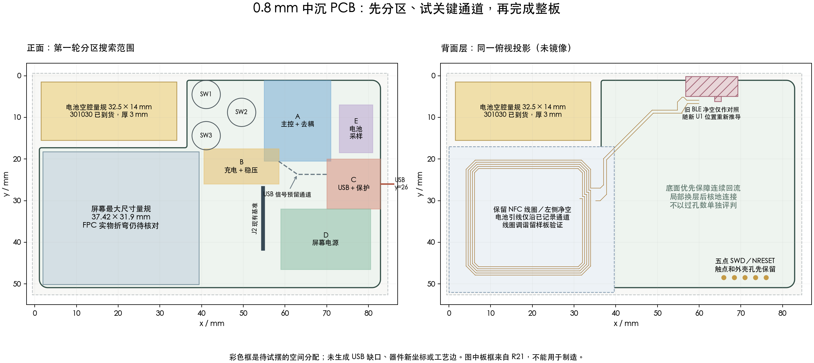

# 中沉 PCB 重设计：第一轮空间与执行方案

## 当前确定方案

2026-09-28，用户确认“先规划，然后设计 PCB”。可以开始独立候选和布局试验。沿用 **0.8 mm、2 层、1 oz、绿色阻焊、中沉 USB-C、标准型 SMT**；保持成品外形和电池、屏幕、NFC 的总体安排，以 4.8 mm 外壳为目标，电池由用户适配。

**本文件是首轮分区规划与电源敏感性计算的输入记录，P0–P3 尚未全部闭合。**后续已建立 [Placement A 原生局部候选](midmount-placement-a.md)，完成同版网表、部分实摆、规则负对照和 USB 数据试布；实际结果以该记录为准。下图彩色框仍表示搜索范围，不是已验收摆件图。机械公差剖面和实际电源负载预算仍待完成。

USB4500-03-0-A / C5354966 暂作机械及扇出试验候选，不等于已选定生产料号。HRO M-13 的缺口尺寸仍不完整，不作为直接替代。供应商若不接受 USB4500 的板边关系，先寻找能满足明确工艺条件的中沉器件；USB4110 保留为备选，不自动改变减薄方向。

**电池输入已更新：**用户本轮确认 **301030 已到手，厚 3 mm，“110 毫安”**。容量暂按 110 mAh 理解，待标签确认单位；这不是允许 110 mA 充电或放电的声明。完整保护板、封边和引线包络及额定充放电电流尚未给出，不把型号数字推成已量测的长宽。厚度相对 3.2 mm 内腔仅余名义 0.2 mm，仍需分配固定材料与膨胀余量。

## 已建立的输入基线

[生成脚本](../scripts/plan-pcb-restart.py)只读 R21 和旧薄壳记录，输出[指纹、坐标和计算值](records/pcb-restart-plan-2026-09-28.json)。本轮复核原生工程、快照、BOM 与制造记录的 SHA-256，PCB 引脚表与 U1 官方叠图记录的 SHA-256；BOM、快照、引脚表的位号集合一致。SQLite `quick_check=ok`。

| 项目 | 本轮读到的数值／身份 | 适用边界 |
| --- | --- | --- |
| R21 原生项目 UUID | `31100f9979703fec0d44544145de78024fe2d8492f50c378743dd57288888143` | 与旧快照导出器硬编码项目不同；不能凭相同 PCB 页 UUID 认定项目正确 |
| PCB 页 UUID | `8033127c48771f3b` | 是历史继承页，不是新候选唯一身份 |
| R21 输入计数 | 66 器件、256 个器件引脚、29 组 BOM、165 过孔 | 是文件计数，不是本轮重新导出的原理图网表或 DRC 结果 |
| PCB 外包络 | x=1.100–82.900，y=1.100–50.900 mm；81.8×49.8 mm | L 形板，不能按外包络矩形当可用面积；R21 右侧直板边仅作对照 |
| 右侧电子区包络 | x=39.62–82.90，宽 43.28 mm | 未扣器件、FPC、机构、装配和供回电通道，不宣称空间充足 |
| 原生工具状态 | 桥接按需停止，未检查客户端未保存状态 | 没有修改或另存 EDA；实际建候选前先检查打开工程、保存状态和候选输出路径 |

创建原生候选时，仍须从正确项目导出同版原理图网表与 PCB 引脚表，核对新 J1 的引脚号、网络和 BOM。不能把本轮文件指纹检查替代这一步。

## 空间规划



采用现有 PCB 的 mm 坐标系。两幅图均为从正面向下看的投影，右图只显示背面层，**没有做背面翻转**。板框来自 R21，图上没有生成中沉缺口；旧 BLE 净空和 NFC 引线是历史对照，随 U1 新位置重新推导。

### 先保留的机械基准

| 对象 | 基准 | 后续核对 |
| --- | --- | --- |
| 电池空腔量规 | x/y=1.5/1.5，32.5×14×3.2 mm | 不含胶、引线、膨胀分配；用户适配电池，不用旧电池厚度强制增厚 |
| 屏幕最大尺寸量规 | x/y=1.95/18.25，37.42×31.9 mm | 来自旧薄壳脚本；实际面板及 FPC 插入、弯折和装配路径尚未量测 |
| 屏幕／NFC 区域边界 | x<39.62、y≥17 mm 的既有净空 | 保留线圈及已记录电池引线例外；不能从图中空白推断允许新增铜或器件 |
| 三键中心 | SW1=(41.1,4.5)，SW2=(49.6,8.8)，SW3=(41.1,14.4) mm | 图中圆为 Ø6.8 mm 键帽挡边投影，非 PCB 封装；按压扫掠另核 |
| J2 | 现有参考点 (54.7,34.26) mm | 第一轮保留方向与大位置；图上粗线仅表示焊盘中心纵向范围，非完整本体／courtyard；最终以实物 FPC 和 XUNPU 图核对 |
| USB 开口 | 右侧，轴线 y=26 mm | 纵深以安装槽共同基准推导，不用 CPL `Mid X` 定缺口；具体壳口、插头空间与容差需剖面 |
| 五点调试 | y≈48.499，x≈65.921–76.081 mm，间距 2.54 mm | 保留背面触点与壳孔；探针可达及实际夹具待试 |

板厚与外壳剖面需分开处理：0.8 mm 是板厚名义值，国内公开公差为 ±0.1 mm；3.16 mm 是 USB4500 的名义连接器高度。旧 4.8 mm 薄壳的 0.12 mm 安装层、USB 局部约 3.39 mm 内腔只是旧 CAD 假设，不能将这些名义值相加就保证新板装配。下一张剖面要包含板厚、焊接定位、壳体制造和安装层的实际公差。来源见[国内工艺复核](jlc-mid-mount-process-review-2026-09-28.md)和[旧薄壳](../enclosure/r1-usb-fit-4.8/README.md)。

### 第一轮试摆分配

以下尺寸是**本次规划分配值，不是原厂要求或已验收的器件坐标**。A/B 交界存在共享搜索范围；试摆后必须消除实体冲突，不能重复计算面积。

| 区 | 搜索范围 x/y（mm） | 成组处理 | 首要判断 |
| --- | --- | --- | --- |
| A 主控与去耦 | x=55–71，y=1.1–20.5 | U1、C1/C6/C7、R3/R4；NFC 匹配与引线另核 | U1 面向上边的天线净空、装配工艺边、供电脚去耦和 USB 引出同时成立；不单移模块 0.5 mm 挤压电容 |
| B 充电与稳压 | x=40.5–58.5，y=17.5–26 | U2+C8/C2/C3、U3+C4/C5、R5–R9/R19 | 两个电源簇分别保持局部回路；与电池焊点、USB 输入及主控电源通道相接 |
| C USB 与保护 | x=70–82.9，y=20–32 | J1、U5/U6、R1/R2；VBUS 保护方案 | 先双向数据触点合并，再保护分支和地回流；留向 A 的信号通道及向 B 的供电路径 |
| D 显示外围 | x=59–80.5，y=32–46.5 | U4+C9/C10、L1/Q1/R15/D1–D3/C11–C13、J2 旁电容 | 开关回路按命名节点重排；电容不按等距美观排成长列；先解决 L1/Q1 同网阻焊问题 |
| E 电池采样 | x=73–81，y=7–18.5 | Q2/Q3、R20–R23、C25 | 可调动以让出关键通道；高阻 ADC 节点局部连接，并避开开关节点 |

优先保持主件正面装配、背面用于线圈、调试点与回流的既有方向。需要两面铜互连时允许换层，但每个过孔都须说明连接目的、两面实际接铜与附近参考地。不能为减少孔数让 USB 保护地绕远，也不预先承诺固定过孔总数。

## 电源与保护：现在能算出的边界

从 R21 引脚表得到的供电链为 `USB_VBUS → U2.IN`，电池接 `U2.BAT`，`U2.SYS → U3 → VDD_3V3`；主控和 `U4 → EPD_VDD` 共用 3.3 V。USB_VBUS 还直接接 U1.32。U5 保护 D+/D−，U6 保护 CC1/CC2，现有保护不能据此推成 VBUS 也受保护。

[TPS7A02 Rev C §6](https://www.ti.com/lit/ds/symlink/tps7a02.pdf)给出 200 mA 输出能力；3.3 V 型号在 200 mA 时最大压差为 270 mV（至 85°C）／310 mV（至 125°C），压差测试以输出降到名义值 95% 为判据。因此 `3.3+0.27=3.57 V` 不能作为本板保持精确 3.3 V 的保证，也不能直接当电池低压停刷阈值；还需计入 U2 电池通路、连线压降及刷新瞬态。

[BQ25186 Rev A §6.3.6、§6.3.8.6](https://www.ti.com/lit/ds/symlink/bq25186.pdf)的默认 SYS 目标为 4.5 V，电池跟踪模式则有 3.8 V 下限。下表只比较 LDO 耗散：`P=(V_SYS−3.3)×I_3V3`，没有假装测得屏幕电流。

| 3.3 V 总负载假设 | SYS=3.8 V 时 LDO 耗散 | SYS=4.5 V 时 LDO 耗散 |
| --- | ---: | ---: |
| 100 mA | 0.050 W | 0.120 W |
| 160 mA | 0.080 W | 0.192 W |
| 200 mA | 0.100 W | 0.240 W |

200 mA／4.5 V 场景，用 DBV 封装资料中的 JEDEC θJA=181.9°C/W 计算温升代理约 43.7°C；本板 2 层铜和薄壳不同，**这不是实板温升预测或通过判据**。调整 SYS 可能转移 U2/U3 之间的耗散，必须同时核总损耗，不能只降低 LDO 发热就宣称整板更凉。

实际预算以 `I_3V3_peak = I_U1 + I_EPD + I_other` 分项闭合。160 mA 可作为留 20% 电流余量的初始工程目标，不是负载上界、芯片保证或已接受的产品指标；屏幕手册的电流仍为 TBD。具体剩余工作如下：

- 取得屏幕冷启动、全刷和无线并发的峰值／持续时间，或有依据的最坏上界；不能拿另一款屏幕电流替代。本轮暂不更换 LDO，也不判定现有 LDO 足够。
- 充电器分别核输入限流、系统负载和实际充电电流。其热估算依原厂公式 `P_U2=(V_IN−V_SYS)I_IN+(V_SYS−V_BAT)I_BAT`；实际电池允许充电／放电规格仍待补。两个 Rd 不赋予 1.5 A／3 A 取电权限。
- VBUS 保护必须同时覆盖 U1.32 和 U2.10：比对工作电压、实际浪涌钳位、负载承受值和保护回流后选件。不能把 U2 自带输入保护当成对外部分支的保护，也不能只按“5 V TVS”标签选料。
- 保留 C14/C15/C19 三颗 4.7 µF、TS 固定电阻和电池采样；有效电容、充电策略、低压刷新门槛以及屏幕时序仍需验证。CE、LFRC、USB 状态限流与屏幕掉电状态继续交接固件。

## 进入 PCB 的具体顺序

1. **建立独立原生候选和同版输入。**先检查当前打开工程及未保存修改，再从 R21 建新文件，登记新项目 UUID 和页身份；导出同候选原理图、BOM、PCB 引脚表。功能保留，J1 更换差异明确列出；旧 R21 不覆盖。
2. **画机械限制层并设置规则。**把上面的量规、FPC／插头／按键运动、两类天线、调试可达与工艺边画成可检查对象。普通区按 0.30/0.60 mm 过孔、0.20 mm 铜距试验，径向孔环名义 0.15 mm；细间距器件、同网孔壁到焊盘、阻焊和铜到板边分别设规则或补充检查。先在可丢弃样例验证规则确实报错，再用于候选。
3. **实际试摆并先布两个难区。**按 A–E 整体放件，给供电和回流留路径；先试 USB 及保护，再试屏幕开关电源。记录对象／孔数、命名电容到服务引脚的实际路径、保护地、开关回路、阻焊和本体间距。普通控制信号随后安排。
4. **在关键区定型前处理外部条件。**USB4500 近零板边焊盘、缺口公差、U1 工艺边及分板交给工厂按具体图确认；电源区根据峰值预算定型。询问 USB 的具体问题已在[共同基准报告](usb4500-datum-review-2026-09-28.md#对下一轮方法的影响)，我准备材料，用户联系。标准型拼板最小尺寸等约束见[国内复核](jlc-mid-mount-process-review-2026-09-28.md)，不能只加两条 5 mm 边就认为满足。
5. **完成整板并保存重验。**通过关键区评审后完成普通信号和覆铜；保存、关闭、重开，检查原生 DRC、逐脚网表、独立铜连通／孤岛、天线、板框、机构、同网近距和阻焊。最后同版 Gerber／BOM／CPL 对账和线上 PCB／SMT DFM；实物调谐、温升及装配留样板。

电池型号与到货已明确；尚缺的额定充放电规格、屏幕峰值和工厂答复不阻止建立候选、机械限制层和明确标注的局部试验，但会阻止相关区域最终定型及制造放行。不得为了让流程继续而静默降低间距、改板厚、放大外壳或省掉保护。

## 本轮验证与下一份产物

```sh
python3 projects/nfc-business-card/scripts/plan-pcb-restart.py
git diff --check
```

脚本成功复核文件身份、位号集合、外包络和计算输出；中文分区图已目视检查。原生 EDA、CAD、制造包保持原样。本轮没有新的原生 DRC、线上 DFM、电源实测或工厂批准。

**执行进展见 [Placement A](midmount-placement-a.md)。**独立候选、同版网表、部分机械参考和实摆图已形成；完整机械限制层与两处关键区回路仍未完成，不能提前勾选整个 P0–P3。

## C 后续：电源预算与保护比较（2026-09-28）

本节复用 C 的同版输入；[可复现计算与制造尺寸记录](records/board-preparation-c.json)由 `scripts/review-board-preparation.py` 生成。用户随后授权按明确假设推进整板候选，USB-C 的工厂确认留在订单审核，不再全局阻塞其余设计。缺失电池／屏幕规格仍限制电源定型，不能改写为已满足。

### 负载与时间口径

| 负载／状态 | 一手证据与已知量 | 尚缺的预算输入 |
| --- | --- | --- |
| U1 无线发送 | [Nordic RADIO 电流表](https://docs.nordicsemi.com/r/bundle/ps_nrf52840/page/radio.html)：3 V、DC/DC、TX-only 典型 4.8 mA @0 dBm／14.8 mA @+8 dBm；未启用 DC/DC 的 +8 dBm 典型 32.7 mA | 不是模块总峰值；CPU、SPI、USB、校准及任务并发需按最终固件测量。典型值不能当最大值，持续时间取决于实际广播／连接参数 |
| 屏幕冷启动／全刷 | GDEH0154E01 v1.0 第 9–10 页电流和刷新电荷为 TBD；官方示例 `120000 ms` 是超时 | 峰值、脉宽、平均电流、有效电容和实际刷新时间；不采用其他屏幕的数值替代 |
| USB PHY 直接分支 | C 网表 `USB_VBUS → U1.32`，不经过 U2 的限流 | 此分支及新增保护静态电流必须计入 USB 总输入；不能仅用 U2 的 ILIM 判断整板取电 |
| 充电 | 用户已收到 301030，容量暂记 110 mAh；U2.CE 默认外部上拉禁止充电，R19 固定 TS 已存在 | 电池实际允许的充电／放电电流、终止电压、保护板压降和内阻。下表 55 mA 仅是热敏感性输入，未授权为电池设定值 |
| 待机 | CE 拉低时仅 10 kΩ 上拉就约 330 µA；U2 电池静态电流与模式有关 | 最终 GPIO、USB suspend、屏幕掉电反灌、调试器断开后的整板测量；不从 110 mAh 直接计算承诺续航 |

### USB／电池敏感性计算

下面**假设**主控和其他 3.3 V 负载合计 25 mA，用于比较屏幕峰值对设计的影响；它不是已证实的上界，且不能覆盖所有未启用 DC/DC 的无线状态。USB=5 V、BAT=3.3 V、充电=55 mA，忽略静态电流用于分离主损耗。U2 的电池跟踪最低 SYS=3.8 V 与默认 SYS=4.5 V 分别计算：

| 假设屏幕峰值 mA | 3.3 V 合计 mA | 距 200 mA / 160 mA 目标的余量 mA | USB 主电流 mA（未含 IQ／PHY） | 电池供电所需倍率约 | SYS=3.8 V，U2 / U3 W | SYS=4.5 V，U2 / U3 W |
| ---: | ---: | ---: | ---: | ---: | ---: | ---: |
| 50 | 75 | 125 / 85 | 130 | 0.68C | 0.1835 / 0.0375 | 0.131 / 0.090 |
| 100 | 125 | 75 / 35 | 180 | 1.14C | 0.2435 / 0.0625 | 0.156 / 0.150 |
| 150 | 175 | 25 / −15 | 230 | 1.59C | 0.3035 / 0.0875 | 0.181 / 0.210 |
| 200 | 225 | −25 / −65 | 280 | 2.05C | 0.3635 / 0.1125 | 0.206 / 0.270 |

这组计算表明：调整 SYS 只是转移 U2/U3 发热，同一行总损耗不变（约 0.221／0.306／0.391／0.476 W）；最后一行明确超出 TPS7A02 的 200 mA 能力。不能通过加宽走线消除芯片电流上限，也不能证明实际屏幕一定落在任何一行。USB 热计算还应加 U2 输入静态电流（手册给定状态最大 1 mA）、PHY 分支、保护损耗、温度和电压容差。

电池经线性通路供电时 `I_BAT≈I_3V3+IQ`，不能套开关变换器的电压比计算。U2 的 RON_BAT 最大 140 mΩ **仅在手册 VBAT=4.5 V、400 mA、TJ<85°C 的条件下**；以它做条件敏感性值，75–225 mA 对应 10.5–31.5 mV 压降，不代表低电池电压下的保证。还要扣电池内阻、保护板、引线和 LDO 压差。现有资料不足以冻结“低于某个电池电压必定能／不能刷新”的阈值。[BQ25186 §5.5、§6.3.8](https://www.ti.com/lit/ds/symlink/bq25186.pdf)

[TPS22919 §6.5、§11](https://www.ti.com/lit/ds/symlink/tps22919.pdf)要求输入／输出电容就近，VIN/VOUT/GND 用短宽连接。3.6 V、200 mA、至 85°C 的 RON 上限 200 mΩ，对 150 mA 是 30 mV／4.5 mW 的条件估算；本板 3.3 V 下不能直接当保证。U4 是负载开关，启动浪涌还包括 `C_eff × dV/dt`，屏幕内部启动负载和电容偏压效应不能省略。

C 的 VBUS 指定上侧供电路径，以 20°C 铜电阻率、35 µm 铜厚、20 µm 孔壁镀铜作**计算假设**：到 U1 约 26.3 mΩ，到 U2 约 36.3 mΩ。后者在 300 mA 下约降 10.9 mV、发热 3.3 mW；不含接口接触、线缆、返回地、温升和制造铜厚偏差，也不是载流认证。现有 0.6 mm 干线不是当前已证实的主要功耗瓶颈；实际负载上界和 U2/U3 热／压差更需要闭合。

USB 状态限流仍需固件控制。BQ25186 500 mA 档在电气表中的范围为 445–505 mA，再加独立 U1 分支后不能保证整板不超过 500 mA。300 mA 档为 270–330 mA，可在源端允许的预算内进一步分配充电与系统负载；枚举前／挂起不可沿用高负载设定。手册寄存器表 `3b100` 写 400 mA、电气表写 380 mA 的口径差异保留待核，本候选不依赖该档位。

### VBUS 保护比较：不能只看“5 V”

U1 的限制先于 U2：nRF52840 VBUS [推荐 4.35–5.5 V](https://docs.nordicsemi.com/r/bundle/ps_nrf52840/page/recommended_op_conditions.html)、[绝对最大 5.8 V](https://docs.nordicsemi.com/r/bundle/ps_nrf52840/page/abs_max_ratings.html)；U2.IN 绝对最大 25 V，推荐范围取决于电流。芯片 DC 极限与 ns 级 ESD 耐受不是同一指标；缺少瞬态耐受／实际波形时，既不能以 DC 极限单独证明 ESD 必坏，也不能宣布已保护。

| 候选 | 厂商数据／本体占地 | 对本板的结论和代价 |
| --- | --- | --- |
| ESD441 | 5.5 V 工作；DPL 的 16 A TLP 典型钳位 7.6 V；0201 0.6×0.3 mm，0402 1×0.6 mm 版本钳位另计 | 可作为入口 ESD 选项，但不是 5.8 V 以下的电压调节器；单独一颗无法证明 U1 保护闭合。应在 J1 入口提供短宽回地，不让浪涌经过整板地细线。[数据手册](https://www.ti.com/lit/ds/symlink/esd441.pdf) |
| TPD1S514（5 V 版本） | OVP 5.90–5.99 V；12 球 DSBGA，约 2.57 mm² | 阈值已经高于 U1 VBUS 的 5.8 V DC 极限，不采用它作为本板默认方案；小球阵列也增加本轮装配难度。[数据手册](https://www.ti.com/lit/ds/symlink/tpd1s514.pdf) |
| TPS259530/531 | OVC 触发 5.5–5.9 V，稳态钳位数据在指定 10 mA 条件下另给；WSON 2×2 mm | 不能用典型“5.7 V”证明 5.8 V 上限内。另需限流电阻、输入电容与热焊盘回地；本轮不选为默认件。[数据手册](https://www.ti.com/lit/ds/symlink/tps2595.pdf) |
| TPS25200 | 钳位 5.25–5.55 V（CL=1 µF、RL=100 Ω、VIN=6.5 V）；WSON 2×2 mm；RON 至 85°C 最大 90 mΩ | 是较接近的比较候选，但**仍未选定**：原厂应用例允许 6.5 V 输出瞬态，§8.2.2.2 指出输出峰值依赖输入斜率、延迟和输出电容，不能按稳态范围直接落板宣布通过。需要入口 ESD 配合、EN 限压、RILIM、CIN/COUT 和真实脉冲测试。[数据手册](https://www.ti.com/lit/ds/symlink/tps25200.pdf) |

如采用串联保护，应在共同分支前拆成 `VBUS_RAW → protection → USB_VBUS`，U1/C1 和 U2/C8 都从保护后取电，原 U5/U6 保留。候选串联器件 300 mA、90 mΩ 时约 27 mV／8.1 mW，500 mA 时约 45 mV／22.5 mW，仅为指定温度条件估算。正常低端 VBUS、启动、拔插和电池供电时的反流／放电行为均须核对。新增 IC、若干 RC/ESD 料和封装需同步原理图、BOM、CPL、PCB 网表；国内库存、SMT 档位及成本未查询，不填猜测价格。

**执行决定：**保留现有未保护网表作为可评审连通候选，保护规划区继续保留，不把“全板能连通”写成电气放行。4×2.7 mm 只是现有空间预约，未证明能容纳完整保护外围；选定方案可能需要调整 USB 内侧簇。其余电源／显示／控制网络可以完成，保护选型与实际峰值仍是真实交付缺口。
