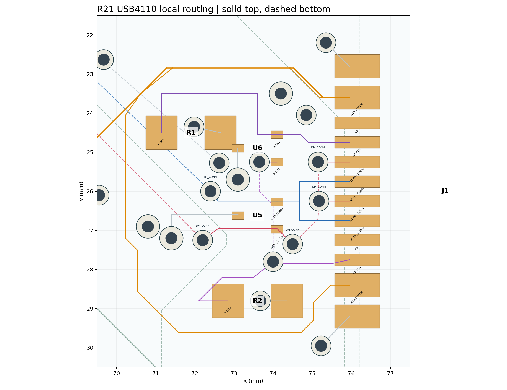

# R21：USB CC2 局部扇出候选

## 当前确定方案

[独立原生工程](../../../../../eda/NFC-Card-R1-Layout-Reset-R21-USB-CC2.eprj2)从 [R20](../r1-layout-reset-r20/README.md)复制，只重布 J1—U6—R2 的 `USB_CC2`：去掉一条并行底层绕行，把 J1 的 CC2 接到保留的过孔与 R2 顶层路径；U6 仍通过另一颗过孔连接同网。**没有移动 J1、U5/U6、R2、去耦、板框、天线或器件焊盘。**

R20→R21：CC2 换层孔 **4→2**，CC2 铜线中心线长度 **12.454→8.196 mm**，整板过孔 167→165。其余网络的器件引脚与线路未改，BOM/CPL 字节相同。USB4110 的 D+/D− 焊盘交错，仍存在必要换层和旧数据线扇出；本版只验证 CC2 一组，**不是 USB 区整体完成**。

## 同版文件与验证

- [Gerber ZIP](NFC-Card-R1-Layout-Reset-R21-USB-CC2-gerber.zip)、[BOM](NFC-Card-R1-Layout-Reset-R21-USB-CC2-bom.csv)、[CPL](NFC-Card-R1-Layout-Reset-R21-USB-CC2-cpl.csv)从保存并重开的 R21 工程导出。
- 重开后原生 DRC **0 条**；[R20 与 R21 的 PCB 引脚清单](../../records/r1-layout-reset-r21-pcb-pins.json)完全相同，均为 66 个位号、256 个引脚。R20 原理图与 PCB 已逐脚对账 0 差异。
- [制造对账](../../records/r1-layout-reset-r21-manufacturing.json)与[复核脚本](../../../scripts/check-layout-reset-manufacturing.py)核对了 Gerber 的 165 个过孔、约 0.30 mm 最小实际钻孔、0.1016 mm 最小径向孔环、BOM/CPL 位号与坐标；[板框和两颗非镀定位孔](../../records/r1-layout-reset-r21-profile-check.json)保留，USB 镀铜槽为 0。
- [独立铜连通](../../records/r1-layout-reset-r21-copper-check.json)、[NFC 线圈](../../records/r1-layout-reset-r21-nfc-check.json)检查通过；[离散异网铜间距](../../records/r1-layout-reset-r21-clearance-audit.json)无 <0.15 mm 配对，同网孔壁到焊盘 <0.10 mm 配对为 0。审计不覆盖铺铜与阻焊；网站曾报 0.12 mm 最小线距，仍需按成品 Gerber 核实。
- [R20／R21 Gerber 对照](../../records/r1-layout-reset-r21-gerber-delta.json)显示改动集中在顶／底铜层与金属化钻孔文件；板框、非镀孔、阻焊、锡膏和丝印图形在导出精度内相同。
- 首次试布曾产生约 0.001 mm² 孤立 GND 铜碎片；调整 CC2 换层位置后重新保存、重开并复查，[最终连通记录](../../records/r1-layout-reset-r21-copper-check.json)中孤立铜为 0。首次试布没有作为制造文件保留。

## 下一步

[R21 Gerber 已上传并解析](vendor-dfm-2026-09-26.md)，但网页“进入分析”与文件行“打开”均未进入结果页，**线上 PCB DFM 结果仍未获取**；BOM/CPL 尚未进入 R21 SMT DFM。下一轮先获取 R21 线上危险明细，再沿 USB4110 官方焊盘逐组检查 D+/D−、VBUS、CC1 与 ESD 的连通、阻焊和成品间距。孔环、U1 装配及 USB4110 与 5.8 mm 外壳名义约 0.18 mm 干涉仍是制造门槛。

**R21 不可下单；没有下单或付款。**
