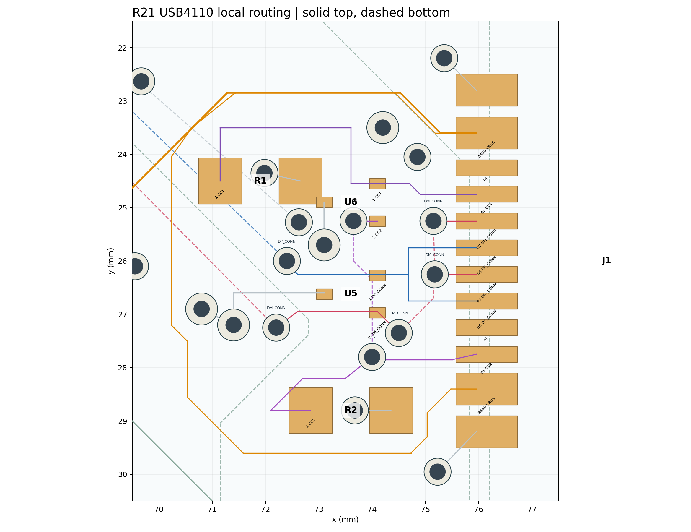

# R21 USB4110 扇出复核

## 当前确定方案

[R21 独立候选](production/r1-layout-reset-r21/README.md)只消除了 `USB_CC2` 的并行底层绕行。按 [GCT USB4110 焊盘图](https://gct.co/files/drawings/usb4110.pdf)固定 J1，按 [TI TPD2EUSB30 §10](https://www.ti.com/lit/ds/symlink/tpd2eusb30.pdf)保留 U5/U6 靠近接口、受保护信号路径和低阻接地；当前不为视觉整齐移动 J1、U5/U6 或充电输入去耦。下面的长度是[重开 PCB 快照](records/r1-layout-reset-r21-routed-snapshot.json)各网**全部线段中心线长度之和**，包含分支，不等于差分对的点到点长度或阻抗验证。

| 网络 | R20 过孔／线长 | R21 过孔／线长 | 现状判断 |
| --- | ---: | ---: | --- |
| `USB_CC1` | 0／6.941 mm | 0／6.941 mm | 顶层可连；暂不动。 |
| `USB_CC2` | 4／12.454 mm | **2／8.196 mm** | 删去并行底层路径，J1、U6、R2 仍连通。 |
| `USB_DP_CONN` | 2／29.888 mm | 2／29.888 mm | 双插向触点在 U5 前汇合；后续与 D− 一起评估。 |
| `USB_DM_CONN` | 5／30.343 mm | 5／30.343 mm | 双插向焊盘与 D+ 交错，已有换层跨线；不能只按孔数判定错误。 |
| `USB_VBUS` | 5／55.865 mm | 5／55.865 mm | 含充电输入等分支与接口上下两组 VBUS 焊盘；应按供电电流路径单独审查。 |

## 数据线与保护接地的逐孔复核

按 R21 重开快照量得，`USB_DP_CONN` 的两颗过孔分别在 **(72.400, 26.000)** 与 **(54.100, 14.201) mm**：前者让 J1/U5 后的数据线转到底层向主控走，后者在 R3 前回到顶层。`USB_DM_CONN` 的五颗过孔如下；坐标是板面几何值，并非成板测量。

| D− 过孔中心 (mm) | 当前作用 |
| --- | --- |
| (75.150, 25.250)、(75.175, 26.251) | 分别接 J1 的 B7、A7；两个触点被 D+ 的 A6 隔开，在底层汇合。 |
| (74.500, 27.350) | 从底层回到顶层，接 U5 的 D− 焊盘。 |
| (72.200, 27.250) | 从 U5 顶层走线转到底层，向 R4 走。 |
| (54.100, 15.700) | 在 R4 前回到顶层。 |

这说明五孔中至少有“交错触点汇合、进入 U5、从 U5 离开、接 R4”四类几何任务；**尚未证明五孔是最少孔数**。若要省去 U5 前后的其中一孔，必须同时重布 D+ 与 D−、保持两个插向触点均先到保护器件，并重新查局部铜距与 GND 回流，不能单独删孔。

U6 GND 焊盘 `(73.099, 24.900)` 到 GND 过孔 `(73.100, 25.700)` 有约 **0.800 mm** 顶层明线。U5 GND 焊盘 `(73.099, 26.619)` **已有 0.20 mm 宽的顶层明线**：向左到 `(71.400, 26.599)`，再向下到 GND 过孔 `(71.400, 27.200)`，中心线合计约 **2.30 mm**。这条线穿过 D+/D− 之间的通道；[独立铜连通](records/r1-layout-reset-r21-copper-check.json)检查通过。它的真实 ESD 放电阻抗仍须结合覆铜、回流和实物评估，不能仅用中心线长度断言性能。

2026-09-26 曾在独立临时候选中试图从 U5 GND 向北直连另一颗地过孔 `(73.100, 25.700)`，原生 DRC 报 **1 条 GND 与 `USB_DP_CONN` Track-to-Track 0 间距**；已撤销。随后向左试布时发现它与上述**现有 GND 明线重叠**，也已撤销，临时候选和制造文件均未保留。此前把 U5 判断为“主要靠顶层覆铜接地”是遗漏这条明线，现予更正；R21 原工程未改。

`USB_VBUS` 的 55.865 mm 也含两组 J1 VBUS 焊盘、U1 VBUS、C1/C8、U2.IN 等分支，不是某一条单向供电路径长度。现有 42 段 VBUS 明线中有 **25 段 0.25 mm、15 段 0.15 mm、2 段 0.18 mm**；下侧 J1 VBUS 焊盘到上侧汇合点含 0.15 mm 绕行。下一轮应按 J1→C8→U2.IN 的实际串联路径与目标充电电流核对线宽和压降，再决定是否重排供电，而不是按全网总长判断。

## 下一轮设计判断

1. **按已核实的拓扑评估 D+/D−。** USB4110 的 A/B 两组数据焊盘在板上交错，D− 的局部跨层有明确几何原因；当前还不能证明五个 D− 过孔都必需。若下一候选要删孔或移线，须同时保持 J1→U5→串联电阻→U1 通路、现有 U5 地线和铜间距，不能只压低一条线的孔数。
2. **以实际危险决定 VBUS 改线。** VBUS 顶层绕过保护器件，肉眼显得长；它不是 R18B 已确认的 USB 镀铜槽或 J1 焊脚危险。若 R21 成品 DFM 或电流路径复核证实宽度／间距问题，再比较更短路径，避免为外观增加贴近小焊盘的过孔。
3. **保留可复查的门槛。** R21 保存重开原生 DRC 0、逐脚网表不变、独立连通无孤立铜；[制造核对](records/r1-layout-reset-r21-manufacturing.json)通过。线上 R21 PCB／SMT DFM、阻焊桥、局部成品线距、U1 装配和新 USB 外壳配合仍未获放行，不能下单。

R21 是逐网验证的局部改善，不代表整块板已经按新 USB4110 完成布线；下一步先取得同版供应商 DFM，再做数据对及 VBUS 的设计选择。
