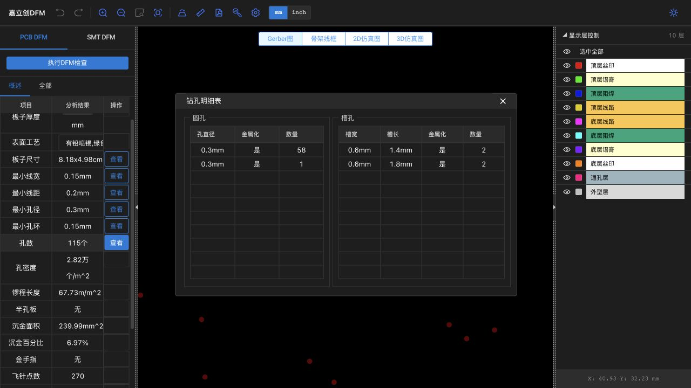
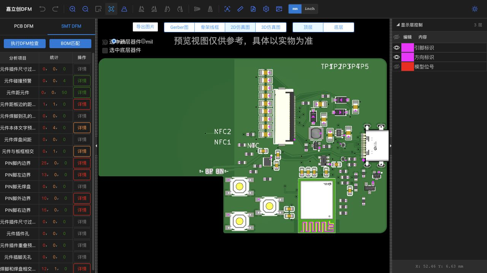

# V4 phase2 国内嘉立创 DFM

## 当前确定方案

2026-09-29，**本目录是 V4 phase2 的部分布线诊断包，不可投厂**。国内嘉立创 PCB DFM、BOM/CPL 匹配及 SMT DFM 均已实际执行，任务号 `DFMP2609290424`；没有沿用 D／第一阶段的制造检查结果，没有下单、付款或联系工厂。

对应 [V4 phase2 原生工程](../../../kicad/v4-phase2/README.md)，PCB SHA-256：`9b83cea853f6523f2123016c29fe3bdd0fcb8e14eed5e1e5a4a789ee6b8690e8`。导出参数、各文件指纹及实际命令见 [manifest.json](manifest.json)。[线上报告](https://www.jlc-dfm.com/order/smt-dfm-lceda?dfmPcbTaskCode=DFMP2609290424&dfmPcbUploadFileKeyId=627718623773130753&dfmPcbTaskKeyId=627718638896996354)需要原账户登录。

## 可复现文件衔接

1. 保存并重开原生 PCB，重铺铜，运行原生 DRC／原理图一致性检查。
2. 使用 `export-kicad-dfm.py` 从同一 PCB 导出 9 个 Gerber 图层、独立 PTH/NPTH Excellon、BOM、CPL；原点 (110,130) mm，Gerber 6 位小数，钻孔单位 mm、槽采用 route 表示。
3. 国内网页上传本目录 `NFC-V4-phase2-diagnostic-gerber.zip`。页面识别 10 层：铜、阻焊、锡膏、丝印各两面，外形与 PTH；空 NPTH 文件未生成可视层。将页面默认板厚 1.6 改为 **0.8 mm** 后执行 PCB 检查。
4. SMT DFM → BOM 匹配，上传本目录 [BOM.csv](BOM.csv)、[CPL.csv](CPL.csv)，确认 29/29 组、66 件全部匹配后保存，再执行 SMT 检查。
5. 读取分类与具体对象，回到 KiCad 修改；有任何 PCB/BOM/CPL 变化即重新导出和检查。本流程没有实时同步。

BOM 字段为 `Comment,Designator,Footprint,Quantity,嘉立创元件编号`；CPL 为 `Designator,Footprint,Mid X,Mid Y,Layer,Rotation,Comment`。UTF-8 BOM 编码，位置 mm，正面 `T`／背面 `B`，角度采用 KiCad 模 360 后的数值。依据[国内规范页面](https://www.jlc.com/portal/server_guide_48022.html)，不使用国际插件的默认角度补偿。J1 原始封装字段为空，但明确料号 `C5354966` 成功匹配；不能因此省略后续实物方向核对。

表面工艺保留本次诊断页面默认的“有铅喷锡、绿色、白色”，**不是产品选定工艺或报价**。没有修改网站规则来消除告警。

## 文件识别与贴装核对

| 项目 | 本次实际结果 | 边界 |
| --- | --- | --- |
| 外形／层 | 2 层、0.8 mm、8.18×4.98 cm；L 形边界、中沉 USB 缺口可见 | 大小是网页四舍五入值，原生板框与冻结基线逐项相同；制造公差未获得确认 |
| 圆孔／镀铜槽 | [明细](pcb-drill-details.txt)显示镀铜圆孔 58+1=59 个；0.6×1.4 mm 与 0.6×1.8 mm 镀铜槽各 2 个；与 [Excellon 报告](drill-report.txt)总 63 个一致，无 NPTH | 页面圆孔直径只显示两位小数；原始钻径为 57×0.300、1×0.302、1×0.305 mm。概述“115 孔”口径未解释，不能取代明细或推断多钻 52 孔 |
| 阻焊／锡膏 | 258 焊接点，对应顶层 256、底层 2 个锡膏开口；原库几何与 D 开口在新摆位中保留 | 迁移保真不代表开口／钢网工艺已经认可；底层 NFC 开口的实际印膏方案仍未定 |
| 数量／料号 | [匹配记录](bom-match.txt)：29 组、66 件全部匹配，无背面 SMT 器件；10 个板上触点不加入 BOM/CPL | 自动匹配不是物料型号或装配正确性的充分证据 |
| U1 | `C5119772 / MDBT50Q-P1MV2`，CPL (63.001,10.616) mm、180°、T；图上天线朝板外下边，61 焊盘的原厂对照沿用经核验的原生几何 | 网页模型命名 `COMM-SMD_MDBT50Q-P512K`；边界类告警不能以料号匹配直接忽略；距板边约 0.07 mm 危险仍在 |
| U2 | `C44639442 / BQ25186DLHR`，(49,21.4) mm、180°、T；[叠图](smt-u2-pins.png)的 pin 1 标识在右上，与原生 pad 1 相符，10 外围焊盘方向吻合 | EP 的 0.88 接触比警告单列，见下文；不是电气地连接失败 |
| J1 | `C5354966 / USB4500-03-0-A`，(78.724,25.9995) mm、90°、T；[叠图](smt-j1-overlay.png)外壳朝右开口、四外壳脚对准槽孔 | 12 信号焊脚接触比 0.50 危险仍在，不能靠调整网页坐标掩盖缺口／封装共同基准问题 |
| J2 | `C2856831 / FPC-05FB-24PH20`，(54.7,34.26) mm、270°、T；[叠图](smt-j2-overlay.png)24 脚列及机械焊片同向，pin 1 标识在右下，与原生 pin 1／24 顺序一致 | 排线插入、触点面及锁扣行程仍需实物；网页模型不证明折弯配合 |

## 实际检查结果

三列统计顺序为 **危险／警告／良好**。原始分类保存于 [PCB 全部](pcb-all.txt)、[SMT 全部](smt-all.txt)，不是 D 版计数。

| PCB 项目 | 危险／警告 | 处理意义 |
| --- | --- | --- |
| 焊盘距外型线 | 12／0 | USB 原厂近边焊盘与通用加工规则冲突，必须闭合工艺／共同基准 |
| 测量槽宽 | 4／0 | 四槽均为 0.6 mm，网页危险界限 <0.61 mm；未改槽宽或规则 |
| 阻焊桥 | 42／4 | 需按具体封装和最终工艺核查 |
| 开窗露线 | 0／50 | 后续连贯区域完成后再核露铜／钢网影响 |
| 焊盘孔环 | 0／95 | 网站口径与 KiCad 不同；网页“最小孔环 0.15 mm”不能覆盖原生 NFC 孔环违规 |
| 丝印距焊盘／孔／线宽 | 50／0、12／5、5／0 | 图文整理尚未完成，归入预期未完成区；不混同铜线正确性 |
| VIA 孔到焊盘、走线间距、裸线头、无连接过孔 | 均 0／0 | 仅在本版网站规则覆盖内，不能证明原理图所有网络已连接 |
| 锐角拐线、mark | 各 0／1 | 保留，mark／工艺边与拼板尚未设计 |

| SMT 项目 | 危险／警告 | 对象与判断 |
| --- | --- | --- |
| 元件碰撞／元件距元件／焊脚到孔 | 均 0／0 | 当前摆位未出现网页碰撞危险／警告；原生 courtyard 也为 0 |
| 元件距板边 | 1／1 | U1 0.07 mm；SW1 0.8 mm。机械基准未改 |
| 焊脚和焊盘相交区域 | 12／1 | J1 12×0.50；U2 EP 0.88，详见 [明细](smt-contact.txt) |
| PIN 内／左／外／右边界 | 25／0、13／0、10／0、15／0 | 包含 U1、J1、U2；保留模型与实际焊盘解释差异，不一键忽略 |
| PIN 无焊盘／插件孔／插脚无孔 | 均 0／0 | 识别链路通过这一项，不等于装配放行 |
| 本体文字／与板框相交 | 0／4、0／1 | 未完成丝印及固定机械边界分别保留 |

**U2 EP 特别说明：**原生铜为 1.501×0.899 mm，阻焊正扩展约 0.0509 mm。网站对象 `rect56.344x32.644` 换算约 1.43114×0.82916 mm，与移植的锡膏开口尺寸接近；若按该矩形与 TI 名义 EP 1.5×0.9 比较，面积比约 0.879，与网页 0.88 一致。这是网站按锡膏图元评估的有力线索，尚非其内部算法确认。[TI BQ25186 手册](https://www.ti.com/lit/ds/symlink/bq25186.pdf) PDF p.55 给出 EP 铜／阻焊示例，p.56 钢网示例为 0.85×1.38 mm、0.125 mm 钢网、约 88% 覆盖。当前开口形状没有因此自动获得批准；钢网厚度、焊膏、空洞及热预算仍需制造／实物验证。不能为把网页比例拉到 0.90 就无依据加大锡膏。

**预期未完成项：**本版 KiCad 仍有 49 项未连接；Gerber 不带完整预期网表，DFM 的“无连接过孔 0”等结果无法检查这些缺线。丝印、工艺边／mark、部分电源和控制区域尚未完成。USB 槽／板边、U1 板边与开口问题属于已有工艺障碍，不能都归咎于“未布完”。

点击过网页 PDF 导出，页面结束生成提示；本记录以已保存的 DOM 明细及截图为证据，未将没有确认落盘的 PDF 声称为已归档报告。下一版从原生工程重新导出并上传，不在线挪模型来代替原工程修改。
