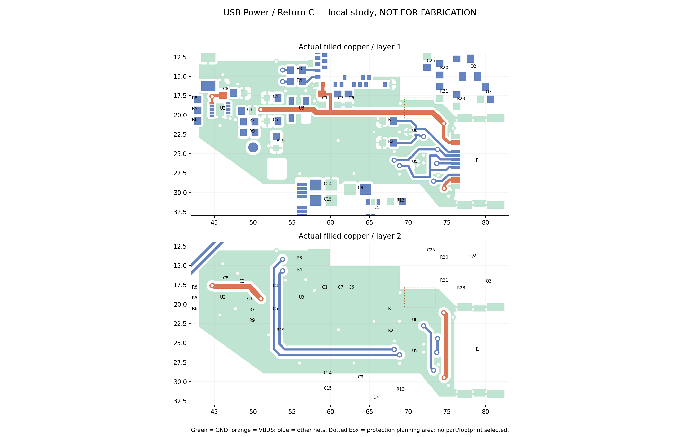
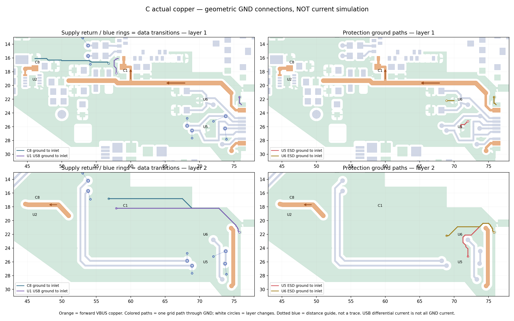
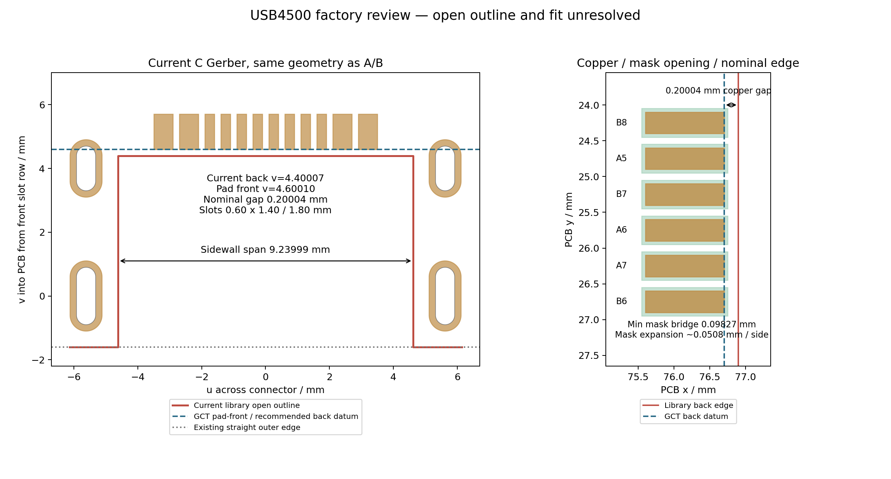

# USB Power / Return C：局部供电、回流与制造边界

## 当前确定方案

2026-09-28，在 `master`、嘉立创 EDA 中从已关闭的 [USB Spaced B](usb-spaced-b.md)复制出 [C 原生工程](../../../eda/NFC-Card-R2-USB-Power-Return-C.eprj2)。**VBUS 和 USB／U1／充电器局部地已实铜连通；参考地仍有局部缺口，保护与制造边界未闭合，USB 区尚不能定型。**本轮停在 USB 局部，没有展开整板详细布线。

A、B、R21 的文件 SHA-256 保持不变；66 个器件的位置、全部焊盘、数据／CC／NFC 铜、板框、电池和屏幕布局不变。正式板厚方向仍为 0.8 mm、双层 1 oz、绿色阻焊、标准型 SMT。以下尺寸都是文件／图纸推导，不是实物测量或工厂认可。



图按 PCB 坐标 y 向下展示，非装配视图。点框是待选 VBUS 保护的规划区域，不代表已经选好器件、完成封装或证明能容纳整套保护电路。

## 电流、保护、回流和空间

接口 `A4B9` 与 `B4A9` 两组 VBUS 经局部上下层引出，在接口内侧汇合；共用输入段经过约 `x=69.5–73.5、y=17.8–20.5 mm` 的保护规划区，再向两负载分支。主段 0.60 mm，接口底层合并段 0.50 mm，接口短引出及 U1 分支 0.30 mm；U2 的末端细间距逃逸用 0.20 mm，保持原焊盘间距。没有为了本轮连通增加串联器件、改网名或默认配置。

| 分支／器件 | 本轮处理 | 仍需闭合 |
| --- | --- | --- |
| `USB_VBUS → C1 / U1.32` | 从共用干线分出，C1 电源焊盘与 U1.32 保持短连接；C1 地用短线／地孔回到局部地 | U1 分支尚无经过耐压／钳位核对的 VBUS 保护 |
| `USB_VBUS → C8 / U2.10` | 干线绕开信号通道和 U3 焊盘，在充电器左侧区域换层；C8 仍为 U2 IN 的并联电容，器件位置不变 | 需要按最终最大输入电流核线宽、压降、孔壁和充电热条件 |
| U5 数据保护、U6 CC 保护 | 器件及信号路径不动，短地线接孔，再接双面实际地铜 | 局部地通了不等于已通过 IEC ESD；位置／局部参考缺口仍需综合评审 |
| U2 GND / EP | 5 脚与 11 脚散热焊盘均接入局部地；孔在 SMT 焊盘外，未加盘中孔 | 最终功耗／铜面积／温升仍待负载预算 |
| 回流 | 将 B 的细长地线试验替换为受边界约束的双面地铜与地孔；J1 两地脚、四壳脚、U5/U6、Rd、C1/C8、U1.33、U2.5/11 在同一实铜分量内 | 全板地仍未布完；信号正下方不全是连续参考铜，详见下节 |

器件规则沿用已缓存的 [BQ25186 §9](https://www.ti.com/lit/ds/symlink/bq25186.pdf)与 [TPD2EUSB30 §10](https://www.ti.com/lit/ds/symlink/tpd2eusb30.pdf)：输入电容靠近服务引脚，充电路径按最大电流尺寸化；保护地以短、宽的路径接到地铜，不能拿一条细长地线的 DC 导通当成低阻抗回路。C1 服务 U1，C8 服务 U2，本轮没有移动这些敏感件。

**本轮没有把电流上界猜成 110 mA。**301030 的“110 毫安”按容量 110 mAh 暂记；允许充放电电流仍未知。BQ25186 的 `TMR_ILIM` 默认输入限流为 500 mA，设置档位可到 1050 mA；这是芯片设置，既不是当前产品承诺，也不代表 USB 主机已经授权该取电量。还需结合 USB 接入状态／电源能力、U1 直接分支、充电限流和屏幕／无线峰值确定预算。[既有电源规划](pcb-restart-design-plan-2026-09-28.md#电源与保护现在能算出的边界)继续有效。

**VBUS 保护是实质阻塞。**U5/U6 不能代替 VBUS 保护，U2 自带输入保护也不覆盖直接接入的 U1.32。当前仍是未加保护的原网表试布；需要完成正常工作电压、瞬态波形下的实际钳位、负载可承受瞬态、限流／反接需求及接地路径比对，再决定保护器件和是否拆分输入／保护后网络。不能仅选一个写着“5 V”的 TVS。规划区允许继续局部调整，不能保证未来器件选定后完全不返工。

## 六个数据过孔与回流边界

全部数据／CC 铜与 B 相同，未通过拉长数据线来少打孔。数据仍为局部交叉 2 孔、主通道换层 4 孔；CC2 另有 2 孔。C 总计 40 孔：NFC 6、数据 6、CC2 2、VBUS 4、GND 22。所有新增 USB 区孔为名义 0.30/0.60 mm，每个孔的两面都有实际接铜。

| 数据孔坐标 mm | 最近已接通两面地孔距离 mm | 结论 |
| --- | ---: | --- |
| D− (73.70, 26.248) | 1.564 | 在 1.6 mm 复核目标内 |
| D− (73.80, 24.450) | 1.950 | 超出目标，保留复核项 |
| D+ (68.90, 26.551) | 1.099 | 在目标内 |
| D− (68.20, 25.850) | 1.100 | 在目标内 |
| D+ (53.80, 14.201) | 1.361 | 在目标内 |
| D− (53.80, 15.700) | 约 1.25 | 在目标内，精确值见 JSON |

1.6 mm 来自[规则索引 RP-001](../../../docs/pcb-design-rules.md)在 0.8 mm 板上的 `max(2H,1 mm)`；这是回流评审目标，不能单独据此判定 USB 全速必然失效。两层板无专用平面对，需结合实铜连接与局部缺口。当前孔 (73.8,24.45) 周围有 CC、数据与 VBUS 通道，不能再塞地孔而破坏正常间距。

对实际覆铜做对侧投影诊断：连接器侧 D+ / D− 中心线长度和约 44.27 / 38.90 mm，直接投影到对侧地铜约 24.39 / 21.46 mm；这包含焊盘、过孔避让、交叉和器件焊盘遮挡，**不作为覆盖率通过／失败阈值**。按 0.025 mm 步长采样，到最近对侧地铜的最大横向距离约 1.32 / 1.46 mm，集中于接口交叉区。R3/R4 到 U1 的短段对侧地铜连续。

因此本轮能确认的是**连通的双面地回流网络**，尚不能确认每条信号下方都有不中断的参考面、受控阻抗或 ESD 裕量。下一轮应在保护器件选定后复核下述实际通道；只有具体铜片连接或电气证据证明需要改善，才调整局部走线／摆位或补孔，不以覆盖率、1.95 mm 或 6 个数据孔的数量单独驱动重布。

## 实际地铜路径与局部衔接



左列橙色箭头表示 VBUS 正向供电，彩线表示 C8／U1 邻近地到 J1 上侧地焊盘的一条可用几何路径；右列为 U5/U6 地到同一接口地焊盘的路径。白圈表示换层，蓝色虚线只是数据孔到已连通地孔的距离引导线，**不是实际铜线，也不是全部 USB 差分电流流过地的示意**。差模信号主要在 D+/D− 间形成电流回路，参考铜及跨层连接还影响共模、位移电流与 ESD；这里没有进行场仿真或电流密度求解。

[路径记录](records/usb-power-return-c-return-paths.json)采用 0.10 mm 网格、实际地铜向内缩 0.02 mm 后搜索，垂直换层按板厚 0.8 mm 计；它只证明存在这条导通通道，未覆盖孔内电流分布。固定终点为 J1 上侧地焊盘时，U5/U6 图示路径约 13.84 / 12.46 mm；到其他接口地／壳脚还存在其他路径，不能将这两个数字当作唯一放电路径或低阻抗证明。

| 具体对象与几何 | 可确认的作用／边界 | 是否需要再改 |
| --- | --- | --- |
| 底层 VBUS 合并线，约 x=74.9、y=21.4–29.25 mm，宽 0.5 mm | 这条长铜线及其避让把接口旁地铜与板内地铜的直达路线隔开；图示返回从其上端绕行，另有下端及顶层／镀铜壳脚互联。不是完全断地 | 待保护选型后联合比较入口与参考铜；现有证据未证明需要再加孔 |
| U5 顶层地铜位于数据折返包围的局部口袋，向两面地的连接在 (72,26.2)、(72,25.2) | 两个孔均实接两面；向接口的图示底层路径需绕过 CC2 上端附近的避让。确实存在绕行，但不存在悬空保护地 | ESD 低阻抗尚未验证；优先评审走线／摆位关系，不能只以地孔数量判优劣 |
| 底层主数据通道上方的 C4/C5、R19／测试焊盘及 VBUS 横穿处 | 对侧投影有缺口，但周边地铜仍通过另一面和地孔连通；单个正常焊盘避让不能被自动判为“回流断裂” | 不按覆盖率补满；保留接口性能验证边界 |
| C1、C8、U2 及 U1.33 的地铜连接 | 已确认同一实铜分量，源／负载两端均有局部接地，不靠一条长明线作为唯一返回 | 未证明热／瞬态指标；随电源预算核实 |

22 个 GND 孔按主要用途分组：U5/U6 地出口 2 个，六个数据换层附近的地连接 6 个，C1/C8/U1.33/U2.5/EP 接地 5 个，J1 两地脚出口 2 个，局部铜区互联 7 个。部分孔兼任 ESD 或参考铜连接，四个镀铜壳脚也能跨层连地，但不混入这 22 个过孔计数。此分组解释每类用途，不主张孔越多越好。

本轮铜区止于 USB／电源通道。后续显示开关回路仍应围绕其自身输入电容、电感、开关和地回路组织，再从右侧电子区与局部地铜衔接；不得让开关返回只经过 USB 保护地的短线。U2 的 BAT/SYS 与电池返回继续在供电区闭合，不把整板地默认视为已经布完。所有扩展都必须避开现有 NFC／屏幕完整净空及 U1 BLE 天线净空，不能为追求地覆盖率跨过禁铜区。

## 12 项 USB 板边问题的分类

**重要更正：当前 A/B/C 是约 0.20 mm 的库内板边铜距；R17 才是近零。**本轮从 C 同版 Gerber 独立读取 16 个连接器铜焊盘、板框与钻槽，焊盘中心／尺寸与原生快照在 0.002 mm 内一致。C 与 B 的 J1／板框完全相同，因此这个结果也适用于保留的 B。



共同基准仍用靠插口一排固定槽中心，向板内为 `v+`，横向为 `u`。以下数值保留计算精度用于复核，不能理解为制造精度。

| 尺寸 | 当前 C 导出 | 原厂／制造关系 |
| --- | ---: | --- |
| 原厂 SMT 焊盘前缘／后缘 | v=4.6001 / 5.7001 mm | 符合 GCT 4.60 / 5.70 名义基准 |
| 库内缺口后缘 | v=4.4001 mm | 比 GCT 推荐后缘／焊盘前缘向插口退约 0.20 mm |
| SMT 铜到库内后缘 | 0.20004 mm | 原生 DRC 报约 7.9 mil，小于当前 11.8 mil（0.30 mm）规则 |
| 缺口侧壁间距 | 9.23999 mm | 接近 GCT 9.24；不能拿旧 R17 的 9.60 mm 混用 |
| 镀铜固定槽 | 0.60 × 1.40 mm 两个，0.60 × 1.80 mm 两个 | 由 Excellon 槽中心线长度＋刀径独立核对；不是小孔失败 |
| 外板边 | x=82.900 mm，约 v=−1.60 mm | 当前仍有整条直边，尚未和库折线合成 |
| CPL J1 | Ref/Mid X=78.724，Y=25.999 mm，90° | 同版核对；不能据此推断网站贴装模型已正确 |

| 分类 | 本轮判断 | 怎样闭合 |
| --- | --- | --- |
| 板框建模错误 | **已证实**：Gerber 有一个完整闭合外轮廓，加一个库内开口折线；直边穿过应移除的缺口区域 | 确认缺口几何后合成唯一闭合制造轮廓，移走库内重复板框线，再重跑检查 |
| 原生 12 项间距错误 | **当前规则确实不满足**，但并非 12 个焊盘已经压进锣槽 | 规则保持 0.30 mm、不忽略；由工厂针对确切结构审核，不能以 DRC 计数代替能力表 |
| 铜距与普通工艺 | 当前 0.20 mm 在名义上接近[国内公开普通铜到锣边最低值](https://www.jlc.com/portal/vtechnology.html)，未证明超出普通名义能力 | 仍需核成品边、公差、CAM 是否保留焊盘；不能把最低值再当成剩余可靠性余量 |
| 封装与本体配合 | **待验证**：库内后缘 v=4.40，与 GCT 推荐基准 v=4.60 有约 0.20 mm 差异；库折线没有重建原图的角部让位 | 取得原厂／工厂可接受的实际缺口和角部图，检查本体底部是否顶板。J1 3D 关联仍不能作为已核实实体 |
| 特殊制造接受 | 若恢复 GCT 后缘 v=4.60，则焊盘前缘近乎贴边，回到 R17 的特殊板边铜议题 | 由工厂明确是否保留铜、是否削铜、毛刺／铜丝与成品边公差；公开“支持标准型沉板”不能替代本板批准 |

当前 12 项是上述问题在 DRC 中的表现，不能硬分成“几项误报、几项真实冲突”；同一组焊盘同时受轮廓建模、配合及制造条件约束。本轮没有改焊盘、锣边、板边规则或忽略项。

## 阻焊和孔到焊盘

同版诊断 Gerber 显示：J1 窄焊盘开窗每边约外扩 0.0508 mm，最小阻焊桥约 **0.09827 mm**。这不是新的铜短路；按[国内 2025 年更新的阻焊说明](https://www.jlc.com/portal/server_guide_34402.html)，单双面新单可以按铜焊盘 1:1 开窗。当前仍保留库开窗，未静默改成 1:1，更未将约 0.098 mm 判成工厂已接受。需与钢网、对位及近边焊盘一起确认。

USB 非 NFC 孔（含 B 留下的信号孔）到任意 SMT 铜焊盘的孔壁距离：**同网最小约 0.410 mm，异网最小约 0.494 mm**；孔壁到任意实际阻焊开窗最小约 **0.358 mm**。同网配对未被排除。导出的顶／底阻焊层均未在这些孔的孔心开窗，表示文件采用盖油；不是塞孔或填孔工艺承诺。

USB 过孔到异网离散铜最小约 **0.250 mm**，出现在交叉区回流地孔 (73.9,27.8) 与 D+ 线之间；这比 B 的约 0.301 mm 小，仍高于未改动的 0.20 mm 原生间距。保留此局部取舍是为了让附近数据换层的回流地孔在 1.6 mm 内，不为追更散把它继续移远。其余三个接近规则的地孔已再挪开，检查以最终保存值为准。

首次覆铜在 U5 信号焊盘之间产生极小悬空铜，局部移除该狭窄填铜口袋后重新铺铜；最终无悬空铜。新增的是 `x=70.25–70.82、y=25.5–26.9 mm` 的顶层**仅禁覆铜**区域，保留了 U5 地焊盘向右的短宽连接，不是忽略 DRC。

## 保存重开和检查结果

C 经 PCB 页保存／关闭重开，再整应用退出、重启、按 C 运行时 UUID 重开导出。器件、焊盘、走线、孔、边界、区域、引脚、规则和网表一致；填铜图元的内部顺序／浮点表达发生变化，独立比较实际地铜的对称差面积小于 `4e-14 mm²`，连通与全部门禁结果不变。同版诊断 Gerber/CPL 从重开后的 C 再次导出。

| 检查 | 结果 |
| --- | --- |
| 原理图／PCB | 66 位号、256 引脚逐脚一致，BOM 29 组 |
| 铜规模 | 161 段明线、40 孔、2 个局部地覆铜 |
| 已完整连通 | 数据、CC 六网＋VBUS；USB/U1.33/U2.5/11 局部地同一实铜分量 |
| 独立实铜检查 | 悬空铜 0、明线死端 0、单面接铜过孔 0 |
| 天线／屏幕 | 原禁布区与 NFC 74 段／6 孔不动，新增异网铜侵入 0；原电池焊点例外保持 |
| 原生未连接错误 | **178 项**：SMD 166、测试点 8、TH 2、Via 2；整板仍有 **44 个未布完／分裂网络** |
| 原生 USB 板边 | **12 项**，如上分类，未忽略 |
| 原生保留 NFC 孔尺寸 | **4 项**，0.508 mm 外径不满足当前规则；本轮未动线圈引出 |
| 其他原生几何错误 | **0 项**；不代表上述板边、NFC 孔或电气门禁通过 |
| 线上／实物 | 未上传本版 DFM、未做 USB 枚举／ESD／充电热／装配实测 |

总计 194 项只用于对账；不能用 B 的 215→194 表示设计通过。原生连接错误不是独立未布线网络数，因此两个口径分列。板框未闭合的问题也不能因为原生未额外计数而消失。

## 给客服的具体问题与下一步

可将本节、上面的[尺寸局部图](records/usb-power-return-c-factory.png)与 [GCT A1 图纸](../downloads/usb4500-drawing.pdf)交给客服。诊断 Gerber 只作审核附件，轮廓尚未定稿，**不能用于下单**。本轮未向客服发消息或上传文件。

询问背景：成品约 81.8 × 49.8 mm，FR-4 双层 0.8 mm、1 oz、绿色阻焊；USB4500-03-0-A / C5354966，标准型 SMT，中沉 0.8 mm。成品外形保持，拼板／工艺框待贵司要求确定。

1. 请审核附图的两条后缘：库内 v=4.40 留约 0.20 mm 铜距，原厂推荐 v=4.60 与焊盘前缘接近齐平。**贵司此料号实际采用哪个缺口后缘和角部让位？能否提供已经贴装采用的封装／加工轮廓？**不能只回复“支持沉板”。
2. 若采用 v=4.40，是否核过塑胶／金属本体与 0.7–0.9 mm 实际板厚的干涉？请给后缘位置、侧壁 9.24 mm、内角／让位及镀铜槽的实际成品公差。普通 ±0.2 mm 锣边与原厂推荐图 ±0.05 mm 如何协调？
3. 若必须采用 v=4.60，是否接受这 12 个贴近缺口的表面焊盘？CAM 会不会缩短或削铜、剩余焊接长度是多少、成品边与毛刺／铜丝如何控制？这是否属于需单独备注／审核／收费的结构？
4. 0.60 × 1.40 / 1.80 mm 四个镀铜槽如何焊接和定位？是否需要中沉治具、人工补焊或其他工艺，费用分别多少？请结合本板 0.8 mm、工艺边和标准型最小拼板要求说明。
5. J1 原导出开窗每边外扩约 0.0508 mm、最窄桥约 0.0983 mm；新单是否建议改成 1:1 开窗？能否保留独立阻焊桥，并确认相应钢网和近边焊盘处理？请提供供我们复核的最终生产稿。

**后续授权已更新：**保留 C 作为已保存对照，另建整板审核候选。先比较并明确记录 USB 缺口机械假设、合成唯一闭合轮廓，再推进其余区域的布局、走线和地连接；USB 工厂答复不再全局阻塞详细布线。VBUS 保护及负载预算继续核对，缺失输入只限制相关定型结论。用户在订单审核时确认接口、U1 工艺边／拼板等实际条件；未获认可的项目不得写成通过。工厂若要求改几何或料号，重验相关电气、机构与同版 DFM。

用户仍需补充电池厂家允许充放电电流；屏幕峰值和保护选型属于设计／测量待办，不能把这些都推给 PCB 客服。是否接受额外治具成本，在工厂给出具体报价后再由用户决定。

## 文件和复现

原生文件：[C](../../../eda/NFC-Card-R2-USB-Power-Return-C.eprj2)；[关闭文件及重开核对](records/usb-power-return-c-file-check.json)。C 复制文件内部仍继承 A 的工程元数据；运行时路径身份为 `53006cfb…03d51b4`，后续用完整路径、运行时 UUID 和 161 段／40 孔实际快照共同确认。

检查证据：[快照](records/usb-power-return-c-snapshot.json)、[原理图网表](records/usb-power-return-c-schematic.enet)、[PCB 引脚](records/usb-power-return-c-pcb-pins.json)、[BOM](records/usb-power-return-c-bom.tsv)、[规则](records/usb-power-return-c-rules.json)、[DRC 分类](records/usb-power-return-c-drc.json)、[独立审查与尺寸](records/usb-power-return-c-review.json)、[最终供电／地铜配方](records/usb-power-return-c-route.json)。

[诊断 Gerber ZIP](records/usb-power-return-c-diagnostic-gerber.zip)与 [CPL](records/usb-power-return-c-diagnostic-cpl.csv)仅用于复核，不是发布的制造包。执行本地核查：

```sh
unzip -o projects/nfc-business-card/hardware/records/usb-power-return-c-diagnostic-gerber.zip \
  -d projects/nfc-business-card/artifacts/usb-power-return-c/gerber
python3 projects/nfc-business-card/scripts/review-usb-power-return-c.py \
  --gerber-dir projects/nfc-business-card/artifacts/usb-power-return-c/gerber \
  --cpl projects/nfc-business-card/hardware/records/usb-power-return-c-diagnostic-cpl.csv
python3 projects/nfc-business-card/scripts/plot-usb-c-return-paths.py
python3 projects/nfc-business-card/scripts/check-netlist-consistency.py \
  --sch projects/nfc-business-card/hardware/records/usb-power-return-c-schematic.enet \
  --pcb projects/nfc-business-card/hardware/records/usb-power-return-c-pcb-pins.json
git diff --check
```

若需重新采集，先在客户端确认 C 路径与身份，再运行已有 `eda-export-midmount-candidate.js`，将输出传给本检查器的 `--capture`。检查器会拒绝 A/B 或其他项目，不能把不同版文件拼成通过结果。
