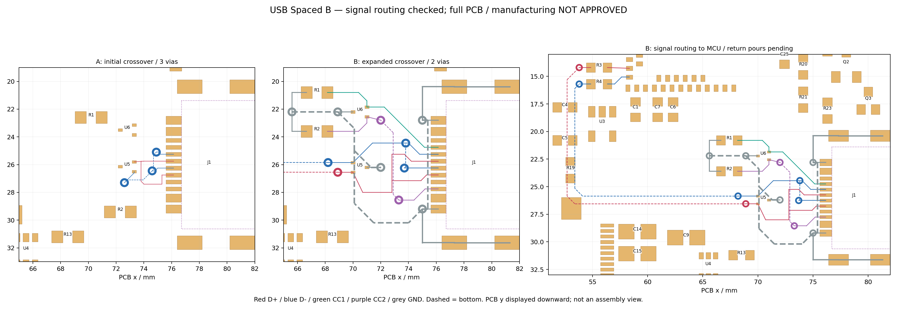

# USB Spaced B：扩大扇出空间的独立候选

## 当前确定方案

2026-09-28，按用户“参考外部、尽量不要太紧凑”的要求，从关闭状态的 Placement A 复制出 [NFC-Card-R2-USB-Spaced-B.eprj2](../../../eda/NFC-Card-R2-USB-Spaced-B.eprj2)。**B 已完成 USB 数据与 CC 信号的实铜连通检查；整板、VBUS 和连续地回流尚未完成，不可制造。**A 与 R21 保留。板框、连接器焊盘、天线、屏幕、电池及其余器件位置不变。



图来自保存重开的实际快照，y 向下显示，非装配朝向。A 只试了触点合并；B 多了主控出口、CC 与局部地线，不能直接以两图线条多少比较拥挤。紫色点框仍只是名义缺口参考。

追加核对：后续 [C 同版 Gerber 审查](usb-power-return-c.md#12-项-usb-板边问题的分类)确认 A/B/C 的库内铜到缺口名义约 **0.20 mm**，12 项 DRC 是相对当前 0.30 mm 规则的间距问题；不能把 R17 的近零关系套用到 B。B 原件和本页历史计数不变，当前执行入口为 C。

## 外部参考如何用于本版

重新读取 [Adafruit Sunken 原生 Eagle 板文件](https://github.com/adafruit/Adafruit-Sunken-USB-Type-C-Breakout-PCB/blob/4cb1207ddd6eae864f4410d110bac38072e9b895/Adafruit%20Sunken%20USB%20Type%20C%20Breakout.brd)，固定提交 `4cb1207ddd6eae864f4410d110bac38072e9b895`，SHA-256 仍为 `69c93336fbd822bb387f3f753466ece7d1254a1f5a956ddee6fc482309b2dc7b`。本轮在内存中解析 XML，没有导入其工程或运行上游代码。

- 原参考的 D+ 留在顶层；D− 用两个 0.3937 mm 钻孔，在底层短接跨过另一组触点，再回顶层。它没有本板的 TVS、主控和充电电路。
- B 借鉴“向板内展开焊盘引出、两孔局部跨线”的拓扑。孔尺寸仍用本板 0.30/0.60 mm，没有复制其它连接器的焊盘、缺口或板厚。
- [Goldfish 固定版本](https://github.com/staticintlucas/goldfish/blob/03b6db501b80048ce1675b586826d4a5abf1e7e1/cad/goldfish.kicad_pcb)的一孔方案使用 0.20 mm 钻孔和不同保护器件，本次没有为追一孔而缩小钻孔。其它差异见[外部参考核查](usb-mid-mount-two-layer-references.md)。

两组触点交错是 J1 引脚排列的约束；周边摆放过紧会增加扇出难度，但放宽摆放不会自动消除 USB4500 的近边焊盘问题。

## 实际改动与间距

| 对象 | A → B | 目的及边界 |
| --- | --- | --- |
| U5 | (72.8, 26.15, 0°) → (70.5, 26.2, 180°) | 向板内移 2.3 mm 并改变出口朝向，腾出交叉和接地空间；保护器件距端口有所增加 |
| U6 | (72.8, 23.5, 0°) → (70.5, 22.2, 0°) | CC 区与数据交叉区分开 |
| R1/R2 | x=70.2/72.3 → 67.4；y=20.8/23.6 | 分别接到 U6 对应信号焊盘，地端沿左侧引出 |
| 接口数据交叉 | A 的 3 孔 → B 的 2 孔 | D+ 顶层、D− 短段换层；这不是完整数据通道的总孔数 |
| 数据主通道 | 两条连接器侧网络接到 R3/R4，再接 U1.35/U1.34 | 整条数据路径共 6 孔：局部交叉 2 孔，加主通道换层 4 孔；R3/R4 位置和值未改 |
| CC 与局部 GND | 两条 CC 网络全连通；CC2 两孔，局部接地五孔 | J1 两个地焊盘、四个壳脚、U5/U6 地和 R1/R2 地同属一个实铜连通分量；尚未接通整板地网 |
| 新铜到异网铜 | 最小约 **0.248 mm** | 最窄处在连接器固定节距的出线处；不能通过拉开周边器件改变封装自身节距 |
| 新过孔到异网铜 | 最小约 **0.301 mm** | CC2 上端过孔再次移开 0.25 mm 后的实铜结果；不只满足原生 0.20 mm 规则就停止检查 |
| 新孔壁到任意 SMT 铜焊盘 | 最小约 **0.449 mm** | 包含同网配对；这是铜几何，尚非最终阻焊／焊膏 DFM |

所有新信号线宽为 0.20 mm，新地线宽 0.30–0.50 mm；新孔均为钻孔 0.30 mm、外径 0.60 mm。普通原生间距规则仍为 0.20 mm，USB 独立检查另以约 0.245 mm 新铜净距及 0.295 mm 新过孔异网净距作本轮数值门槛，给数值舍入留 0.005 mm 容差。这些是本项目设计目标，不是工厂批准或新的通用工艺下限。

## 电气取舍与未完成部分

按 [TI TPD2EUSB30 §10](https://www.ti.com/lit/ds/symlink/tpd2eusb30.pdf)核保护器件局部路径：进入和离开数据区的铜在 U5 对应信号焊盘连接，CC 下拉从 U6 对应保护焊盘引出。U5/U6 地焊盘到首个地孔中心的明线分别约 1.00/1.10 mm。

**空间变宽的代价必须保留：**只比较触点合并至 U5 的局部铜，D+ 总线段长度约 7.58→13.53 mm，D− 约 7.86→11.35 mm；它们是含双插向分支的长度和，不是单一路径或差分偏斜。此次优先为焊接和扇出留空间，尚未证明这是最优布线。

局部 GND 实铜连通不等于完整 USB 回流已经成立：当前没有地覆铜，局部地网尚未与 U1／整板地汇合。后续需同时处理主通道参考地、换层处回流和 ESD 泄放路径；不能把首个地孔距离当作整个放电回路长度，也不能仅以 USB 全速为由跳过检查。阻抗和实际 USB 性能尚未验证。

VBUS 两组触点、U1.32/C1、U2.10/C8 尚未布线，VBUS 保护选型仍待定。当前周边留白不表示供电布线已预检通过；下一轮应先联合验证供电出口与地回流，再决定是否接受当前 USB 区排布。301030 的额定电流、屏幕峰值和电源预算仍按[规划输入](pcb-restart-design-plan-2026-09-28.md)处理。

## 保存重开后的检查

- 66 位号、256 引脚逐脚网络一致，BOM 29 组；四个移动器件外的焊盘、电池／调试焊点、NFC 74 段铜和 6 孔、板框与禁布区保持。
- 当前 149 段铜、19 个过孔。独立检查确认 `USB_DP_CONN`、`USB_DM_CONN`、`USB_DP_MCU`、`USB_DM_MCU`、`USB_CC1`、`USB_CC2` 六个网络各自完整连通；无悬空铜、明线死端、仅单面接铜的过孔或屏幕区新增异网铜。
- 原生 DRC **215 项**：199 项连接错误（188 贴片焊盘、8 测试点、2 插件焊盘、1 过孔），12 项 USB 库封装板边、4 项保留 NFC 过孔尺寸错误。普通异网几何间距错误为 0；整板仍有 45 个未布完／分裂网络。
- USB 缺口尚未合成为制造轮廓；12 项近边焊盘、U1 装配边、公差、J1 3D 关联、薄壳和 FPC 问题没有因本轮放宽布局而解决。未运行本版线上 DFM，也没有制造放行。
- [关闭客户端后的文件检查](records/usb-spaced-b-file-check.json)确认 B 工程身份与 SQLite 完整性；A 和 R21 的 SHA-256 均未改变。

复制的 `.eprj2` 内部 `projects` 元数据仍继承 A 的 UUID／名称；客户端按 B 文件路径派生运行时 UUID。已整应用退出重启、按 B 运行时 UUID 重开，核对 66 器件、149 段铜、19 孔及全部焊盘／规则与退出前一致。后续用文件路径、运行时身份和实际快照共同识别候选，不只读数据库工程名称。

证据：[快照](records/usb-spaced-b-snapshot.json)、[原理图网表](records/usb-spaced-b-schematic.enet)、[PCB 引脚](records/usb-spaced-b-pcb-pins.json)、[BOM](records/usb-spaced-b-bom.tsv)、[规则](records/usb-spaced-b-rules.json)、[DRC](records/usb-spaced-b-drc.json)、[独立审查](records/usb-spaced-b-review.json)、[布局／路径坐标配方](records/usb-spaced-b-route.json)。配方用于追溯，最终事实以原生工程重开导出为准。

复现时先在客户端打开 B，确认文件与运行时身份，再执行：

```sh
node projects/nfc-business-card/scripts/eda-exec-wait.mjs \
  projects/nfc-business-card/scripts/eda-export-midmount-candidate.js 30000 \
  > projects/nfc-business-card/artifacts/usb-spaced-b/export.json
python3 projects/nfc-business-card/scripts/review-usb-spaced-b.py \
  --capture projects/nfc-business-card/artifacts/usb-spaced-b/export.json
python3 projects/nfc-business-card/scripts/check-netlist-consistency.py \
  --sch projects/nfc-business-card/hardware/records/usb-spaced-b-schematic.enet \
  --pcb projects/nfc-business-card/hardware/records/usb-spaced-b-pcb-pins.json
git diff --check
```
