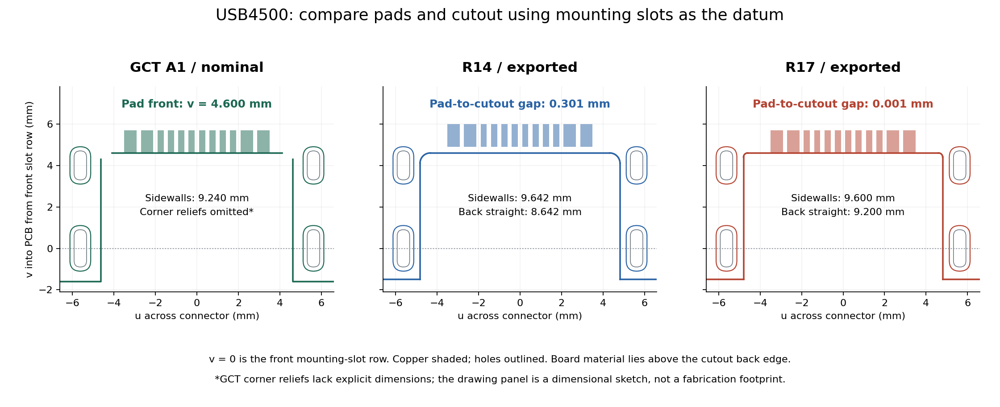

# USB4500 共同基准复核与薄型路线判断

## 当前确定方案

2026-09-28，继续开工前审查，未修改 PCB、封装、CAD 或制造文件。**保留 0.8 mm 中沉方向，但不能恢复 R17 直接重布。**[国内工艺调研](jlc-mid-mount-process-review-2026-09-28.md)已回答嘉立创提供标准型沉板装配；本次把剩余问题收敛到具体的焊盘到缺口关系、外形公差及贴装基准。

主要更正：R17 的 SMT 焊盘纵向位置基本符合 GCT 原图，R14 反而向板内偏约 0.30 mm；R17 的近零板边净距仍与嘉立创公开普通锣边规则冲突。旧检查中的“缺口宽 9.20 mm”实际是后缘直线段长度，两侧壁间距是 9.60 mm。两者都不能作为“嘉立创做不了薄型 USB-C”的证据。

## 基准、输入与独立核对

以靠插口的两个固定槽中心连线为 `v=0`，向板内为 `+v`；两槽中点为横向 `u=0`。不使用可随焊盘包络变化的 CPL `Mid X` 作为机械基准。

- 图纸：[GCT USB4500](https://gct.co/connector/usb4500)，A1，2023-05-31，第 1 页 Recommended PCB Layout；[本地 PDF](../downloads/usb4500-drawing.pdf)。图纸尺寸是人工阅读转录，图中未明确标注的角部让位尺寸没有重建。
- 历史输入：[R14](production/r1-layout-reset-r14/README.md)与 [R17](production/r1-layout-reset-r17/README.md)的归档快照、同版 Gerber 和 CPL。
- [只读审查脚本](../scripts/review-usb4500-datum.py)从快照计算尺寸，并独立解析 Gerber 铜层的 16 个 J1 焊盘闪光、板框全部端点。铜焊盘中心在 0.002 mm 内一致（快照坐标舍入）；非对称矩形／长圆尺寸及板框端点在 0.000002 mm 内一致。这同时校验了旋转 90° 后长短轴的解释。
- [数值及输入 SHA-256](records/usb4500-datum-review-2026-09-28.json)、[等比例尺寸对照图](records/usb4500-datum-review-2026-09-28.png)。本次不重新审计完整钻孔、网表或布线；历史槽孔加工证据仍见各版本记录。



## 尺寸结论

以下均为图纸／文件名义值，单位 mm，不是实物测量。快照约 0.001 mm 的舍入级差异不解释为实际加工精度。

| 尺寸 | GCT A1 推荐 | R14 导出 | R17 导出 |
| --- | ---: | ---: | ---: |
| 固定槽左右中心距 | 11.240 | 11.242 | 11.242 |
| 固定槽前后排中心距 | 4.000 | 4.001 | 4.001 |
| SMT 铜焊盘靠插口边的 v | 4.600 | 4.901 | 4.601 |
| SMT 铜焊盘靠板内边的 v | 5.700 | 6.001 | 5.701 |
| 缺口后缘的 v | 图示与焊盘前缘相接 | 4.600 | 4.600 |
| 铜焊盘到缺口后缘 | 图示近零 | 0.301 | 约 0（快照 0.001） |
| 缺口两侧壁间距 | 9.240 | 9.642 | 9.600 |
| 缺口后缘直线段 | 角部让位尺寸未重建 | 8.642 | 9.200 |
| 外侧 PCB 板边的 v | −1.600 | −1.496 | −1.496 |

**焊盘与加工约束没有同时闭合。**R14 用约 0.30 mm 的纵向偏移获得了铜到缺口的距离，却偏离推荐焊盘位置。R17 移回后更接近原图，却使 12 个焊盘几乎接触锣边。因此不能简单恢复 R14，也不能认定 R17 的板边危险是模型误报；移动焊盘和修改缺口都需要检查焊脚落铜、塑胶／金属本体避让及加工公差。

**旧缺口指标命名错误。**[历史检查脚本](../scripts/check-e20-outline.py)的 `abs(raw[42]-raw[45])` 取的是后缘两段圆弧之间的直线长度。R17 两端各有 R0.20 圆角，所以平行侧壁间距是 `9.20 + 2×0.20 = 9.60 mm`。这不在 GCT 的 9.24±0.05 mm 推荐范围内，但本身不证明器件一定装不上；必须重新检查实际配合。历史报告保留原结果并加勘误，不能把其 `PROFILE_AND_SLOTS_PASS` 当作原厂封装一致性通过。

**公差仍是工艺边界。**GCT 推荐 PCB 图注明 ±0.05 mm；[嘉立创普通锣边](https://www.jlc.com/portal/vtechnology.html)为 ±0.2 mm，精锣 ±0.1 mm 也未覆盖原图全部要求，且本板尚不满足公开精锣尺寸／定位条件。不能用名义间隙相减就宣布装配可靠，也不能假设改成沉金会解决锣边公差或铜到板边问题。

**CPL 的参考点和包络中点必须分开。**R14 的 `Mid X=78.679 mm`，R17 为 `78.829 mm`；两版 `Ref X=78.829 mm、Ref Y=26 mm、Rotation=90°` 不变。网页 DFM 实际如何使用这些列与库内模型原点尚未核实；本次结果不足以断言 12 条焊脚告警全是 CPL 错误。

## HRO 低价候选的图纸核对

已从国内 C223906 器件详情取得 HRO `TYPE-C-31-M-13` 图纸，A 版，2018-01-12：[国内公开 PDF](https://atta.szlcsc.com/upload/public/pdf/source/20190321/C223906_97EBC11092760FCA5FB297BEECA53A8E.pdf)、[本地缓存](../downloads/hro-type-c-31-m-13-drawing.pdf)。[HRO 原厂产品页](https://www.krhro.com/Product-Details/725.html)也标注 8.94×6.5×3.16 mm、沉板 0.8 mm、16P。本次逐图核对，不把商品名里的 12P 当成少了数据功能。

| 项目 | USB4500 | HRO TYPE-C-31-M-13 | 判断 |
| --- | --- | --- | --- |
| 本体高度／下沉量 | 3.16／0.80 | 3.16／0.80（图题及产品页） | HRO 是成本候选，不会自动再薄一层 |
| 板上 SMT 焊盘 | 12 个，8 窄＋4 宽；长 1.10 | 12 个，8 窄＋4 宽；长 1.15 | 包含双向 USB 2.0 数据触点、CC 和 SBU；不能凭焊盘数量判定电气简化 |
| 固定槽推荐 | 宽 0.60，长 1.40／1.80 | 同样标注 0.60、1.40／1.80 | 相似的安装形式不等于已审核互换 |
| 靠插口的槽中心至推荐外板边 | 1.60 | 2.10 | 相差 0.50；需重新核对接口伸出与外壳开口 |
| 缺口与焊盘定位 | 明确 9.24 侧壁宽、4.60／5.70 焊盘边基准；角部让位未完整标注 | 本页未完整标注缺口宽与焊盘纵向基准 | HRO 不能直接用作消除板边问题的替代封装 |

HRO 的推荐图同样画出焊盘接近缺口后缘，但缺少足够尺寸，不按图片像素反算制造尺寸。候选价格与库存见[国内调研记录](jlc-mid-mount-process-review-2026-09-28.md)；尚未选定或替换 BOM。

## 对下一轮方法的影响

1. **先确定接口小区的制造边界。**保留 0.8 mm、双层、1 oz、绿色阻焊、标准型 SMT 的讨论基线。原厂推荐、库封装、锣槽、板厚、CPL 和外壳要共同审定。不能再以全板 DRC 0 后才发现接口工艺冲突的方式推进。
2. **布局围绕具体出口安排。**沿用[外部双层参考](usb-mid-mount-two-layer-references.md)的扇出思路；先处理 J1 的两组 D+/D− 合并与交叉，再一起安排 U5 并联 TVS 支路、串阻及主控出口，给保护地留下短回路。CC 与 U6／下拉支路、VBUS 与 C8／充电输入分别规划，不能把并联保护或去耦画成串联器件。电气证据沿用 [R21 路径复核](r1-r21-pre-routing-review.md)，移动前按[规则索引](../../../docs/pcb-design-rules.md)逐项核对。历史 0.30 mm 钻孔／0.15 mm 异网间距仅作对照；新普通区按[开工清单](../docs/pcb-start-readiness-2026-09-28.md)试 0.60 mm 过孔外径及 0.20 mm 铜距，细间距扇出另审，未经试布不承诺过孔数。
3. **明确公开资料没有回答的那个问题。**本轮未找到国内官方对该型号近零板边焊盘的明确豁免。若按 USB4500 继续，需要询问的具体内容是：“0.8 mm 双层板、USB4500-03-0-A 推荐图的 12 个焊盘前缘与缺口后缘近乎齐平。贵司是否接受这一结构？要求的最小净距、槽角形式和实际外形公差是什么？能否给出该料号已采用的封装／板框处理？”附本报告及原图即可，不能只问‘支持沉板吗’。未向客服发送消息。

若供应商要求严格保留 0.20 mm 铜到缺口距离，再比较具有明确本体避让余量、能保留该净距的中沉连接器，或取得原厂认可的焊盘／缺口调整；不先自行缩短焊盘，也不因一次 DFM 结果立刻放弃薄型。此处是尚待闭合的工程条件，公开可贴库资格不能代替本板工艺认可。

## 本轮验证

```bash
python3 projects/nfc-business-card/scripts/review-usb4500-datum.py
git diff --check
```

只读脚本成功生成 R14/R17 数值报告与尺寸对照图，已目视检查图中长短轴、圆角、标注和原厂图对应关系；原厂 PDF 相关整页与推荐焊盘局部均已渲染阅读。未重跑原生 DRC、在线 DFM 或实物装配；下一轮按已确认的中沉方向及[开工清单](../docs/pcb-start-readiness-2026-09-28.md)推进，确切料号与制造边界仍待闭合。
