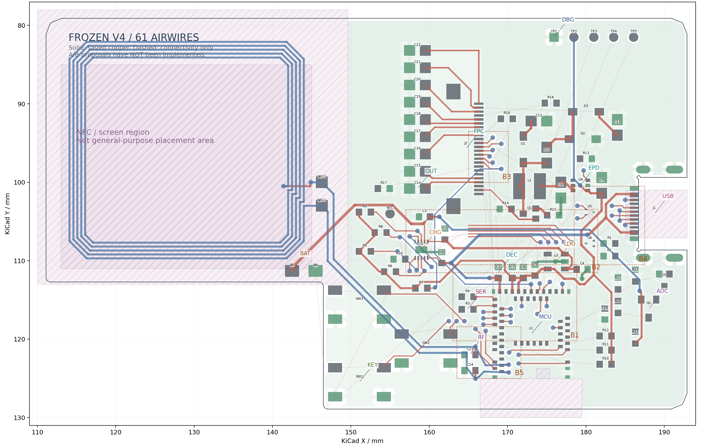
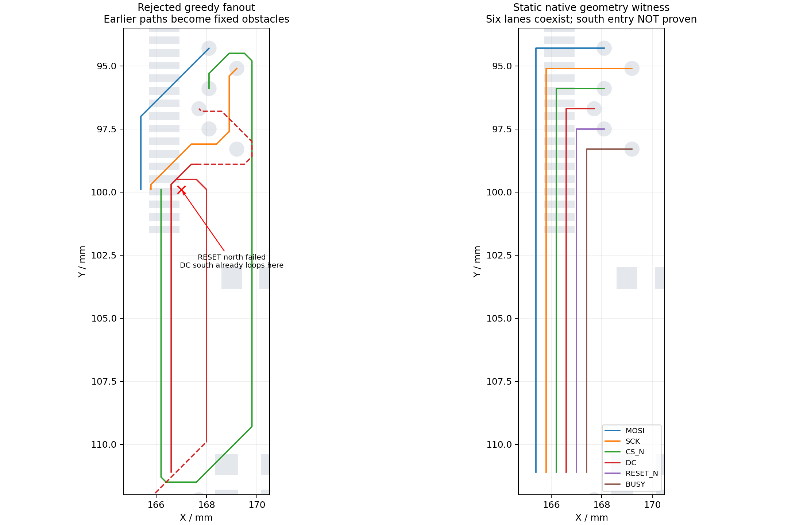
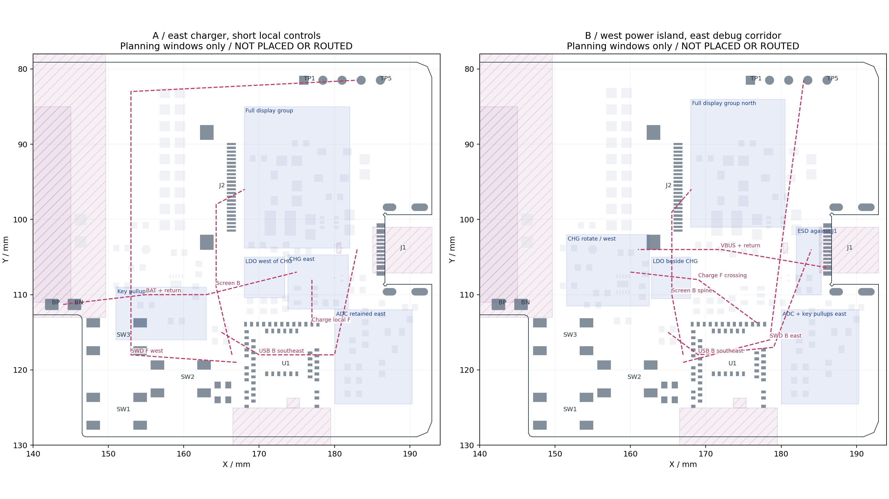

# NFC V4 全板布局与可布性复盘

## 当前确定方案

2026-09-29，按用户最新要求**停止批量试路，仅交付诊断与两个布局方案，等待选定方向后实施**。沿用 `pcb-methodology` 与 `kicad-workflow`，继续在 `master`。没有改板框、接口、天线、料号或电池采样功能，没有继续执行批量路由，也没有上传新的 DFM。

**推荐下一次比较方案 A：把充电组移到 MCU 北侧偏东，使五条充电控制线成为局部连接；把屏幕、SWD、USB 分配到不同的成组通道。**主要代价是电池供回电支路变长。方案 B 保持充电组靠近电池，联合西移 LDO、北移完整显示电源组，代价是保留五条控制线与显示通道的交叉。两者均为布局提案，尚未完成封装排入、实际接通或回流验证。

当前没有证据证明必须改变双层、板框、接口或天线基准。此前搜索失败同时包含**真实的局部几何阻挡**与**固定前序路径产生的算法限制**，不能据此判定整板面积不足。

## 冻结状态与证据入口

- [全板交互图](records/kicad-v4-phase3/layout-review/index.html)：同一张板图含全部功能组、实际焊盘、已有顶底层铜、保存的真实地铜、六个限制区、五处瓶颈、供回电关系及全部 61 个未连接项。可按 52 个已命名网络筛选，放大 MCU/J2/USB 并显示实际引脚；A/B 覆盖层是方案意图。
- [冻结原生候选](kicad/v4-phase3/NFC-Card-V4.kicad_pro)、[工程／库／计划／失败日志备份](records/kicad-v4-phase3/layout-review/checkpoint.zip)、[逐文件 SHA-256](records/kicad-v4-phase3/layout-review/checkpoint-manifest.json)。解压后保留原目录结构，工程仍使用相对库路径。
- [61 项原生未连接 CSV](records/kicad-v4-phase3/layout-review/unconnected.csv)、[全部引脚、网络与区界 JSON](records/kicad-v4-phase3/layout-review/review-data.json)、[33 份计划结果索引](records/kicad-v4-phase3/layout-review/trial-index.json)。失败数是“请求数”，不是原生 DRC 的断点数。
- [保存记录](records/kicad-v4-phase3/layout-review/freeze.json)：GUI 工程身份核对后只保存既有状态，保存前后 PCB SHA 均为 `61d07570596485f2a6e394ac39bdf9f4962ea417b04b9987b5022c49ffb97c6f`；后台路由进程已结束。后来的整板计划没有写入候选。

| 当前冻结原生板 | 结果与解释 |
| --- | --- |
| 明线／过孔 | 361 段／65 孔，含原封不动的 NFC；不代表覆盖完整性或质量 |
| ERC／原理图-PCB parity | 0／0；[ERC](records/kicad-v4-phase3/layout-review/native-erc.json)、[DRC](records/kicad-v4-phase3/layout-review/native-drc.json) |
| 未连接 | 61 项，涉及 34 个网络，包括 5 项 GND；不是只差四根线 |
| DRC 114 项 | 悬空过孔 41、悬空线端 5、热辐条不足 6、USB 近板边 14、NFC 孔环 2／孔径 2、库封装差异 7、文字高度 7、丝印重叠 27、丝印压铜 3 |
| 普通铜间距／courtyard 重叠 | 本冻结板均为 0；不能代替连接、回流或制造验收 |
| 对照与功能 | D、V4 第一阶段、第二阶段保留；256 器件引脚、U1 61 焊盘、66 件 BOM、相对库、固定基准、NFC、规则与采样功能核查见 [身份与约束记录](records/kicad-v4-phase3/layout-review/identity-check.json) |

114 项包括未完成造成的端点提示及待整理库／丝印提示，也包括尚未关闭的真实工艺／返回问题。此次没有新增忽略项或降低规则。两项原生计数应分别读为 **DRC 114、未连接 61**，不能相加后称作 175 种问题。



图的细虚线连接原生 DRC 的对象标记点，**不是建议走线或最短实际路径**；Zone 标记尤其不等于最近铜边。两层以顶视坐标叠加显示，不表示层间已连接。精确板框以原生工程为准。

## 1. 全部需求为何汇集到 MCU 入口

坐标采用 KiCad mm，y 减小是图上方。交互图可查看下表每个网络的所有实际焊盘，包括分支及已接通部分。

| 关系 | 实际端点／出口 | 争用原因与必须共同纳入的分支 |
| --- | --- | --- |
| 屏幕六线 | U1.36 SCK、.37 MOSI、.38 CS、.39 DC、.41 RESET → J2.13/.14/.12/.11/.10；U1.24 BUSY → J2.9 | MCU 左侧内外两排混用，BUSY 从北边出；J2 信号夹在显示电源脚之间。R18 BUSY 上拉及其 EPD_VDD 不能遗漏 |
| 五条充电控制 | U2.7→U1.19 SDA，.8→.16 SCL，.9→.20 INT，.3→.21 PG，.4→.22 CE | U2 在 `(159,108.6)`，MCU 端在 x≈174–177、y≈114–115；五条线全部横穿显示纵向需求，R5–R9 又分散在 x≈152–160 |
| USB 数据 | J1 A6/B6→U5.1→R3.1/.2→U1.35；A7/B7→U5.2→R4.1/.2→U1.34 | 接口在右、MCU USB 脚在左，必有跨区连接；串阻靠近 MCU 并不能消除这条跨区需求。不能使保护器件变成远端支线 |
| USB CC | J1.A5→U6.1→R1.1；J1.B5→U6.2→R2.1 | 与 USB 数据、VBUS、U5/U6 地及连接器槽共同占用 B4；不能只留下两根数据线的空间 |
| SWD／复位 | U1.51 `(168.351,122.934)`→TP4；.53 `(168.351,123.734)`→TP3；.40 `(169.251,117.734)`→TP5 | 两个 SWD 脚靠近固定 NFC 匹配区，目的端是 y=81.501 的背面调试点；还需 TP1 GND、TP2 3V3。原来的“给剩余 SWD 找缝”策略不成立 |
| 三键 | U1.3/.4/.5→SW1/SW2/SW3；R10/R11/R12 上拉分支 | MCU 引脚在右／内侧，按键在左；当前横穿 MCU 下方，与 NFC、SWD 争用出口。每个按键同网的两只焊脚也必须连完 |
| ADC／采样控制 | U1.11→C25.2/R21.2/R20.1；U1.10→R23.1/Q3.1 | Q2/Q3、R20–R23、C25 全部保留。BAT→Q2/R22、栅极网络、分压电源及 GND 都要纳入；不能只接 MCU 的两根线 |
| 显示使能与完整电源 | U1.27→R13/U4.3；U4.6→C10/L1/J2.15；J2.2 GDR、.3 RESE | EPD_EN 也是内排出口。Q1 是实际升压开关；U4 是负载开关。导通、关断、负压泵及输出电容回路必须成组 |
| 电源主干 | J1→C8/U2 IN，U2 SYS→C2→U3/C4，U3 OUT→C5→C6/C7/U1/C9/上拉/TP2，BP→C3/U2 BAT/Q2 | 原布局让多条电源支路在 MCU 北面横穿，再把两面的剩余空隙留给六屏幕线和控制线；供电线本身也会切断信号参考地 |

B1 是 MCU 西北入口；B2 是充电—显示—LDO 的横纵交叉；B3 是 J2 六线出口；B4 是 USB/ESD 与调试通道；B5 是 SWD/按键/NFC 匹配之间的交叉。它们是耦合问题，不能分别把一块“布完”就锁住。

**供回电必须成对看：**C8.2→U2.5/EP、C3.2→U2 EP/BN、C4/C5 地→U3.2、C1 地→U1 USB 地、C6/C7 地→U1 地、C10 地→R15/C12/D2/C13/J2.17。当前原生仍显示 BN、U2.5、U4.2 及两处铜区之间断开；之前独立审计还检出未回到 U2 EP 的地分量，见 [冻结批次审计](records/kicad-v4-phase3/batch1/audit.json)。图中画出的供回电关系只表示必须建立的路径，不能视为已经有合适的返回。

**通道容量有真实限制：**0.15 mm 线／0.20 mm 间距下，六线铜带至少 1.90 mm、五线 1.55 mm、三线 0.85 mm；还要加与外部铜的边界及参考地，不能把这些数当最终通道宽度。六只 0.60 mm 孔同排至少占 4.60 mm。若要从两个这样的异网过孔之间再穿一条 0.15 mm 线，孔中心距至少 `0.60+0.15+2×0.20=1.15 mm`。已有 0.8–1.0 mm 密排孔不提供这条通路；这是局部真实阻挡，不是整板空间不足的证明。

## 2. 真正固定的条件与可以重排的器件组

| 分类 | 本轮处理 |
| --- | --- |
| 机械／天线硬基准 | 双层 0.8 mm、现有板框／USB 缺口与四槽、J1 USB4500 方向、J2/FPC 基准、U1 对板边的天线关系、屏幕／电池总体包络、SW1–SW3、BP/BN、TP1–TP5 均保留；4.8 mm 外壳为目标，尚非实测公差闭合 |
| RF 电气冻结项 | NFC 连续线圈／端口及既定 BLE/NFC 净空不变。C23/C24 本身不是外壳定位件，但在当前线圈与匹配连线冻结条件下不能当作自由件移动；本轮两方案均保留 |
| 可成组移动／旋转 | U2＋C2/C3/C8＋R5–R9/R19/NTC；U3＋C4/C5；U5/U6＋R1/R2；R3/R4；完整显示组 U4/C9/C10/Q1/L1/R13–R16/D1–D3/C11–C13/R18；C14–C22；完整 ADC 七件；R10–R12 |
| 有服务关系、没有旧坐标硬锁 | C1/C6/C7 必须分别贴近 U1.32/.28/.30 并具有本地地返回，但“必须排成 y=111.5 一行”没有依据。C9 服务 U4 IN，C10 服务显示功率回路；不能为整齐单独远移 |
| 继承限制需按用途重推导 | 原生六个限制区并不全是“禁止走线”：NFC 大区禁止铺铜，内区另禁器件；BLE 两区禁铜线／孔；J1 与 U5 局部区只禁铺铜。特别是 U5 局部禁铜矩形不能因沿用旧坐标就成为所有方案的固定墙，移动保护组时应查清用途并同步重推导，不能无依据删除 |

原厂依据、适用页码与未闭合输入集中在 [设计输入](v4-design-inputs.md)：BQ25186 布局与局部返回、TPS7A02 COUT/回地、TPS22919 IN/GND、Raytac 模块电源／天线、Good Display DESPI-E01 完整电源电路、GCT/FPC 机械图。**这些要求约束服务关系与几何，并不授权把本轮任一普通器件坐标永久固定。**

## 3. 失败记录应怎样解释

| 已保存试验 | 实际发现 | 能／不能推出什么 |
| --- | --- | --- |
| `wholeboard-open-crossing` | 剩 SCL、INT、NRESET、SWDIO 四个失败请求；生成的 PG 跨区主干片段合计 62.666 mm、SWDCLK 主干片段 65.442 mm（均不含既有焊盘逃逸，不冒充完整端点线长） | 失败较少不等于布局最好；多数局部逃逸和已布支路仍不可拆改 |
| `wholeboard-debug-bridge` | 五条控制、三条调试桥及主要供电先成功，随后 EPD_EN、CS、MOSI、USB D+ 和一个按键同网焊脚连接失败 | 证明“前一组能接通”并不代表给后一组留下了通道；未应用 |
| `wholeboard-supply-topology` | 改上拉供电入口及 VBUS 层后仍有七个失败请求 | 电源关系确实影响通道；单独换供电入口没有解决入口排列与全体连接 |
| `wholeboard-orthogonal-lanes` | 六条纵向线段先建成，仍有十个接入／供电／显示输出请求失败 | 纵向容量存在不代表两端扇出成立；下面选其中一个失败作独立反例 |
| 带锁定前缀的 Freerouting 对照 | 剩余原生断点仍含同一组四个控制／调试网络，另有 GND | 求解器不同，但锁定输入相近；它不是“独立证明硬约束下不可布” |

上一轮的问题是把过多预设过孔和局部逃逸当成了不变前缀，随后反复改顺序及少量支路。批量搜索没有得到足够的成组摆放变化，回流也没有成为搜索目标。此次冻结这些记录，后续不按失败计划继续逐点补孔。

## 4. 自编布线器审计与独立几何反例

[route-v4-octilinear.py](../scripts/route-v4-octilinear.py) 是固定障碍上的避障接通器，不是联合布局／交互推挤布线器。

| 机制 | 已查代码与影响 |
| --- | --- |
| 指定通道／端点 | `reserved_corridors` 禁止未列入的网络进入，但不会替所有允许网络分配容量；`through` 固定指定点，可能先把后续端点包围。`bounds` 只限定网格搜索，直连快捷分支没有检查其范围；“在指定通道中成功”并非被一致保证 |
| 网格 | 默认 0.1 mm，以目标坐标对齐；端点只试 ±4 格邻域。窄合法窗口可能落在格点之间。当前没有自适应细化或连续可达性证明；这种失败不能等价为物理无路。本次没有继续试不同网格 |
| 图层 | 中间点复用请求的 `end_layer`；仅识别请求端点处现成镀铜孔的两面可达。点层声明和是否允许换层，会改变可达集 |
| 复用已有铜 | `join_existing_copper` 以连通分量的焊盘中心、孔中心和线段顶点选接入点，不对整段铜连续寻找最合适接点。它还可能绕开原来计划从某个电容焊盘出发的供电关系；网络接通不保证拓扑合适 |
| 不能推挤 | 主循环把前序铜全部作为硬障碍；协商脚本也冻结 `C6.1 to C5.1` 之前的局部前缀和预放孔，只能拆改带 owner 的后序对象。已出现 KEY_OK/KEY_NEXT 反复互拆，不是证明板不可布 |
| 质量缺项 | 不把地铜、命名返回、完整开关回路或未来通道纳入成本；绕远／短串行换层仍可能被报告为 routed。`direct_blockers` 只列“最近搜索点到终点直线”的障碍，并不是阻断整个可达域的最小割证据 |

**选定案例：RESET 的 J2 北侧接入失败。**来自 `wholeboard-orthogonal-lanes-spec-plan.json`：请求 `(167.0,99.9)→(168.1,97.5)` 未找到路径。前序 `DC south` 为连接 MCU 侧与南端 `(166.6,111.1)`，实际先绕到 y=99.5，再沿已接入通道返回南端，F/B 两段合计 **33.396 mm**。前序 CS 北端也绕到 y=111.5，长 **33.250 mm**。它们实际占掉了后续北端出口。

独立核查没有再次运行 A*：用 **KiCad pcbnew 原生对象**保留模型的原生焊盘、固定 NFC、指定 0.60/0.30 mm 孔及已完成局部前缀，统一移除这组六线的南北扇出，直接构造六条 B.Cu 嵌套正交线。通道 x=165.4/165.8/166.2/166.6/167.0/167.4，从 y=111.1 延伸至各自 J2 出口 y，再转向原出口孔。

- 六线之间及对保留离散异网铜的最小净距为 **0.250 mm**，超过原有 0.200 mm；线宽仍 0.150 mm。
- KiCad **重铺铜后**检查：这 12 个反例线段没有铜间距等几何违规；有 6 个预期南端悬空提示。整个诊断夹具仍有 197 条各类提示、74 个未连接，不能叫整板通过。
- 该反例只证明 **J2 北侧和纵向六线容量可以同时成立**。MCU 南侧接入被明确移除、尚未证明；参考地也没有因此通过。
- 因此，原失败状态的阻挡是真的，但“固定前序路径后失败”不能推出“J2 局部放不下六线”，更不能推出必须扩板／加层。

[独立结果及原路径](records/kicad-v4-phase3/layout-review/algorithm-case.json)、[原生 DRC](records/kicad-v4-phase3/layout-review/j2-witness-drc.json)、[静态构造脚本](../scripts/check-v4-j2-fanout-witness.py)。夹具仅保存在 `artifacts/kicad-v4-phase3/j2-witness/`，未替换当前 PCB。



## 5. 两个具有布局差异的方案

图中是**待排入的器件组窗口**，不是已验证的封装摆放。灰色是现有位置参考，深灰为固定基准；红虚线表示通道意图，不作为精确线长或已接通证据。



| 项目 | A：充电东置，减少跨区控制线（推荐） | B：电源西置，显示电源北移 |
| --- | --- | --- |
| 充电整组 | U2/C2/C3/C8、R5–R9/R19/NTC 重排到 x≈173.8–181.8、y≈104.7–111.9，转向使五控制脚朝 MCU 北端、IN 朝 USB；BAT 朝西 | U2 与三电容保持靠电池一侧，窗口 x≈151.5–162.5、y≈102–111.5，整体转向使控制出口朝东；控制电阻与 NTC 同步排入 |
| LDO 与 MCU 去耦 | U3/C4/C5 放充电组西侧 x≈168–173.4、y≈105–110.4，输出朝 C6/C7/U1；C1/C6/C7 不强制成行，按服务引脚排 | U3/C4/C5 与充电组相邻，x≈162.8–168、y≈105–110.5，SYS 短；3V3 从西侧送至 MCU 本地 C6/C7，仍需横穿 |
| 显示完整电源组 | 在 J2 东侧至北侧 x≈168–182、y≈85–103.8 内重排，Q1/R15 朝 J2.2/.3；导通、关断、泵及 C9/U4/C10 一并调整，腾出新充电组位置 | 完整组更明确地向北排，x≈168–180.5、y≈84–101，释放 MCU 东北到调试点的通道；GDR/RESE 距离可能变长，不单独留下 Q1 |
| 输出电容 | C14–C22 可按 J2 各电源脚分成两列／两段，不强制旧单列；本地地先安排 | 同样按引脚拆分电容列，但需保留西侧电源组与 FPC 之间的屏幕通道 |
| USB / CC | U5/U6/R1/R2 作为保护组贴接口左侧；R3/R4 在 MCU 左 USB 出口；两数据线由 MCU 内侧向东南同走，避开西侧屏幕纵向组；CC 留接口局部 | 同样保持保护先经过、串阻靠 MCU；保护组向 J1 收拢，给其西侧东向 SWD 通道留成组窗口 |
| 屏幕六线 | B.Cu 从 MCU 西北整体进入 x≈163.5–167.5 的纵向区域，再按 J2 顺序共同扇出；BUSY 的北边出口同时纳入，不能最后补入 | B.Cu 中央纵向，五条充电控制在 F.Cu 横穿；先共同确定南北端与交叉区容量 |
| 充电五线 / EPD_EN | 五线在 MCU 北侧短距离接入，不再全部横穿屏幕通道；EPD_EN 单独与显示供电控制入口配套 | 五控制线作为一组在 y≈107–110 横穿；EPD_EN 继续向北，必须与五线、屏幕六线和 3V3/SYS 一起验证 |
| SWD 三线及调试供地 | 三线从 B5 共同扇出，主干走释放出的西侧 F.Cu、绕至固定顶部触点；同组走向，不分走左右两边；TP2/TP1 同时规划 | 三线从 MCU 内／侧面共同接入东侧 B.Cu 通道，再到顶部触点；U3 西移和显示组北移提供空间，USB 局部桥仍须验证 |
| 按键 / ADC | R10–R12 移至按键侧，减少右侧分支；按键铜与 B5 同时重排。ADC 七件保留在 MCU 右侧成组安排，BAT 采样支路从新充电组就近分出 | ADC 七件与按键上拉在右侧重新分组；按键横穿 MCU 下方的需求仍在，不能声称北移显示组已解决 B5 |
| 供回电与参考地 | USB→充电支路缩短；BP/BN 到充电组变长，必须分配成对的供回电走廊。屏幕 B 主干对面保留 F 地，SWD F 主干对面保留 B 地；局部交叉与换层处须追踪实际地返回 | BAT/BN、SYS 可更集中；VBUS 与 3V3/控制仍需跨区。屏幕 B 与控制 F 交叉区是重点回流风险，必须安排连续侧向地及跨层接地，不能以“全地网连通”代替 |
| 主要代价／否决条件 | 电池供回电加长；西侧 SWD 可能明显绕远。若必须穿过 NFC 区、依赖细颈回地，或五控制仍绕到 J2 北侧，则 A 不成立 | GDR/RESE 可能加长，五控制交叉仍在。若交叉区只能多次短距离换层，或挤掉显示／USB 参考地，则 B 不成立 |

选择 A 的理由是**消除五条跨区连接的根本需求**，而不是相信更少过孔。它允许用一条变长的 BAT 供回电走廊换掉五条横穿信号；这项取舍必须在实际线长、供回电截面、压降条件预算和装配排入后复核。屏幕峰值、电池额定电流仍未知，不能提前承诺电池支路的载流／热通过。

两方案都不依赖更小过孔、降低间距、删除采样或改 GPIO 映射。窗口若排不下真实 courtyard／服务关系，就回到该组布局比较，不把窗口画出来当作成立。没有提出改变硬基准的实施请求。

## 6. 下一次试布的明确通过条件

待用户选定 A/B 后，只实施一个命名候选，以下门槛共同成立才可推进详细布线：

1. **器件组确实排入。**固定基准／天线／NFC／256 引脚网络／66 件 BOM 不变；器件本体、courtyard、USB 槽与机械包络无新增冲突。U2 全组、U3/C4/C5、显示完整功率组都有命名供回电与取舍记录。
2. **同一候选中同时验证全部拥挤连接。**六屏幕线＋EPD_EN、USB D±/CC/VBUS、五充电控制、三 SWD＋TP1/TP2、三键及上拉、ADC 两控制／采样线和 BAT 支路、NTC、SYS/3V3、J2 全部电源输出都进入连接清单；B1–B5 中这些路径不能仍有未连接端点。其它若分批，逐项列出实际可用余量与出口，不能只画空白区域。
3. **回流与回路同时成立。**BN→U2 EP、C8→U2 地、C4/C5→U3 地、U1 三组去耦、U5/U6→USB 地、显示导通／关断／泵／输出地逐条追踪真实填铜；新增孤立地及热辐条不足为零。SCK/USB 的对面缺口要展示两侧实际返回和换层接地关系，不能仅凭投影长度或整网连通作结论。
4. **路径质量可解释。**普通线为 H/V/45；按命名端点报告实际线长和串行换层，列出每次换层绕开的对象。任何前序信号绕过另一端的扇出区再回来、相邻同向连接分绕整板两侧、无必要的短串行换层，都触发成组复盘。没有统一孔数上限。
5. **原生与独立检查相互校验。**重铺铜后的 ERC 0、parity 0；所验证通道原生铜间距／孔间距／courtyard／热连接无新增问题。既有 USB 板边、NFC 孔尺寸等工艺项保留对象和接受状态。保存重开与几何／网表一致，才把该次试布记作通过。
6. **停止条件。**同一通道再次出现“接一条挡一条”时，给出端点、阻挡对象、受影响返回及组级替代，不继续扫顺序／网格／孔位；此次证明了某个局部有容量，也不允许把它升级成整板通过。

C3 换料建议、C1/VBUS 保护、U3 全轨负载与压差、屏幕峰值、电池额定电流及装配／温升边界沿用 [决策依据](v4-phase3-decisions.md)，不因这份布局复盘自动关闭。当前制造问题未关闭，本轮不以诊断图生成新的“最终”制造包或 DFM 结论。

## 复现

以下只保存、检查、绘制诊断，不执行批量试路；从仓库根目录运行。

```bash
python3 projects/nfc-business-card/scripts/review-v4-layout.py
python3 projects/nfc-business-card/scripts/verify-v4-phase2.py --stage v4-phase3
kicad-cli pcb drc --format json --schematic-parity \
  -o projects/nfc-business-card/hardware/records/kicad-v4-phase3/layout-review/native-drc.json \
  projects/nfc-business-card/hardware/kicad/v4-phase3/NFC-Card-V4.kicad_pcb
kicad-cli sch erc --format json \
  -o projects/nfc-business-card/hardware/records/kicad-v4-phase3/layout-review/native-erc.json \
  projects/nfc-business-card/hardware/kicad/v4-phase3/NFC-Card-V4.kicad_sch

# Independent static witness, not the editable candidate:
/Applications/KiCad/KiCad.app/Contents/Frameworks/Python.framework/Versions/Current/bin/python3 \
  projects/nfc-business-card/scripts/check-v4-j2-fanout-witness.py
kicad-cli pcb drc --refill-zones --save-board --format json \
  -o projects/nfc-business-card/hardware/records/kicad-v4-phase3/layout-review/j2-witness-drc.json \
  projects/nfc-business-card/artifacts/kicad-v4-phase3/j2-witness/j2-witness.kicad_pcb
python3 projects/nfc-business-card/scripts/summarize-v4-j2-witness.py
```

身份脚本的输出文件名沿用 `final-validation.json`，内容明确为约束／身份通过、设计未放行；本轮结果另存 `layout-review/identity-check.json`。运行图册脚本不改 PCB，复跑时校验冻结 PCB 哈希。

[交付核对记录](records/kicad-v4-phase3/layout-review/verification.json)：238 个归档文件的指纹与 ZIP CRC 均通过；76 个原生封装全部归入功能组，61 项未连接完整进入 CSV／图册；本地报告链接、网络筛选、A/B 切换及供回电覆盖层已检查。
