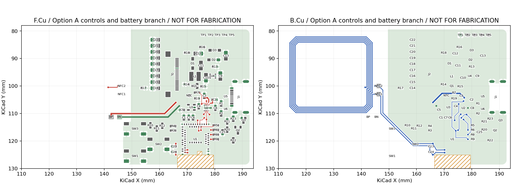
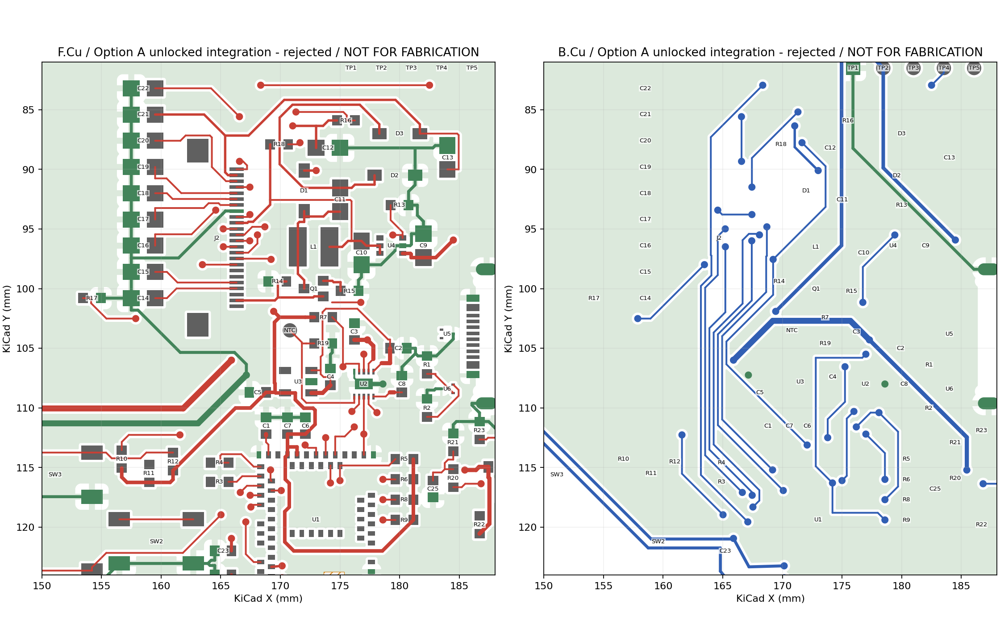
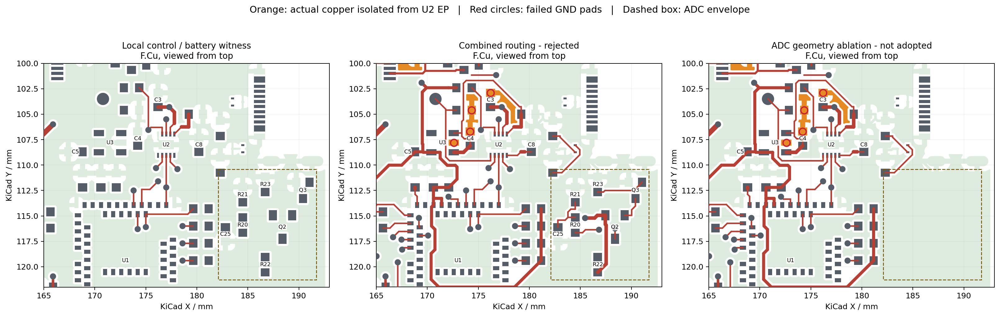

# V4 方案 A 实施与联合验收

## 当前确定方案

2026-09-29，已按用户选择实施**完整功能方案 A**，另存工程，未覆盖 D、V4 第一／第二阶段及复盘冻结板。使用 `pcb-methodology` 与 `kicad-workflow`，在 `master` 工作。

**充电整组能排入，五条充电控制线已成为 MCU 北侧的局部连接；但当前整板合并候选未通过共同连接和返回门槛，因此不推进该份铜线的详细收尾。**否决对象是本次实际合并的布局／通道组合，不是“方案 A 永远不可行”或“板面积不足”。未再扫描布线顺序、网格或预设孔位。

- [A 局部验证原生工程](kicad/v4-option-a/README.md)：136 段／22 孔，含完整原始 NFC 74 段／6 孔；只落实五控制线及 BAT／BN、C2/C3 局部连接，其余保持未完成。保存重开后 SHA 一致。
- [A 整板合并失败对照](kicad/v4-option-a-integration-rejected/README.md)：612 段／57 孔。五充电控制、六屏幕信号与部分电源同时连通，但失去关键地返回，另有 USB、SWD、按键等断点。保留供复盘，禁止用作制造来源。
- [几何删减对照记录](records/kicad-v4-option-a/sampling-ablation.json)：仅在独立诊断副本移除 Q2/Q3、R20–R23、C25、四个专用网络铜及采样 BAT 支路。主 BAT 和全部共享 GND 铜保留。未修改功能工程的原理图／BOM。删减没有恢复主要失败返回，**不采纳删除采样功能**。

| 验收维度 | 本轮结论 |
| --- | --- |
| 整板设计是否完成 | **否。**局部验证板 98 未连接；整板合并对照 26 未连接。不能用两块板各自接通的部分拼成“全板通过” |
| 本地检查是否通过 | **身份与逐引脚一致性通过，完整设计检查未通过。**ERC 0、parity 0；两板各有 DRC 55，分类不同，关键返回与热辐条问题仍在 |
| 制造问题是否关闭 | **否。**本轮没有最终制造包或新的 PCB/SMT DFM；旧 D／phase2 结果不覆盖本板 |
| 哪些仍待实测／外部证据 | 电池额定充放电电流、屏幕峰值、低压刷新／启动、封壳温升、USB 特殊近边装配及 NFC 调谐。C1/C3、VBUS 保护等公开资料结论继续保留，未因布局改变关闭 |

## 摆放与硬约束

原生 courtyard、铜间距和短路检查均为 0。保留 76 封装、266 焊盘、256 器件引脚和 66 件 BOM，U1 61 焊盘网络不变。双层 0.8 mm、板框、中沉 USB/FPC、U1 天线基准、NFC 全部铜、C23/C24、BP/BN、调试点和三个按键基准不变；4.8 mm 外壳目标没有改变，未将其写成实物装配通过。

| 器件组 | 实际实施与取舍 |
| --- | --- |
| U2 与 C2/C3/C8 | U2 `(177,108,180°)`；C2 `(179.9,105,0°)`、C3 `(176.2,103.6,90°)`、C8 `(180.2,108,90°)`。先按真实封装排入，再使 BAT/SYS 出口避开 PG/CE。C3 服务路径变长，见下表 |
| U3/C4/C5 | U3 留充电组西侧 `(171.5,107.8,90°)`，C4 `(174.2,107.4,90°)`、C5 `(168.1,108.7,180°)`。整板合并后的供电绕行与返回隔离说明这组位置尚未定型 |
| 控制上拉 | R5/R6/R8/R9 从阻挡 MCU 北侧出口的横排改为东侧竖列，x=180.4，y=114.3/116/117.7/119.4；R7 在 `(173.6,102.4)`。不是仅改变布线顺序 |
| 显示电源 | U4、Q1、L1、二极管、电容及相关电阻整体北移 4 mm，释放充电位置。U4 仍是负载开关。整组移动不表示关断／泵／输出返回已通过 |
| USB 与 CC | U5 移至 `(184,103.8,180°)`，U6／R1／R2 成组靠接口。U5 的“仅禁铺铜”窗口随器件平移；连接器、槽孔、锡膏不变。当前整板合并未证明这一保护组的完整扇出 |
| 电池采样 | 七件整体向右平移 0.4 mm，功能完整；使 MCU 外侧焊盘边到控制电阻信号焊盘边的实际间隔为 1.292 mm，可放入 0.6/0.3 mm 过孔并保留原间距。没有把该间隔当成整板可布性证明 |

规则依据及适用性沿用[设计规则索引](../../../docs/pcb-design-rules.md)的 DC-001/DC-003、SW-002/SW-003 与[原厂输入核查](v4-design-inputs.md)：去耦对应具体服务引脚；供电与本地地成组；完整显示开关回路必须一起验证。真实 courtyard 不删除，不以缩小孔／间距换接通。仅恢复 IPC 移动后工具错误改写的封装本地几何，原始焊盘、锡膏、装配边界保留。

## 五条控制线：实际铜路径比较

使用保存后的铜中心线和焊盘接触计算，不把端点直线距离当实际线长。D 对照是保留 912 段／198 孔的原始导入板；不是后续 V4 铜线。线长忽略电镀孔的垂直长度，换层数单独列出。[D 测量](records/kicad-v4-option-a/d-path-comparison.json)、[A 局部测量](records/kicad-v4-option-a/controls-power-audit/audit.json)、[同版合并测量](records/kicad-v4-option-a/joint-seeded-audit/audit.json)。

| 网络及端点 | D 长度／串行换层 | A 长度／串行换层 |
| --- | --- | --- |
| SDA：U2.7 → U1.19 | 86.157 mm／6 | **8.978 mm／2** |
| SCL：U2.8 → U1.16 | 89.646 mm／4 | **4.884 mm／0** |
| INT：U2.9 → U1.20 | 33.421 mm／4 | **7.502 mm／2** |
| PG：U2.3 → U1.21 | 43.887 mm／4 | **18.321 mm／2** |
| CE：U2.4 → U1.22 | 30.961 mm／6 | **10.088 mm／2** |

五条和各自的信号侧上拉分支在同一静态方案中构造并检查，不逐条冻结。SCL 主路径同层；SDA/PG 通过底层到 MCU 内排，INT 在底层跨过 SCL 再回顶层，CE 由 U2 北侧转到底层接 MCU。PG 为避开组内交叉，仍沿组西侧绕行，**并非五条都实现最短直连**。上拉的 VDD 侧在局部板未完成；整板合并时加入，不能漏报。

新增普通线均为 H/V/45°，最小 0.15 mm；孔保持 0.60/0.30 mm，最小铜间距 0.20 mm。SCL 起点相对 U2.8 中心偏 1 µm，仍在焊盘内，是消除无意义碎段的焊盘接入，不是任意端点取整。NFC 保持原始几何。[静态构造及独立相交检查](../scripts/plan-v4-option-a-controls.py)、[IPC 写入记录](records/kicad-v4-option-a/controls-ipc.json)。



两面均按顶视坐标显示；绿色为保存后真实填铜。图中大面积空白／未布区域不表示其它线路已有通道。放大见[关键区](records/kicad-v4-option-a/controls-power-audit/critical.png)。

## 电池路径的收益、代价与条件预算

| 路径 | D | A |
| --- | --- | --- |
| BP → C3 | 38.241 mm／8 次换层 | **40.858 mm／2 次换层**，增加 2.617 mm（约 6.8%） |
| C3 → U2 BAT | 2.161 mm／0 | **4.123 mm／0**，变差，不能被总孔数减少掩盖 |
| BP → U2 BAT | — | 42.781 mm／2；从 C3 附近分支，不能把往返电容支线重复算进主路径 |
| BN 明线 | — | 0.5 mm 宽，23.327 mm 后经 `(167.15,107.251)` 孔进入底层地；U2 EP 另经 `(178.6,108)` 接地 |

BAT/BN 在电池焊点出口先成对向右；BAT 到 `(165.9,106)` 换底层，经上方到 `(177.3,104.3)`，再由顶层进入 C3/U2。主支路 0.5 mm，C3 局部 0.35 mm，0.4 mm 节距引脚附近保留约 1.216 mm 的 0.15 mm 颈段。没有用细长 0.15 mm 铜线代替整条电池主支路。

**仅作条件计算：**假设成品铜厚 35 µm、20°C 电阻率 1.724×10⁻⁸ Ω·m，按实际宽度／长度积分，BP→U2 的明线约 45.7 mΩ，BN 的已知 0.5 mm 明线约 23.0 mΩ。两者合计约 68.7 mΩ，100/200 mA 时对应约 6.9/13.7 mV。**这不是回路阻抗上界**：尚未加入过孔、铺铜路径、接点、公差、温升，也没有把 100/200 mA 当电池或屏幕的保证值。当前工程未给出已验收的成品铜厚，35 µm 是计算假设。

[宽度／长度与条件计算数据](records/kicad-v4-option-a/battery-conditional-budget.json)保留全部假设和排除项。

局部板重铺铜后 BN、C3.2、C8.2、U2.5/EP 属于同一实际地网络；这只关闭了连接性。**整板合并后 C3.2 再次失去该返回，因此不能判断延长的电池供回电已合理。**新增引线与既定 NFC 焊点出口的耦合、实际 RF 性能仍须实测；没有改变 NFC 铜或既有天线禁区来通过检查。

## 当前合并候选的具体否决项

该对照在本轮新摆放与上述局部线基础上纳入全部连接需求。DSN 中只有原始 NFC 固定；其余已有 74 个 wire/via 条目均为 `route`，没有锁死预设过孔或前序逃逸。[解除固定的输入记录](records/kicad-v4-option-a/joint-seeded-unlocked.json)。完成一次有界合并后即检查并停止，没有继续扫顺序。

1. **真实地返回被破坏。**C3.2、C4.2、U3.2、R19.2、R14.2 不再到达 U2 EP。独立实铜分析找到四块不属于 U2 地分量的顶层铜：16.90528、2.74213、3.15420、0.60716 mm²；原生同时报告 4 项 GND 未连接。这不是单凭 SCK 投影缺口长度判断回流。
2. **关键连接未共同成立。**五充电控制与六屏幕信号同时接通，六屏幕主路径约 24.5–30.6 mm、均 2 次换层；但 USB 数据至 U5/MCU、CC/VBUS、SWDCLK/NRESET、EPD_EN、按键和采样仍有断点。完整 [26 项原生清单](records/kicad-v4-option-a/joint-seeded-drc.json)保留对象和坐标。不能用另一块板已接通这些网络来代替同版验收。
3. **供电路径质量退化。**C2→C4 为 14.452 mm 顶层绕过北侧控制／电容组；C5→C9 的 3V3 支路达到 55.421 mm、2 次换层，SWDIO 达到 60.694 mm、3 次换层。前者同时伴随 U3/C4 地断开，后者未与 SWDCLK/NRESET 成组完成，不能因“能测到一条通路”接受。
4. **热连接仍未通过。**局部板 C4.2、U3.2、U4.2 热辐条不足；合并板仍有 2 项热辐条不足和 1 段悬空铜。没有降为单辐条、改忽略规则或删除边界来清零。



推荐下一次针对**U3/C4/C5、C3 的本地地、SYS 进入和 VDD 分支、EPD_EN／屏幕入口**一起比较实际几何；保留充电东置带来的五条局部连接收益，但允许重新安排这些局部线和器件，不把本报告路径变成不可移动约束。USB 需复用 phase2 已验证的同接口扇出几何重新适配 U5/U6 组；其失败目前也不能证明接口周围没有空间。

下一次通过条件：上述 26 项中所有关键端点同版接通；命名地返回与热连接全部成立；C5→C9、SWD 三线及六屏幕线没有由局部前序路线造成的跨区绕行；新增铜几何检查通过。之后才继续整板收尾。当前没有提出改板框、加层或移动接口／天线的必要性证据。

## 删除采样区的独立几何比较

完整功能方案已先排入、试布和合并检查。随后才执行一次采样消融，**不是通过删功能来制造较低未连接数**。

- 释放的是七件 courtyard 的并集 **41.64749 mm²**；包围范围 x=182.100–191.705、y=110.405–121.295 mm。不是把约 104.6 mm² 的包围矩形全算成新增可用面积。
- 此次没有把该面积分配给新器件或通道；先检查删去这些对象是否直接恢复当前失败的返回。结果五个失联地焊盘及四块孤立地铜的面积**完全相同**。USB、SWD 主要断点也保留。
- 未连接从 26 变成 23 主要因为被删除的端点消失，不能解释为设计改善。该副本故意保留原理图作几何对照，不能作为电气一致、BOM 或制造候选。[消融实铜审计](records/kicad-v4-option-a/sampling-ablation-audit/audit.json)。
- **功能代价：**失去 MCU 控制的电池电压分压采样，无法依靠本电路读取电池电压／估算剩余电量；不是移除充电器或电池保护板。由于没有验证出空间被有效使用的收益，本轮不采纳该功能损失。



橙色为未连到 U2 EP 的实际地铜，红圈标失联地焊盘；虚线矩形只是采样组包围范围。删采样后，主要失败区域未改变。

这个反例只证明“删除现有采样区本身没有修复当前主要失败项”，不声称所有可能的器件组迁入方案都没有收益。若以后有具体组级安排能利用该区域，应重新比较完整功能搬移与删除功能两者，而不是把本次路由失败当作删除依据。

## 工具假性失败与边界

保留的失败输入和日志见 [试验档案](records/kicad-v4-option-a/trial-checkpoint.zip)。以下结果全部未采纳：

| 发现 | 核查及处理 |
| --- | --- |
| 自动扇出把线缩至 0.1124 mm | 原生 `track_width` 检出。仅关 automatic neckdown 仍不足；禁用单独 fanout 阶段后才保持最小 0.15 mm。没有降低工程线宽规则 |
| 仅禁铺铜区在 DSN 中成为禁走线区 | U5/J1 焊盘出口被错误阻挡。按原生规则修正工具模型，原生 PCB 限制区不变；NFC 保守限制仍保留，仅允许已指定 BAT/GND 引线通过固定焊点出口 |
| SES 导入不包含固定 NFC 铜 | 导入隔离副本后恢复原始 80 个 RF 对象，并核对位置、宽度、层和形状；不能把缺失 NFC 导致的断网归因于摆放 |
| 首个合法模型整板试布把 BP→C3 绕到 79.112 mm | 拒绝采用，改为直接构造五控制／电池供回电整体，再做一次允许拆改的整板合并。后者虽然保持 40.857 mm 的 BP→C3，仍因关键返回和缺线被否决 |

原生检查和独立几何检查优先于路由器内部统计。工具失败、端点搜索失败与实际铜冲突分开记录；没有据此宣布板面积不足。

## 保存、复核及复现

[身份检查](records/kicad-v4-option-a/identity-check.json)：340 个既有文件指纹不变；全部器件引脚、BOM、固定基准、NFC、规则／排除项通过。唯一移动的限制窗口是随 U5 平移 3.5 mm 的器件自身仅禁铺铜区；天线与机械区不变。[关闭后重开并保存记录](records/kicad-v4-option-a/reopen.json)确认磁盘 SHA 不变。

| 原生分类 | A 局部验证 | A 合并失败对照 |
| --- | ---: | ---: |
| ERC／schematic parity | 0／0 | 同一原理图／0 |
| 未连接 | 98 | 26 |
| 铜间距／短路／courtyard 重叠 | 0／0／0 | 0／0／0 |
| 热辐条不足／悬空线 | 3／0 | 2／1 |
| USB 铜到板边 | 14 | 14 |
| 原 NFC 孔环／孔径 | 2／2 | 2／2 |
| 库封装差异／文字高度 | 7／7 | 7／7 |
| 丝印重叠／压铜 | 17／3 | 17／3 |
| DRC 合计（不含未连接与 parity） | 55 | 55 |

从仓库根目录复核；先关闭对应 PCB Editor 后，才使用带 `--save-board` 的铺铜检查。无需安装或升级工具。

```bash
python3 tools/kicad/health.py
kicad-cli sch erc --format json \
  -o projects/nfc-business-card/hardware/records/kicad-v4-option-a/native-erc.json \
  projects/nfc-business-card/hardware/kicad/v4-option-a/NFC-Card-V4.kicad_sch
kicad-cli sch export netlist --format kicadxml \
  -o projects/nfc-business-card/artifacts/kicad-v4-option-a/netlist.xml \
  projects/nfc-business-card/hardware/kicad/v4-option-a/NFC-Card-V4.kicad_sch
kicad-cli pcb drc --format json --schematic-parity \
  -o projects/nfc-business-card/hardware/records/kicad-v4-option-a/controls-power-drc.json \
  projects/nfc-business-card/hardware/kicad/v4-option-a/NFC-Card-V4.kicad_pcb
python3 projects/nfc-business-card/scripts/audit-v4-phase2.py \
  projects/nfc-business-card/hardware/kicad/v4-option-a/NFC-Card-V4.kicad_pcb \
  projects/nfc-business-card/hardware/records/kicad-v4-option-a/controls-power-audit \
  --label 'Option A controls and battery branch' --include-service
python3 projects/nfc-business-card/scripts/verify-v4-option-a.py
```

源布局计划、IPC 操作记录、静态控制／电池构造、合法／非法工具输出分开保留。重做布线试验应从归档的指定输入另存，不能把 placement/controls plan 重复追加到已完成同批线路的工程。

电气／制造待办继续见 [V4 决策依据](v4-phase3-decisions.md)：C3 换用现有 4.7 µF 的建议未应用；C1 与 VBUS 保护需共同选择；U3 200 mA 是全轨额度，不是屏幕峰值保证；301030 带保护板、3.7 V／最高充电 4.2 V 已知，电流额定仍缺。USB 近边、槽孔、接触比、U1 支撑及阻焊桥未获得本板接受。没有新生成最终 Gerber/BOM/CPL 或运行最终 DFM，没有下单、付款、烧录、联系供应商或 push。
