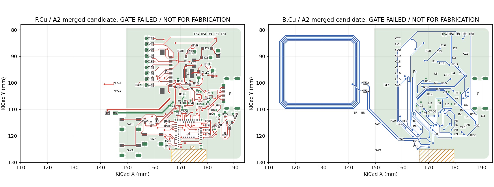
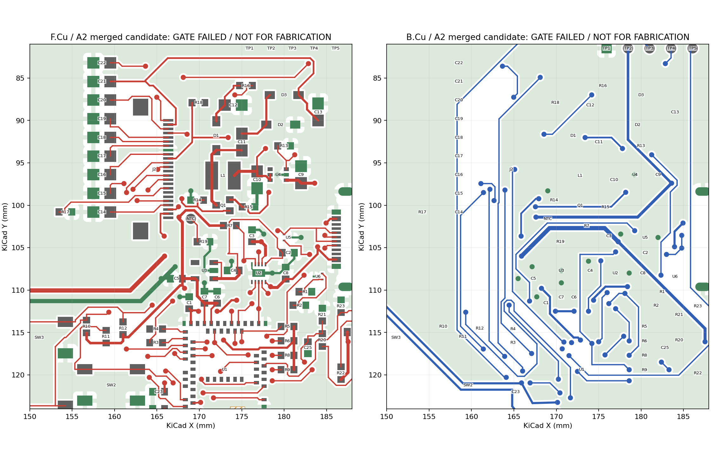
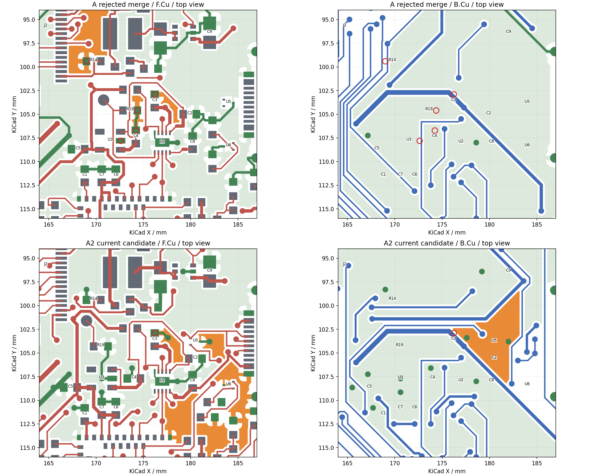

# V4 方案 A2：供回电联合重排与合并否决记录

## 当前确定方案

2026-09-29，继续在 `master`，使用 `pcb-methodology` 和 `kicad-workflow`。保持充电组靠近 MCU，另存东西两种 U3 组摆放和完整连接范围的合并尝试。**整板尚未完成；关键连接与返回未同时成立。当前失败状态已保存重开核对，停止继续批量试路。**这里的否决对象是下列具体合并状态，不是对方案 A、双层或既定板框的全局不可布证明。

最新入口：[A2 合并失败候选](kicad/v4-option-a2-full/README.md)。目录名 `full` 表示整板连接范围的尝试，不表示整板通过。最终板为 666 段／88 孔，**ERC 0、parity 0、DRC 59、未连接 16**。双层 0.8 mm、4.8 mm 外壳目标、U1／接口／按键／调试／天线基准及完整采样功能保留；无改料号、放宽规则或新增忽略项。没有生成本轮最终制造包，也没有执行本轮线上 PCB／SMT DFM。

[重开记录](records/kicad-v4-option-a2/reopen-check.json)确认保存、退出本候选编辑器、重新打开再保存后 SHA-256 一致：`c2e70a964cc8b4850bd4bb8f1027148edceec1493e024230bf05a1192b410715`。旧 A 局部板、旧 A 失败板及 phase1/2/3 共 527 份受核对文件未变。原理图／BOM、266 个焊盘网络、256 个器件引脚、66 件物料、76 个封装及相对项目库核对见 [身份记录](records/kicad-v4-option-a2/identity-check.json)。局部焊盘、阻焊、锡膏、装配边界及其它封装图形与 phase3 一致，只有允许的刚体摆放变化。

## 独立候选与已验证失败

| 原生工程／记录 | 实际内容 | 原生结果与边界 |
| --- | --- | --- |
| [旧 A 局部板](kicad/v4-option-a/README.md)／[旧合并失败板](kicad/v4-option-a-integration-rejected/README.md) | 原样保留 | 旧合并 26 未连接；不能与本轮结果拼接 |
| [A2 东侧 U3 供电板](kicad/v4-option-a2/README.md) | U3/C4/C5 移到充电组东北侧；C3 转为更直接 BAT 支路，电源／升压骨架 | 188 段／23 孔；85 未连接、DRC 60；早期 U3→C5 约 7 mm 的摆法被否决，重排后 2.623 mm |
| [东侧整板合并失败板](kicad/v4-option-a2-integration-rejected/README.md) | 全部非 NFC 铜允许改动的有限联合路由 | 617 段／65 孔；26 未连接、DRC 65；工具的理想地平面不能替代原生填铜，合并地岛否决 |
| [东侧扩大重排失败板](kicad/v4-option-a2-expanded-rejected/README.md) | 再联合调整 USB/CC、MCU 电容及 R19；保留真实封装 | 只有 NFC 原铜；整组显式计划发现 43 项几何冲突，未把失败计划写入 PCB。不是空间不足证明 |
| [A2 西侧局部板](kicad/v4-option-a2-west/README.md) | U3/C4/C5 向西成组、C2/SYS/C3 返回、USB/CC、五控制及内排出口共同构造 | 237 段／38 孔；71 未连接、DRC 57；五个旧失败地焊盘及整板地在此未完成状态连通 |
| [西侧完整范围合并失败板](kicad/v4-option-a2-full/README.md) | 保留显式地骨架，全部信号／电源铜可重布；随后联动 C6/C7 返回及一次剩余网批次 | 最终 666 段／88 孔；16 未连接、DRC 59；C3 与其它地分量重新断开，BUSY/CS/USB/TS 未共同成立 |

西侧首次合并为 594 段／72 孔、19 未连接；其 MCU 去耦地返回失败，故继续联合移动 C6/C7 并重建返回，再尝试剩余网络。最终 16 未连接比 19 少，**地返回却更差，不接受“断点数减少”作为进步证明**。[有限试验 ZIP](records/kicad-v4-option-a2/bounded-trials.zip)保留两次 DSN/SES、日志、19 未连接时的原生 PCB、初次长去耦失败板及末批前模型；[指纹清单](records/kicad-v4-option-a2/bounded-trials-manifest.json)可核对。

## 联合摆放与供回电

以下是最终合并板的 KiCad 坐标，单位 mm／角度；没有沿用旧铜作为机械约束。

| 器件组 | 本轮实际位置／关系 | 结果及代价 |
| --- | --- | --- |
| U2/C3/C8 | U2 `(177,108,180°)`；C3 `(176.2,103.6,90°)`；C8 `(180.2,108,90°)` | 五控制仍局部连接；西侧最终方案保留旧 A 的 BAT 路径，C3→BAT 4.123 mm 的代价没有消失 |
| SYS、U3/C4/C5 | C2 `(180.5,105.6,0°)`；U3 `(170.6,107.7,90°)`；C4 `(174,107.7,180°)`；C5 `(167.3,108.65,180°)` | C4→U3.1 3.686 mm，U3.5→C5 1.500 mm；输入／输出电容到 U3.2 的局部返回同版成立。SYS 北侧绕行仍需改善，不能只看本地去耦 |
| MCU 电容与 VBUS | C1 保留 `(168.8,111.5,90°)`；C6/C7 分别 `(172.1,110.85,90°)`、`(170.6,110.85,90°)` | 两电容向北移动 0.65 mm，重建 C1/C6/C7/U1.33 返回；U1.15 仍不在该返回分量，VBUS 新支路又围住 BUSY |
| TS、独立 NTC | R19 `(170.5,104.3,0°)`；NTC `(169,101.6,0°)` | R19 地恢复；U2.6→R19 的 TS 信号仍被当前 PG 通道限制。NTC 是预留焊盘，移动不代表电池温度检测已有实物 |
| USB／CC | U5 `(180.5,103.8,180°)`；U6 `(184,108.4,0°)`；R1 `(182.5,110.2,0°)`、R2 `(181.8,111.8,0°)` | 参考 phase2 的 USB 局部扇出，按本版重新验证；真实 courtyard 无重叠。最终 MCU 方向 D− 和两 CC 尚未接通 |
| 电池采样 | Q2/Q3、R20–R23、C25 全部保留 | 控制／采样信号已接，但 C25 等地仍失联，不能宣告采样可用；本轮没有证明其占地是主要障碍，未删除 |

### 五个旧失败地焊盘逐项诊断

依据旧失败板的**实际填铜**及铜对象，见 [根因对象与地岛边界](records/kicad-v4-option-a2/old-five-ground-causes.json)。

| 焊盘 | 旧合并失败原因 | 本轮动作与最终状态 |
| --- | --- | --- |
| C3.2 | 约 2.742 mm² 地岛被 SYS/BAT 包围，同时有原生热辐条不足 | 联动 SYS 入口以腾出合法换层区，显式连接到 `(177.6,103.4)` 地孔；西侧局部板恢复，**最后合并又断开**。最终这里没有热辐条违规，问题是下层地分量被新跨区铜切断，继续加同岛地孔无效 |
| C4.2 | 与 R19.2 同处约 3.154 mm² 地岛，被 SYS/CE 边界切断；非热辐条告警 | C4 翻转并随 U3 西移，显式局部返回；最终连到 U3/U2 地，局部窗口内也连通 |
| U3.2 | 约 0.607 mm² 独立铜分量，TS 邻近出口隔断；非热辐条告警 | U3/C4/C5 与 R19 整组重排，先建立地骨架；最终连接恢复 |
| R19.2 | 与 C4.2 相同的孤岛，不是仅一个焊盘热连接不足 | R19 移至西北，地直达 U3 局部返回；最终恢复，但 TS 信号没完成 |
| R14.2 | 约 16.905 mm² 地岛被 GDR/SW/RESE/FPC 电源信号围住；非热辐条告警 | 实际布出到 `(168.9965,98.3)` 的返回；最终连到 U2 地，但不等于整个显示返回通过 |

[最终局部返回记录](records/kicad-v4-option-a2/final-returns/returns.json)用真实铜加明线，在指定矩形内查返回，并作 0／0.05／0.075／0.095 mm 腐蚀敏感性诊断。U3 两电容返回与 C1/C6/C7/U1.33 通过这些几何探针；C3、U1.15 不通过。U3→C9/U4 在显示供电检查窗口内也不通。窗口限制和腐蚀半径是诊断方式，**不是低阻抗、温升或信号完整性保证**。

### 命名路径前后比较

线长按同版铜中心线加焊盘中心接触测量；串行换层按端点实际路径计数，不是全网孔数。前列取旧 A **合并失败板**，不是把各阶段的最佳数字拼接。

| 路径 | 旧 A 合并失败：mm／换层 | 本轮最终：mm／换层 |
| --- | --- | --- |
| BP→C3 | 40.857／2 | 40.857／2 |
| C3→U2 BAT | 4.123／0 | 4.123／0 |
| C5→C9 | 55.421／2 | **26.673／2**，短 28.748 mm（51.9%），但供电返回未通过 |
| SCK | 27.302／2 | 26.035／2 |
| MOSI | 27.152／2 | 34.493／2 |
| CS | 26.324／2 | 未接通 |
| DC | 24.873／2 | 30.327／2 |
| RESET | 30.564／2 | 25.362／2 |
| BUSY | 24.520／2 | 未接通 |
| SWDIO | 60.694／3 | 60.252／3 |
| SWDCLK | 未接通 | 67.274／1 |
| NRESET | 未接通 | 57.317／1 |

五充电控制在同版仍为 SDA **8.978 mm／2**、SCL **4.884／0**、INT **7.502／2**、PG **18.321／2**、CE **10.088／2**；局部化收益保留。它们和相关孔没有被视作永久约束：两次整板 DSN 中均允许调整信号／电源铜。最后补余线的工具却不具备推挤／联合拆改其它路径能力，不能把该次失败当作否决所有重排方向。

BAT 主支路与旧 A 基本相同：0.5 mm 主线，0.35 mm 局部，U2 窄节距短颈为 0.15 mm。旧 A 的条件预算仍只能作为量级参考：假设 35 µm 铜厚、20°C，已知 BAT 明线约 45.7 mΩ、BN 明线约 23.0 mΩ；不含孔、填铜、接点、温升和铜厚公差，不是回路阻抗上界。本轮 C3 返回再次失败，**不能判断变长电池供回电已经合理**。完整条件见 [旧 A 电池预算](v4-option-a-review.md)。

## 阻塞证据与算法边界

[连续几何核查](records/kicad-v4-option-a2/busy-continuous-geometry.json)独立于网格与 A*，对实际焊盘／铜线／孔／禁走线区进行缓冲和连通分量计算。使用 0.15 mm 线宽、0.20 mm 间距、0.60/0.30 mm 过孔及 0.40 mm SMT 铜到孔壁距离；未改原生规则。

- 当前 BUSY 源 U1.24 `(173.001,113.934)` 的顶层可达分量仅 **1.4866 mm²**；J2.9 不在该分量，分量内合法换层中心面积 **0**。当前其它铜保持不动时，是真实出口被围住，不是仅因搜索网格错过孔位。
- 只在诊断模型里撤去末批 **VBUS→MCU 支路的 11 段铜**，可达分量变为 11.7576 mm²，合法换层中心面积恢复到 **0.78324 mm²**，连续几何见证点约 `(173.689,109.934)`。这不是已接通的 BUSY，更不是允许断开 VBUS；它证明应联合重排 VBUS 与 BUSY，而非宣布板面积不足。
- 另一诊断模型撤去该区 MCU 3V3 铜，也恢复出口。两项反事实均未写入当前原生板，不是电气完整候选；不能凭此选定孔位后重新锁死其它路径。

其余失败的对象和范围：

| 阻塞 | 当前证据 | 下一步最小联合拆改范围 |
| --- | --- | --- |
| USB D−：U5.2→R4.1 | 末批先布的 D+ 占用 R4 邻近出口；脚本不能回拆 D+ | U5、R3/R4、D+/D− 与 VBUS/CC 的共同扇出；以真实回流铜为同批对象，不能逐条锁定 |
| CC1/CC2：J1→U6 | 固定焊脚附近 VBUS 与数据扇出占用入口；没有独立证明全局无解 | U5/U6/R1/R2、VBUS 两焊脚到两分支，与 USB 双线同版规划；J1 与槽口不动 |
| CS：U1.38→J2.12 | 现有 SCK 背面通道挡住 J2 侧接近；属于已有铜不可回拆模型的局限 | 六屏幕线在 J2 入口及 MCU 出口一起重新分配；允许拆 SCK，不只绕 CS |
| TS：U2.6→R19 | 当前 PG 背面纵向通道与西移 R19 的连接争用 | R19/NTC 与 U2 五控制束共同整理；PG/CE 的既有线孔允许调整 |
| C3/U5/U6/按键/采样等地分量 | 最终实铜与原生未连接均证实分裂；并非仅热辐条不足 | 在重建 VBUS/USB/显示横向通道时保留跨区返回连接，重新填铜验证所有分量，不能补同一岛内的孔 |

工具适配已经修正 U5 **仅禁铺铜**窗口被 DSN 错当禁走线区的问题；原生限制没有删除。东西两次有限整板试验的模型分别见 [东侧模型](records/kicad-v4-option-a2/route-model.json)、[西侧模型](records/kicad-v4-option-a2/west-route-model.json)。后者固定 NFC 和显式 GND 骨架，信号及电源均可重布；导回时专门保留原生 GND，因为 SES 不能被当作真实填铜。理想平面仍会掩盖铜被切割，这是该工具结果必须由原生填铜否决的原因。

**本次停止条件已触发：**完整范围合并及一次供回电联合修正后，关键地再次退化，剩余脚本依赖冻结前序路径，继续扫描顺序没有新的物理依据。未证明必须改双层、板框、接口或天线；不提出无证据的硬约束变更，也不把采样功能删除当捷径。

## 最终检查分类

[原生 ERC](records/kicad-v4-option-a2/final-erc.json)、[原生 DRC／parity](records/kicad-v4-option-a2/final-drc.json)、[独立审计](records/kicad-v4-option-a2/final-audit/audit.json)均针对上述同一候选。ERC 使用现有项目规则，报告列出的既有禁用检查未新增；项目配置和规则字节与 phase3 一致。

| 项目 | 最终数量 | 处理状态 |
| --- | ---: | --- |
| ERC / 原理图 PCB 差异 | 0 / 0 | 逐引脚一致；不代表铜已接完 |
| 未连接 | **16** | GND 9、BUSY 2、TS/CC1/CC2/CS/USB D− 各 1；是原生缺失连接条目数，不是 16 个网络 |
| 短路／普通铜间距／courtyard 重叠 | 0 / 0 / 0 | 独立离散铜 0.20 mm 检查亦无冲突 |
| USB 铜到板边 | 14 | 未关闭；保留原厂焊盘／槽口，没有降规则 |
| NFC 孔环／过孔尺寸 | 2 / 2 | 未关闭；NFC 铜几何未改 |
| 热连接不足 | 2 | R2.2 与 C23.2 各仅 1 辐条，规则要求 2；未忽略、未改热连接阈值 |
| 单层接铜／悬空孔 | 2 | EPD_EN `(171.801,116.2)`、CS `(170.7,116.934)`；冻结在失败对照，未掩盖 |
| 封装库差异 | 7 | 原有板实例／库提示保留；已另核实例局部几何与源板一致，不能据此忽略库同步提示 |
| 文字高度／丝印相交／丝印压铜 | 7 / 20 / 3 | 未做最终丝印收尾；本轮停在关键区否决，不能为减少数量修改铜或装配边界 |
| DRC 合计 | **59** | **未通过**；0 新间距冲突不等于 0 DRC |

独立实铜检查发现未连 U2 EP 的地焊盘包含 C3.2、C25.1、R1.2/R2.2、U5.3/U6.3、J2.17、部分 U1 地和按键地，完整列表在审计 JSON。地分量包含有焊盘及无焊盘铜，不能用地岛数量代替原生未连接条数，也不能用全网同名 GND 证明返回。

## 图像

以下均为同版保存填铜；两层采用从顶面看的相同坐标，底层没有镜像。红为顶层非地铜，蓝为底层非地铜，浅绿为真实地填铜，深绿为显式地铜；图仅显示铜几何，不是装配图。





下图上排是旧 A 合并失败板，下排为本轮最终板；橙色为无法连接 U2 EP 的实际地分量，红圈标出五个指定地焊盘中失联者。左／右为顶／底层。局部优化没有阻止新的大地岛出现。



## 电气与制造待办继承

依据及页码继续以 [原厂设计输入报告](v4-design-inputs.md)、[具体选型方案](v4-phase3-decisions.md)为准。本轮没有通过布局消除这些待办，也没有联系供应商。

| 对象 | 已知证据／候选 | 未闭合范围与下一步 |
| --- | --- | --- |
| C3 有效容量 | 现用 CL10A225KO8NNNC，4.2 V 曲线典型约 1.134 µF；仅乘 −10% 后约 1.021 µF，靠近 BQ 最低 1 µF | 温度／老化／偏压曲线无保证下限。推荐同封装 CL10A475KO8NNNC（C19666，已用于 C8），同条件典型约 2.486 µF；需料号决策，尚未替换 |
| C1 与 VBUS | 当前 2.2 µF 的 5 V 典型有效值约 0.965 µF；Raytac 参考 10 µF | 直接改 10 µF 将 C1+C8 标称总量从 6.9 增至 14.7 µF，需同时解决 USB 浪涌／VBUS 保护，不孤立换电容 |
| U3 TPS7A0233DBVR | 200 mA 是全 3V3 轨，不是屏幕额外预算；手册稳压条件包含 VIN≥3.8 V | 不能保证电池全范围仍稳压 3.3 V；实测最低电池电压时 MCU+屏幕启动／峰值压降和温升。布局不能填补负载数据 |
| VBUS 保护 | U5/U6 TPD2EUSB30 保护数据／CC；U1 VBUS 仍直接承受输入，U2 输入保护不覆盖这条支路 | 既有 TPS259470LRPWR 候选阈值／响应余量仍不足以无条件保证 MCU 5.8 V 绝对最大值。受控 5 V 诊断与完整保护改版须明确选择；不得当产品输入保护通过 |
| 屏幕、充电和电池 | Q1 是升压开关，U4 是负载开关；显示负载峰值无厂家保证。用户已确认保护板、3.7 V／最高充电 4.2 V | 实测刷新／启动电流、U3压降、充电温升；实际 301030 厂家完整型号、充放电额定和保护阈值仍缺，容量及其它同尺寸产品不能代入 |
| USB4500-03-0-A | 0.8 mm 中沉基准及 4 个 0.6 mm 镀铜槽保留 | 原生近边铜；线上槽宽 0.61 mm 模型与中文常规最小值差异；焊脚接触比须同版制造识别及供应商接受。不能为清零擅改原厂焊盘或槽 |
| U1 板边／阻焊／NFC 孔 | 已有原厂／几何／DFM 证据继续有效地说明风险，但旧网页结论不覆盖新布局 | U1 约 0.07 mm 板边支持、阻焊桥／装配、NFC 孔径孔环特殊条件仍需闭合；暂无接受状态 |

由于关键门槛失败，本轮没有执行最终 Gerber/BOM/CPL/装配图导出及新 PCB/SMT DFM。旧 phase2 DFM 只作制造问题来源，不计作本候选的验证。以后任何板改动均应重新导出同版包及指纹、重新读取国内 PCB/SMT 报告；现在不能投厂。

## 下一次实施范围与明确通过条件

推荐从 **西侧局部板**另存新的联合布局候选，参考失败板确认通道占用。保留 U2 靠近 MCU；共同拆改 U1 北侧 C1/C6/C7、VBUS→MCU、BUSY、SYS／3V3 分支，以及冲突的 PG/CE，先保留能连续回到 U2 EP 的地通道。BUSY 核查给出了需要释放的实际范围：`x≈170.5–176.7, y≈106.6–114.4`；它不是新硬禁区。USB 另以 U5/U6/R1/R2/R3/R4 作为完整组，共同安排 D+/D−/CC/VBUS；显示六线与三 SWD 通道必须一起纳入，既有线孔可拆。

这项修改仍在现有授权内，不要求扩大板框、移动接口或删除采样。尚没有一个经过验证的最小**硬约束**变更可向用户推荐。不能把诊断见证点变成必须使用的固定孔。

下一次通过需在**同一原生板、同次重铺铜**中同时满足：

1. 六屏幕线、五充电控制、USB数据／CC、SWD／复位、按键、TS、ADC 和全部供电连接完整；关键地焊盘没有孤岛，未连接清零。当前失败网络不能依赖另一候选的证据。
2. C3/C4/C5/C8/C1/C6/C7 的命名返回在局部可闭合，显示供电和升压导通／关断／充电泵的返回实铜可追踪；跨区信号没有被新电源铜隔离参考地。先过此项，再做丝印收尾。
3. 逐条列出 SWD 三线实际共同通道及必要换层理由；C5→C9 的变短不能牺牲显示回流。串行换层与长绕行按原因评审，不设置任意统一孔数上限。
4. 原生 ERC／parity／独立焊盘核对一致，DRC 逐项有处理依据；USB／NFC 等未获接受的工艺项继续明确标为未关闭，不能增忽略项。
5. 保存重开后同版导出 PCB／SMT 诊断包，运行国内嘉立创检查；若 DFM 后改板，重跑受影响检查和导出。

若再次形成“新线路接通但切断已验证地返回”的同类局面，应停下重新扩大相关组的摆放范围；不再对相同冻结铜反复扫描线序／孔位。

## 可复现检查

从仓库根运行。检查读取冻结原生板；不要把历史 JSON 路由计划重复追加到已经执行过的候选。`plan-v4-option-a2-power.py`／`critical.py` 对应东侧扩大重排失败模型，`west.py` 对应西侧早期摆放；它们是构造历史试验的代码，当前有效几何以保存原生板和各批 JSON 为准。

```sh
kicad-cli --version
kicad-cli sch erc --format json -o projects/nfc-business-card/hardware/records/kicad-v4-option-a2/final-erc.json projects/nfc-business-card/hardware/kicad/v4-option-a2-full/NFC-Card-V4.kicad_sch
kicad-cli sch export netlist --format kicadxml -o projects/nfc-business-card/artifacts/kicad-v4-option-a2/final-netlist.xml projects/nfc-business-card/hardware/kicad/v4-option-a2-full/NFC-Card-V4.kicad_sch
kicad-cli pcb drc --format json --schematic-parity -o projects/nfc-business-card/hardware/records/kicad-v4-option-a2/final-drc.json projects/nfc-business-card/hardware/kicad/v4-option-a2-full/NFC-Card-V4.kicad_pcb
python3 projects/nfc-business-card/scripts/verify-v4-option-a2.py
python3 projects/nfc-business-card/scripts/audit-v4-phase2.py projects/nfc-business-card/hardware/kicad/v4-option-a2-full/NFC-Card-V4.kicad_pcb projects/nfc-business-card/hardware/records/kicad-v4-option-a2/final-audit --label 'A2 merged candidate: GATE FAILED' --include-service
python3 projects/nfc-business-card/scripts/audit-v4-option-a2-returns.py projects/nfc-business-card/hardware/kicad/v4-option-a2-full/NFC-Card-V4.kicad_pcb projects/nfc-business-card/hardware/records/kicad-v4-option-a2/final-returns
python3 projects/nfc-business-card/scripts/check-v4-option-a2-busy-window.py
```

验证版本 KiCad 10.0.6；IPC 使用仓库 `.cache/kicad-venv` 的 kicad-python 0.8.0。没有安装或升级。原生填铜已随每次 IPC 批次保存；若需要强制重新填铜，先关闭本候选编辑器，再对另存副本使用 `kicad-cli pcb drc --refill-zones --save-board`，不能在未知未保存 GUI 状态下覆盖。完整项目库使用 `${KIPRJMOD}`，原生项目可以独立打开。
