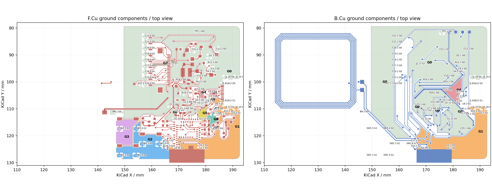
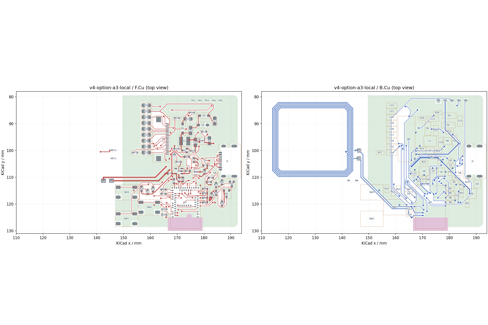

# V4 A3：实际地分量修复与剩余局部阻塞

## 当前确定方案

2026-09-29，按用户调整后的方法，从保存重开的 A2 另存 [A3 原生工程](kicad/v4-option-a3-local/README.md)，停止整板自动重布。本轮只操作有明确对象的地连接、C25 ADC 出口和 CC 电阻组；其它信号试案经过局部检查或原生填铜否决后没有留在当前板中。

**必要地的未连接已恢复，整板信号没有完成。**当前 672 段／98 孔；ERC 0、原理图／PCB 差异 0、DRC 58（19 error／39 warning），另有 7 项未连接。不能进入最终制造阶段，也不能把地网连通等同于回流质量通过。

| 验收对象 | 当前结论 |
| --- | --- |
| 整板未连接清零 | **未达到**。A2 的 16 项为 GND 9＋其它 7；A3 为 GND 0＋其它 7，后者属于 6 个网络，BUSY 有两项 |
| ERC／网表一致性 | ERC 0、parity 0；266 个 PCB 焊盘网络、256 个器件引脚核对一致 |
| 原生 DRC | **未通过**。没有新增短路、普通铜间距或 courtyard 重叠；保留 USB／NFC／热连接等既有问题 |
| 关键供回电 | U3 两侧电容、充电电容和显示到 LDO 的局部返回改善；MCU U1.15 的返回仍绕出本地去耦区域，显示部分返回也对窄颈敏感，尚不能整体通过 |
| 制造识别／DFM | **本轮未执行最终 DFM**。未达到先清零再收尾的门槛，未生成最终 Gerber/BOM/CPL；旧版本结果不覆盖 A3 |
| 实物／输入 | 电池额定电流、屏幕峰值、温升、连接器装配等仍缺证据；已有电气与制造待办不变 |

开始复制时 A2 磁盘与 GUI 内容相同，见 [复制记录](records/kicad-v4-option-a3/initial-copy.json)。[保存、退出、重开再保存](records/kicad-v4-option-a3/reopen-check.json)的 PCB SHA-256 一致：`ab66cc15f4c938ee7a722bb5656f242f5f31c8664d6fb8d4bf1fa949a21c7259`。A2、旧 A 局部／合并失败板、phase1/2/3 等 [622 个对照文件指纹未变](records/kicad-v4-option-a3/preserved-comparisons.json)。继续在 master；双层 0.8 mm、4.8 mm 外壳目标、固定接口／板框／天线基准和完整采样功能保留。无改料号、规则放宽或新增忽略项。

## 实际地铜分量与修复对象

下图来自 A2 保存的原生填铜加明线，不是飞线或理想地平面。同色表示通过实际铜／通孔连接的一个电气分量；每个分量可能包含多个顶、底层几何片。G0 以 U2 EP 定位编号，**不要求其它负载都直接拉到 U2 EP**。



[局部放大图](records/kicad-v4-option-a3/baseline-ground/critical.png)／[逐焊盘、逐铜片及相邻对象 UUID](records/kicad-v4-option-a3/baseline-ground/components.json)。相邻对象列表是边界线索，不把邻近本身当作单一根因。表中的阻断来自两面实铜关系及随后修复／回填结果；没有删除承载器件的地岛。

| 分量 | 实际承载对象 | 铜面积：F／B，mm² | 隔离边界与本轮处理 |
| --- | --- | ---: | --- |
| G0 | U2、U3、U4；C1/C2、C4–C10、C12–C22；R13/R14/R15/R17/R19、D2、BN、TP1、U1.33 和 J1 上侧接地焊脚 | 848.377／1049.738 | 主参考分量，本身仍有跨区返回绕行，不能由它面积大推断回流好 |
| G1 | R21.1、Q3.2、R23.2、U6.3、U1.1/.2/.55、J1.17/.19/A1B12 | 183.883／215.582 | VBUS/CC、采样、按键、SWDCLK/NRESET 与原禁铜边界共同分隔。分别在 USB 下侧 `(185.5,113.48)` 和 MCU 东南侧 `(184.12,119.44)` 接到实有对面地；两个位置服务不同本地返回 |
| G2 | C23.2、C24.2、SW1.3/.4、SW2.3/.4、SW3.4 | 123.533／0 | 按键、SWD 与 NFC 边界之间的地片；在 `(161.41,120.36)` 接通对面铜。C23 另有一条热辐条不足，不能因连通恢复而消项 |
| G3 | SW3.3 | 52.759／0 | 按键线与禁铜边界分隔；在 `(153.82,114.91)` 接到实际底层地 |
| G4 | **C3.2、U5.3** | 9.076／27.625 | F 面 SYS/BAT/VBUS/USB 数据、B 面 BAT/EPD_EN/USB/3V3 构成分隔；不是 C3 焊盘缺热辐条。在 `(181.2,106.65)` 桥接 F 主地与 B 的 27.625 mm² 分量，恢复 C3/U5 本地返回 |
| G5 | **U1.15** | 10.324／0 | SCL/SDA/INT、EPD_EN、VBUS 出口围住地片；`(178.69,113.04)` 接到真实底层地。恢复电气连通，但不能因此认为其到 MCU 去耦地的局部路径已理想 |
| G6 | R2.2 | 8.479／0 | CC2 及邻近支路分割，原焊盘另有热辐条不足；先在 `(182.55,112.8)` 桥接，后随 R1/R2 共同翻转重建本地地支路，R2 热告警消失 |
| G7 | **J2.17** | 5.910／0 | FPC 的 EPD_VDD/VGH/VSNL1/VSNL2/VSPH/VSPL2 扇出切开地片；在 `(167.49,93.35)` 接到对面显示地，没有改连接器基准或焊盘 |
| G8 | **C25.1** | 0.720／0 | 原 ADC 南侧 U 形回头线与右侧 BAT_MEAS_EN 把地焊盘夹住。局部改 ADC 为北侧出口，再用 `(182.2,118.65)` 地孔和两条 0.5 mm 连接恢复返回；保留原热连接宽度要求 |
| G9 | **R1.2** | 0.697／0 | CC1 环绕支路和 CC2 下侧支路围住地焊盘。R1/R2 在原中心各转 180°，信号端朝 U6，地端朝本地地，不靠把 R1 再接到原孤岛消项 |

这十个分量全部承载必要地焊盘，没有可直接删除来清除未连接的无用地岛。禁铜设置、铜到边规则和焊盘热连接要求均未放宽。

最终全部 **61 个地焊盘属于同一电气分量**，仍由 11 个 F 面铜片和 7 个 B 面铜片通过实铜连接。[最终全板图与分量](records/kicad-v4-option-a3/final-ground/whole.png)／[逐焊盘结果](records/kicad-v4-option-a3/final-ground/components.json)。本轮增加的 **10 颗地孔**在最终回填后中心均实际接触两面地铜，[接触记录](records/kicad-v4-option-a3/new-ground-via-contact.json)没有用“孔的网络名是 GND”代替物理连接。

## 局部批次与回退

| 连贯修改／检查点 | DRC／未连接／其中 GND | 处理 |
| --- | --- | --- |
| 起点 A2 | 59／16／9 | 保存重开一致后复制 |
| 八处有两面实铜依据的地桥 | 59／9／2 | C3、MCU、USB、J2 与按键地恢复；R1/C25 仍需改障碍线 |
| C25 ADC 北向出口＋本地地孔 | 60／8／1 | C25 连通恢复但出现热连接不足，继续在该组内修复，未宣称批次通过 |
| R1/R2 原中心翻转及 CC 终端／地支路重建 | 59／7／0 | R1 恢复、原 R2 热问题消失；C25 热问题仍保留待修 |
| **TS/PG 交叉局部方案** | 59／7／**1** | TS 接通，却使 **C4.2 失联**；数量相同掩盖了回流退化。该批**撤回**，恢复原 PG 铜，失败 PCB 归档 |
| C25 两条显式地连接按既有 0.5 mm 热宽重建 | 58／7／0 | C25 新增热问题解决，剩余热问题是原 C23；没有降阈值 |
| 显示到 U3 返回桥 `(167.11,103.11)` | 58／7／0 | F/B 均有实际地，恢复显示供电区域内 C9/U4 到 U3 的返回，未破坏充电与 LDO 地 |

最初一次 ADC 网格建议复现了旧 U 形几何，没有收益，随后明确改为北出口；它不是成功修复的证据。本轮没有按不同整板顺序反复搜索。未写入 PCB 的试案、原生否决板和相同项目配置归档在 [局部试验包](records/kicad-v4-option-a3/local-trials.zip)／[文件指纹](records/kicad-v4-option-a3/local-trials-manifest.json)。

### 返回和路径的实际收益／代价

[局部返回检查](records/kicad-v4-option-a3/display-returns/returns.json)使用同版保存的填铜和显式 GND，在命名区域内检查连通，不以全网地连通作替代：

- U3.2→C4.2/C5.2、U2 EP→C3.2/C8.2/C2.2/R19.2，在各自区域内连通；0～0.095 mm 铜腐蚀探针仍连通。
- U3.2→C9.2/U4.2 原来在显示供电窗口内不通；新增显示地桥后，同一窗口与上述探针下连通。这只证明几何返回改善，不是阻抗或温升保证。
- C1/C6/C7/U1.33 本地地关系保持；U1.15 的新孔在旧 MCU 窗口右界之外，但把窗口扩到 x=179.3、y=108.5 后仍与去耦分量分开，返回需绕出该区域。不能只引用旧窗口的 false，也不能仅用全局 true 宣告合理。
- 显示 C10→关断／充电泵／输出电容地均真实连通；其中 C15–C22 在 0.05 mm 腐蚀探针下分离，其它部分在更大探针下分离。这是现有细颈／热辐条敏感性线索，**不是新增制造规则或电气保证值**，完整回流质量仍未放行。[同版审计](records/kicad-v4-option-a3/final-audit/audit.json)

| 命名路径 | A2 → A3 | 解释 |
| --- | --- | --- |
| MCU→C25 ADC | 20.657 → 21.959 mm，均 4 次串行换层 | 北向出口多 1.302 mm，交换得到 C25 的本地地通道；没有增加 ADC 换层次数 |
| C5→C9 | 26.673 → 26.673 mm，均 2 次 | 供电铜未假称缩短；本轮改善的是地返回 |
| 五充电控制 SDA/SCL/INT/PG/CE | 8.978/4.884/7.502/18.321/10.088 mm；换层 2/0/2/2/2，前后相同 | 失败的 PG 改法已撤回。这些铜允许后续局部联合拆改，并非锁定约束 |
| BP→C3、C3→U2 BAT | 40.857／4.123 mm，分别 2／0 次，前后相同 | C3 地连通修复；长电池支路的压降／温升预算仍依赖未知电流与实际铜厚，未宣称通过 |

## 七项剩余未连接及最小拆改范围

[原生完整清单](records/kicad-v4-option-a3/final-drc.json)中的七项是：U2.6→R19.1 的 `BAT_NTC_TBD`、J1.A5→U6.1 的 CC1、J1.B5→U6.2 的 CC2、U5.2→R4.1 的 D−、U1.38→J2.12 的 CS、U1.24→J2.9 与 R18.2→J2.9 的两项 BUSY。**TS/MR 是 U2 同一个 6 号引脚的支路，本版不存在另一个应独立补接的 MR 网络。**

[连续几何核查](records/kicad-v4-option-a3/local-access.json)独立于网格、路由顺序和指定通道，保留当前其它铜，用 0.15 mm 线宽、0.20 mm 间距、0.60/0.30 mm 孔和 0.40 mm SMT 铜到孔壁距离检查两层可达分量。它不把铺铜当作禁止信号走线；实际返回必须另经原生填铜验证。

| 对象 | 明确阻挡／已经验证失败的改法 | 下一次需要共同处理的最小范围 |
| --- | --- | --- |
| **TS/MR** | TS 源有 0.783242 mm² 合法换层区，但两层图仍不能到 R19。PG 的 B 面 `x=172.8, y=105.8…114.899` 与上侧折线是障碍之一。PG 在 `(172.8,104.7)`／`(172.8,106.1)` 间转到 F 后 TS 能接通，却切断 C4 地，已撤回。R19 放 `(175.35,110.9,90°)`、NTC 放 `(174.5,104.75)` 的另一组模型有 **13 项实际几何冲突**：SDA/INT 逃逸孔和 CE 支路占位，未实施 | U2 下沿 SDA/INT/CE/PG 逃逸、R19/NTC、C4 地走廊作为同一局部组，约 x168–179/y103–116；不能只移 R19 或 PG 一个孔。C4 本地地骨架必须保留或同时重建 |
| **BUSY＋VBUS** | U1.24 顶层出口被 VBUS/3V3 及邻近控制围住，合法新过孔中心面积 **0**。只拆 VBUS→C1 的支路可完成 BUSY 两支，但 VBUS 恢复失败；第二个模型保留 C1 已合法的 4 段尾部与原换层孔，仅撤去其余 7 段／2 孔，仍在 SDA/PG/CE/3V3 处受阻。两案均未写入 PCB | 与上述充电控制局部组联合分配 C1 的 VBUS 入口和 U1.24 出口；不能保持五控制逃逸不动而只给 BUSY 找缝。C1/C6/C7 返回与 U1.15 返回一起验收 |
| **USB CC1／CC2** | 两源出口合法新过孔面积均 **0**。CC1 边界为 B7/B8 焊盘、VBUS 下斜线 `0f801243…`、D− 支路及孔 `5bf05dcf…`；CC2 为 A8、B4A9 与 VBUS 孔 `10c6337f…`。把 VBUS 移到连接器外侧的具体方案有 **12 项几何冲突**：J1 接地焊脚／孔距、B 面 NRESET、C8 地和拟替换 C3 地桥均受到影响，未实施 | J1 固定；联合 U5/U6、VBUS 上下焊脚扇出、CC 与数据扇出及 C3/U5 地桥。不能先锁死 VBUS 新孔再填 CC。外侧路线若保留，还必须包含 NRESET 的局部避让 |
| **USB D− 到 R4** | R4.1 的顶层可达区域内没有合法新孔，被原 D+ 纵向末段、3V3、MOSI 等围住。拆除该 D+ 主干并将显示 3V3 横线从 y101.4 让到 y101.0 的双线模型中，D− 可用原通道，但 D+ 仍不能到 R3；整对未通过，不保留单线结果 | R3/R4、两根 MCU 短出口和 D+/D− 作为一对重排；向 U5 的成对通道与 USB 入口组衔接。至少需要改变现有串阻端出口安排，不是继续单独补 D− |
| **CS** | 固定铜的局部网格试布受 SCK 背面 `x=164.8351, y=96.0366…110.1719` 阻挡。**连续两层几何仍可达**，所以不能否决空间。连续见证需要多次换层；按见证点构造的局部路线又在 J2 电源扇出附近失败，尚未生成可接受的 H/V/45 铜线；这里明确存在算法／通道限制 | 只联合 J2.12/.13 的 CS/SCK 扇出和 MCU CS 出口，必要时连带这段 SCK 纵向铜；保持显示电容地通道。不能把失败搜索当成改板框、移 J2 或绕全板的依据 |

**本轮停止在上述具体局部边界，未达到整板清零。**已经证明单独 PG 换层会损坏必要地、单移 R19/NTC 或 VBUS 外绕与实际铜／焊盘冲突，且独立几何识别了四个无合法换层点的出口。没有证明全板面积不足，没有提出改变硬约束或删除采样功能。

推荐下一次首先只实施 **U2 控制逃逸＋R19/NTC＋C1 VBUS/BUSY 的局部联合方案**，USB 与 CS 另作有明确对象的局部组，仍不启动整板自动重布。通过条件是该组所有信号及供电在同一板上连通、61 个必要地焊盘不退化、C3/C4/C5/C1/C6/C7 的本地返回保持、U1.15 不再依赖绕出区域的路径，并且没有新增原生几何／热连接问题。其它组的通道必须保留；不能用某个支路接通或总孔数下降替代这些条件。

## 原生检查与制造／电气保留项

| DRC 分类 | 数量 | 状态 |
| --- | ---: | --- |
| USB 铜到板边 | 14 | 原厂焊盘／槽口与工艺接受待闭合，未减规则 |
| NFC 孔环／孔径 | 2＋2 | 原 NFC 几何保留，未改小孔或扩大焊盘清零 |
| 热连接不足 | 1 | C23.2：要求 2 辐条，实际 1；连通不代表该项通过 |
| 单面接铜孔 | 2 | EPD_EN `(171.801,116.2)`、未完成 CS `(170.7,116.934)`；未忽略 |
| 工程库匹配 | 7 | C5、R3/R4/R10/R11/R12/R13，留待连通完成后的库一致性整理；独立局部焊盘／阻焊／锡膏／courtyard 与基线相同 |
| 字高／丝印重叠／丝印压铜 | 7／20／3 | 按用户顺序留到连通清零后整理；未为保留丝印牺牲铜空间 |
| 短路／普通铜间距／courtyard 重叠 | 0／0／0 | 原生与独立离散铜检查无冲突，但不代表制造放行 |

[ERC](records/kicad-v4-option-a3/final-erc.json)、[DRC/parity](records/kicad-v4-option-a3/final-drc.json)、[身份／库／规则检查](records/kicad-v4-option-a3/identity-check.json)均对应重开的同一板。既有规则／忽略设置逐字保留，没有新增忽略以消警告。

[电气原厂输入](v4-design-inputs.md)和[已准备的选型候选](v4-phase3-decisions.md)继续有效：C3 有效容量余量、C1 与模块参考值的差异、VBUS 保护／上电浪涌、U3 200 mA 全轨负载和低压差范围未闭合；C3 同封装 4.7 µF 等备选没有擅自替换。301030 带保护板、3.7 V／最高 4.2 V 是用户已提供事实，仍没有该电池的充放电额定电流。屏幕峰值、上电／刷新波形和温升缺实测，容量／平均功耗不替代上界。

USB 槽宽／镀铜槽、焊脚接触比、U1 板边、阻焊桥及 NFC 孔尺寸仍需区分设计几何、网站模型和供应商接受条件。A3 未完成连接，因此没有用未完成板执行“最终 DFM”，也没有援引 D 或 phase2 报告作为 A3 通过。达到清零及回流门槛后，再从同一最终版本重新导出 Gerber、钻孔、BOM、CPL、装配图并运行国内 PCB/SMT DFM。

## 图与复现



[关键区顶底层高清图](records/kicad-v4-option-a3/critical-top-bottom.png)；[修复前地分量](records/kicad-v4-option-a3/baseline-ground/critical.png)与[修复后地分量](records/kicad-v4-option-a3/final-ground/critical.png)使用相同坐标。

命令均从仓库根目录执行。检查现有板无需修改它；重建必须指定不存在的新目录：

```sh
python3 projects/nfc-business-card/scripts/replay-v4-a3-local.py projects/nfc-business-card/artifacts/a3-replay-new
kicad-cli sch erc --format json -o /tmp/a3-erc.json projects/nfc-business-card/hardware/kicad/v4-option-a3-local/NFC-Card-V4.kicad_sch
kicad-cli pcb drc --format json --schematic-parity -o /tmp/a3-drc.json projects/nfc-business-card/hardware/kicad/v4-option-a3-local/NFC-Card-V4.kicad_pcb
python3 projects/nfc-business-card/scripts/audit-v4-ground-components.py projects/nfc-business-card/hardware/kicad/v4-option-a3-local/NFC-Card-V4.kicad_pcb projects/nfc-business-card/artifacts/a3-ground-check
python3 projects/nfc-business-card/scripts/check-v4-local-access.py projects/nfc-business-card/hardware/kicad/v4-option-a3-local/NFC-Card-V4.kicad_pcb projects/nfc-business-card/artifacts/a3-access-check.json
```

[已验证的重建记录](records/kicad-v4-option-a3/replay-check.json)：由原 A2 加 [已接受的原生增量](records/kicad-v4-option-a3/accepted-native-delta.json)生成新完整工程并原生重铺铜，复现 58／7／0；铜对象几何与两面填铜和 A3 完全一致。局部计划含特定起点的对象 UUID，不能在任意后续版本上盲目重放。失败方案仅用于诊断，不能合并其“已接通”结果。
