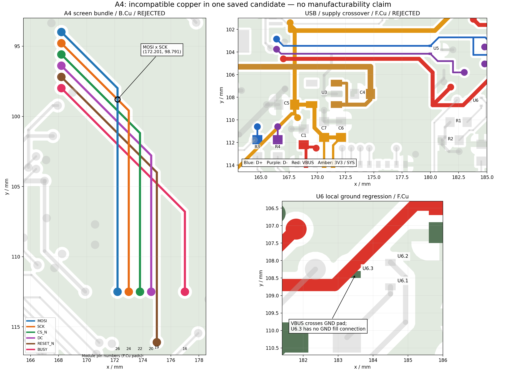

# V4 A4 联合布局与 GPIO 试验：方案被否决

## 当前确定方案

**2026-09-30：本轮没有证明右侧信号、供电和合理地返回能够同时成立。A4 是完整原生工程形式的失败候选，不是完整布线板；不作为下一轮铜基线。** 保留 [A3](v4-option-a3-review.md) 及所有旧对照，从 A3 重新提出有正确端点顺序的方案。按本轮停止条件，完成一个显式联合方案及一次有明确原因的联合修正后停止，不再扫描顺序／网格／随机种子。

入口：[A4 原生工程](kicad/v4-option-a4-joint/README.md)、[检查记录](records/kicad-v4-option-a4/)、[GPIO／固件接口](v4-a4-firmware-interface.md)。`master` 未切分支，未提交或 push；未下单、联系供应商、付款或烧录。

最需要说明的失误：**本次显式路径本身存在束内交叉和电源碰地焊盘，并未得到一个可以比较回流质量的合法布线解。** 这些结果不能证明双层空间不足，不能据此要求删除采样、换料号、移动机械基准或改四层。电池／供应商资料缺失也不是这次路径失败的原因。

## 同版验收结果

| 检查 | 保存重开的 A3 对照 | 保存重开的 A4 失败候选 |
| --- | ---: | ---: |
| 原生 ERC | 0 | 0 |
| 原理图／PCB parity | 0 | 0 |
| 器件引脚对账 | 原映射 | 256 个引脚符合明确的新映射 |
| 未连接 | 7，均非 GND | 10：1 GND、9 非 GND |
| 原生 DRC，`--all-track-errors` | 58：19 error / 39 warning | **311：269 error / 42 warning** |
| 必要 GND 焊盘的同网几何连通 | 61/61 | **60/61，U6.3 独立** |
| 新增 courtyard 重叠 | 0 | 0 |
| 独立异网铜间距配对 `<0.1999 mm` | 本轮未重新计此指标 | 184 对，失败 |
| 整板设计／关键返回 | 未通过 | **未通过，拒绝接受本轮铜** |
| 本版 PCB／SMT DFM | 无最终结果 | 未运行；联合门槛未过 |

DRC 口径必须一致：第一版默认报告 212 项；修正版默认报告在保存重开前后为 164／163 项，同一磁盘几何的聚合报告会选择不同对象。最终改用完整的 `--all-track-errors`，A3 与 A4 用相同参数重测；A4 两次 **311/10/0**，对象／描述集合一致。311 不含另列的 10 个未连接。不能把默认 163 与完整 311 当作设计变化。

保存关闭、GUI 重开并保存后，工程全部受检文件字节指纹不变；PCB SHA-256：`caa488d45bfb44a3bc4dd0092b906b1e300a670136f19ad4009812d8d1afaa3c`。618 段／101 孔／76 个封装／66 个 BOM 器件／266 焊盘。独立检查确认 1298 个旧对照文件未改、机械基准／NFC 铜及禁布区／0.8 mm／料号／规则／排除项／局部焊盘、阻焊、锡膏、槽孔、courtyard 均保留。**这些身份检查通过，不表示电路连接或制造通过。**

## 方案比较与实际变更

| 方向 | 计划安排 | 取舍及决定 |
| --- | --- | --- |
| 保留 U2 东北位置 | I2C 保持可高速的普通 GPIO；把慢速控制向其它 GPIO 分散，屏幕集中上沿 | 电源改动较少；MCU 上沿仍要容纳两根 I2C 与六根屏幕信号，右侧又有采样和 USB。受限 GPIO 必须另核波形／drive，不能全部互换。未实施，也未证明不可行。 |
| 充电组西移、屏幕向北 | U2/C2/C3/C8、TS/R19/NTC 与上拉成组移到西侧；五控制转 MCU 西侧，六屏幕转上沿；USB 串阻向 MCU 西北移动 | 本轮选择并实施。真实封装占位可以排入，但显式铜方案失败，且充电控制反而变长，不接受为 A3 的改进。 |

第一次占位草图与 J2、C14、按键装配包络存在交叠，先调整完整器件组及 C8 朝向，再作原生试验，没有缩小／删除 courtyard。最终位置信息由 [机器记录](records/kicad-v4-option-a4/identity-and-geometry.json)生成。主要位置（mm／°）：

- U2 `(177,108,180) → (158,107.3,180)`；C2 `(161.5,105.3,180)`，C3 `(157.2,103.5,90)`，C8 `(161.5,107.4,0)`。
- R19 `(155.4,109.6,180)`、NTC `(154,107.5,0)`、R7 `(155,104.9,0)`；R5/R6/R8/R9 排在 x151.7 的西侧列。
- R3 `(164.7,112.5,270)`、R4 `(166.5,112.5,270)`；J1、J2、U5、U6 保持实际原位。
- 初版同时西移 U3/C4/C5；修正版把这三件完整返回 A3 局部关系，保留 C6/C7/C1。这个修正没有证明外围供回电可接受。

GPIO 限制、原厂 PDF 页码、前后映射和固件占用见 [接口文档](v4-a4-firmware-interface.md)。选用的 SPI/I2C 引脚不是 Raytac 限制为低频 standard-drive 的引脚；专用 USB、SWD、复位、NFC、ADC、晶振选择与按键保留。库符号的引脚编号未篡改。工程的逻辑映射已同步，但**几何顺序安排失败**。

## 实际实施与否决原因

### 第一版及一次修正

第一版使用明确坐标、图层、线宽的路径，IPC 成组拆改后原生填铜；没有调用固定铜 A* 搜索。独立预检已报大量交叉，因此写入的是明确标记的诊断失败模型，用原生 DRC 复现，未作为接受的设计。完整项目已归档为 [entry-failed-project.zip](records/kicad-v4-option-a4/entry-failed-project.zip)。默认原生报告 212 项／10 未连接，按键及 C23/C24 的地分离，否决。

一次联合修正改变了实际条件：USB 横向段转 F.Cu、屏幕束留 B.Cu；FPC 扇出扩展过孔节距；U3/C4/C5 回到 A3 关系；显示 3V3 与 RESE 横跨段转 F.Cu；C8 地从自身 GND 侧引出。不是换布线顺序。但是修正后仍存在下述错误，**整批不接受，不再继续补孔**。

### 明确的同版冲突

1. **屏幕束内部顺序错误。** B.Cu MOSI `(172.201,112.5)→(172.201,97.991)` 与 SCK `(173.001,99.591)→(168.2,94.79)` 的中心线交点为 **`(172.201,98.791)`**。其他屏幕线也有交叉。Shapely 线段交集与原生 DRC 相互验证，[独立见证](records/kicad-v4-option-a4/bundle-order-witness.json)。这不是网格、固定过孔或搜索算法失败，而是本次端点顺序与转弯构造有误。
2. **FPC 过孔节距不足以保证斜向铜间距。** 0.8 mm 节距、0.6 mm 过孔与 0.15 mm 斜线的局部间距只有约 **0.1907 mm**，小于保持不变的 0.2 mm 规则。不能用中心距 0.8 mm 宣布通过，也不降低规则。
3. **USB 与供电的交叉被搬到了西端。** D− 过孔 `(166.4,103.75)` 与 GDR 孔 `(165.8543,103.6436)` 短接；D± 转到底层的接近段与 VBUS 底层支路相交；R3/R4 新入口碰到 3V3／KEY_OK 通道。把横向 USB 换到顶层本身不足以构成整对路径。
4. **U6 地退化。** 新 VBUS F.Cu 段 `(185.2,106.4005)→(182.9005,108.7)` 直接碰 U6.3 `(183.5,108.4)` 的 GND 焊盘。原生报短接；GND 专用几何分析中该焊盘只剩 0.06 mm² 的孤立焊盘分量，未连地填铜。不是缺少任意一个缝合孔，也不能视为网站模型差异。
5. **五条充电控制没有形成合法共同通道。** 西侧新路径之间交叉，还碰到 SWDIO/SWDCLK；SDA／INT 的 MCU 端孔也过近。R5/R6/R8/R9 信号端尚未补齐。本次只是画出了带冲突的主干，不能声称五线已局部接通。
6. **电源／返回未共同成立。** 新 SYS 横段碰地铜，C4 与 C14 热连接仍不足；采样 BAT 的两处支路未接回。原理图和采样器件都保留，但本候选不能声称采样电路已布通。C1→U1 和 C4→U3 的短段仍在，也不能替代上游供电正确性。



### 未连接清单（原生 10 项）

| 类别 | 对象 |
| --- | --- |
| GND ×1 | U6.3 到主地分量 |
| 充电上拉 ×4 | R5.2 SDA、R6.2 SCL、R8.2 INT、R9.2 PG 到其控制主干 |
| 采样 BAT ×2 | 新充电 BAT 支路到 Q2.2；Q2.2 到 R22.1 |
| USB CC ×2 | J1.A5→U6 CC1 支路、J1.B5→U6 CC2 支路 |
| BUSY 上拉 ×1 | R18.2→屏幕 BUSY 主干 |

此外存在真实异网短接，所以“只剩 10 项”没有电气完成度意义。缺线确实转移到了其它支路，**违反了本轮接受条件**，因此未接受。

## 长度、换层与代价

下表来自同网铜中心线图；包含端点焊盘附件，不含填铜返回。A4 有异网短接，**这些是失败模型的几何量，不是可用路径收益**。完整 [路径数据](records/kicad-v4-option-a4/path-metrics.json)包含六屏幕、五充电及 SWD。

| 命名路径 | A3 mm／串行换层 | A4 失败模型 mm／串行换层 | 含义 |
| --- | --- | --- | --- |
| BP→C3 | 40.857 / 2 | 17.641 / 0 | 主支路画短了，但与其它网冲突、采样 BAT 断开，不能接受 |
| J1 VBUS→C8 | 8.359 / 0 | 31.503 / 2 | 充电西移的明显代价 |
| C3→U2 BAT | 4.123 / 0 | 3.016 / 0 | 局部几何缩短，不代表回流通过 |
| C8→U2 IN | 3.083 / 0 | 3.378 / 0 | 略长 |
| C1→U1 VBUS | 1.817 / 0 | 1.817 / 0 | 局部未变，上游不合格 |
| C4→U3 IN | 3.686 / 0 | 3.686 / 0 | 修正版恢复原局部关系 |
| C5→C9 | 26.673 / 2 | 26.575 / 0 | 长绕行基本未改善，顶层新交叉使少两次换层无效 |
| U2 TS→R19 | 未连 | 2.062 / 0 | 不能抵消全板短接／返回退化 |
| 五充电控制各主路径 | 4.884–18.321 | 16.338–26.372 | **整体代价变坏，不再满足“充电靠 MCU 形成局部”的原意** |

## 图与原生检查

[全板顶底层](records/kicad-v4-option-a4/whole-top-bottom.png)；[A3 同范围对照](records/kicad-v4-option-a4/a3-critical-top-bottom.png)；[A4 同范围顶底层](records/kicad-v4-option-a4/critical-top-bottom.png)；[实际地分量](records/kicad-v4-option-a4/final-ground/critical.png)。均从对应保存文件的实际铜／填铜生成，不是飞线示意或不同候选的合成结果。

完整 DRC 分类：铜间距 63、孔到铜 52、走线交叉 61、异网短接 61、铜到板边 14、热连接不足 3、阻焊桥 11、孔到孔 1、孔环 2、过孔外径 2、游离过孔 2／走线 1、库几何差异 7、丝印文字高度 7／丝印重叠 20／丝印压铜 4。前四类含同一物理冲突的不同检查口径，不能相加当作唯一故障地点数；完整 JSON 保留对象 UUID。0 个 courtyard 重叠仅证明名义装配占位排入。

未运行整板最终丝印整理、制造导出及 A4 线上 PCB/SMT DFM。旧 phase2 的文件识别结果不能覆盖 A4；本轮无制造放行。

## 下一项真正需要改变的条件

**推荐保留本轮引脚资料核对结果，放弃 A4 的铜，回 A3 另起候选。** 不沿用 A4 的西移坐标和预设过孔继续修补。

1. 先让屏幕束的端点顺序符合从 MCU 上沿向左转入 J2 的实际走向。例如按 MCU 上沿从左到右改为 BUSY、RESET、DC、CS、SCK、MOSI（模块脚 26、24、22、20、19、16），这些脚的电气选择已在原厂表范围内；**这里只提出下一候选，不曾写入当前工程，也没有证明整组物理可布**。还要同步新的原理图／接口文档。斜线邻过孔所需节距至少 `(0.3+0.075+0.2)×√2≈0.8132 mm` 是该几何必要条件，不是整个 FPC 扇出的充分条件。
2. USB 西端、C1／C5 电源出口、GDR/RESE 和 U6/VBUS 入口必须作为两个端点组一起规划。明确复核范围是 x164–187、y101–114 mm；允许普通器件／旧线联合拆改，机械端口保持。不能在图层交叉处只补一对孔然后把新的端点冲突留给后续网络。
3. 充电组不推荐继续移到 x158。它换来更短的电池正极线，却拉长所有控制线及 VBUS。重新比较更接近 MCU 西北出口的位置，并把控制 GPIO 的顺序、四个上拉、TS、本地地、SYS、BAT 与 SWD/按键信号一起纳入；现有失败不足以证明必须拆采样或加层。
4. 下一次进入原生落铜之前，完整显式计划必须先排除束内交叉、穿过异网焊盘以及漏接支路。本次把这些缺陷写入诊断板有复现价值，但没有设计改善价值。不能把这样的失败转述为制造规则太严或物理空间不足。

新方案的通过条件仍是：同一候选包含全部关键主干和支路；必要地 61/61 且局部返回成立；无新增真实短接、间距、孔到铜、热连接错误；未连接不能转移到采样／上拉／SWD；保存重开同版结果一致。先满足这个门槛，才继续整板及最终 DFM。当前没有证据要求用户改变机械基准、删功能、改层数或换料号。

## 电气、制造与实测待办保持

依据 [原厂设计输入](v4-design-inputs.md)和 [phase3 电气决策候选](v4-phase3-decisions.md)，以下都未因新映射或铜线关闭：

- C1 与 Raytac 参考容量差异及增加容量后的 USB 浪涌；C3 偏压下有效容量余量。
- TPS7A0233 的整轨 200 mA 边界和低电池电压压差；显示峰值没有厂家保证值。
- U5/U6 是数据／CC ESD，不覆盖 MCU 的 VBUS 过压；U2 输入保护也不等于保护 U1。
- 实际 301030 仅确认带保护板、3.7 V、最高充电 4.2 V；厂家／完整型号、允许充电和持续／脉冲放电电流仍缺证据。
- BQ25186 充电热预算、屏幕启动／刷新供电瞬态、完整显示开关／充电泵返回需合法布局后验证及实测。
- USB4500 近边铜、0.6 mm 镀铜槽、焊脚接触比与工厂模型／接受状态；U1 板边、阻焊桥、NFC 孔环与孔径。当前 A4 还新增本地严重错误，不能混为网站误报。

没有新增需要用户提供的资料问题；已有缺失电池电流／屏幕峰值信息集中保留。它们不妨碍先修正本次错误的路径构造，也不为 A4 提供通过依据。

## 复核命令与文件

从仓库根运行：

```bash
python3 tools/kicad/health.py
kicad-cli sch erc --format json -o projects/nfc-business-card/artifacts/kicad-v4-option-a4/recheck-erc.json projects/nfc-business-card/hardware/kicad/v4-option-a4-joint/NFC-Card-V4.kicad_sch
kicad-cli pcb drc --refill-zones --schematic-parity --all-track-errors --format json -o projects/nfc-business-card/artifacts/kicad-v4-option-a4/recheck-drc.json projects/nfc-business-card/hardware/kicad/v4-option-a4-joint/NFC-Card-V4.kicad_pcb
python3 projects/nfc-business-card/scripts/audit-v4-a4-joint.py
python3 projects/nfc-business-card/scripts/render-v4-a4-conflicts.py
```

图层重铺和原生编辑使用 KiCad 10.0.6／kicad-python 0.8.0；无安装或升级。原生操作计划 `entry-plan.json`、`corrected-plan.json`，IPC 结果、原生 DRC、保存重开指纹和原始构造脚本均归档。不要对当前失败工程重跑 `prepare-v4-a4-joint.py`；它只接受未经改动的独立 A3 副本。复现检查可直接打开 A4，或在新目录解压首版 ZIP，不覆盖现有工程。
